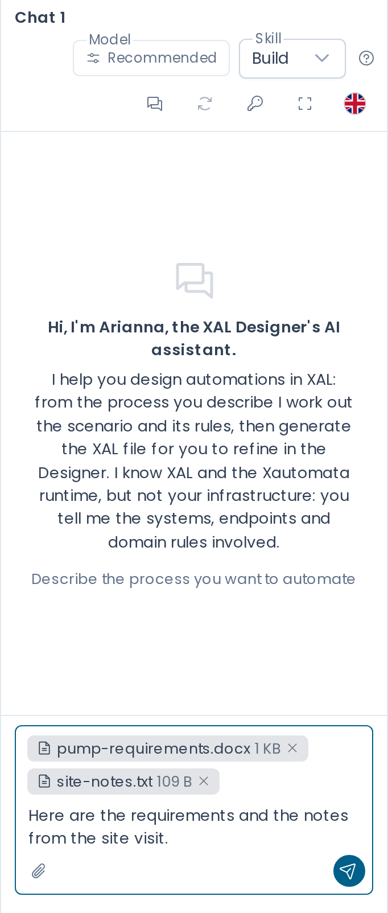
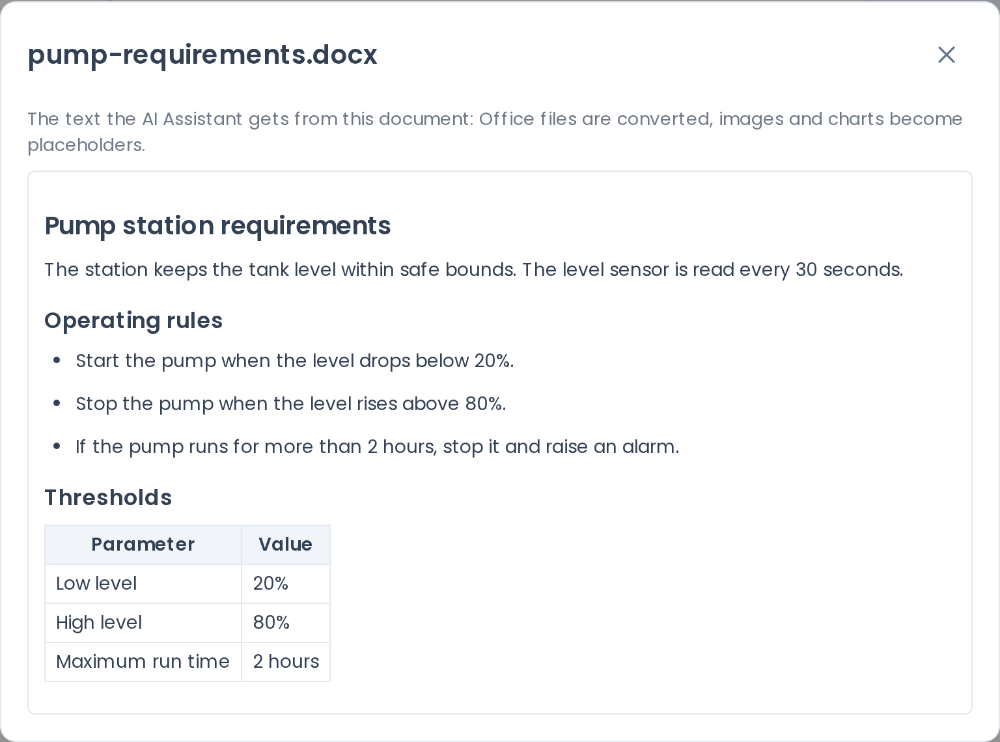
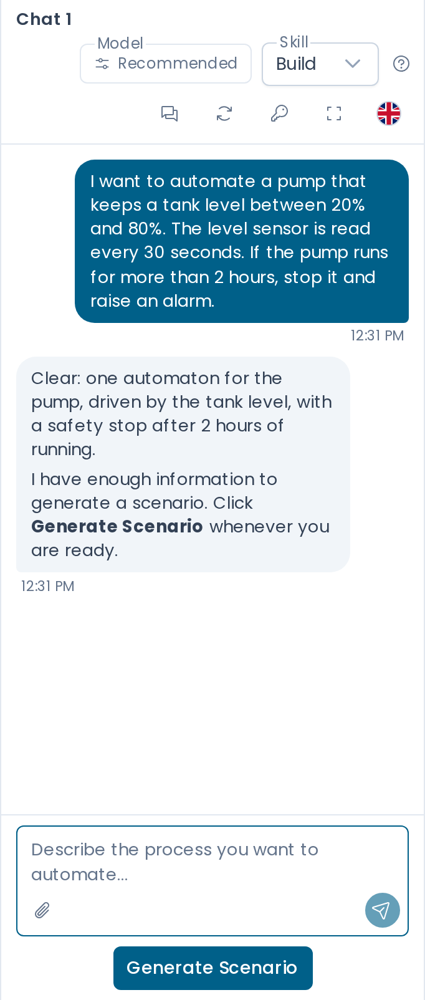
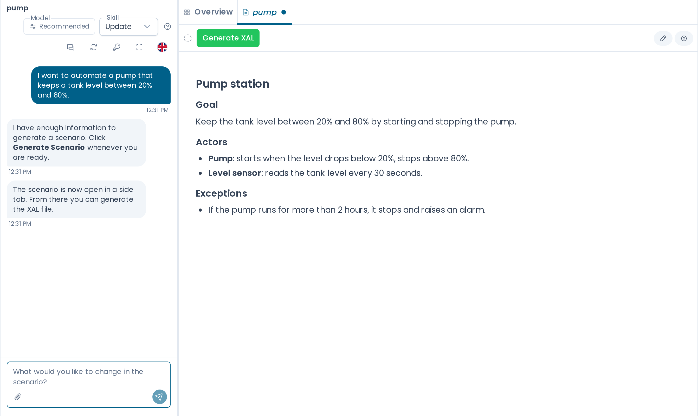

# Generare uno scenario

Lo scenario è la descrizione strutturata in linguaggio naturale di un automa — il ponte tra la tua intenzione e il file XAL. Arianna ti aiuta a costruirlo attraverso un flusso conversazionale.

---

## Aprire una sessione chat

Puoi avviare la generazione di uno scenario da due punti di ingresso:

**Da una sessione libera**: clicca **New** nel pannello delle sessioni, oppure l'icona **New chat** (**+**) nell'intestazione della chat se non hai ancora sessioni (vedi [Sessioni chat](sessions.md#creare-una-sessione)). La sessione parte senza un file collegato. Quando Arianna consegna lo scenario, propone un nome di file e la sessione prende quel nome.

**Da un file esistente**: clicca con il tasto destro su un file `.xal` o `.scenario.md` nel **Repository Explorer** e seleziona **New chat** (oppure **Open chat** se in quella sessione hai già scritto). La sessione è collegata al file e ne prende il nome. Il file può essere vuoto. Se l'XAL ha già degli automi ma non ha uno scenario, vedi [Generare uno scenario dall'XAL](scenario_from_xal.md).

---

## Descrivere il processo

Digita una descrizione del comportamento dell'automa nel campo di testo della chat. Non ci sono requisiti di formato — il linguaggio naturale funziona bene. Includi:

- quale condizione o evento l'automa monitora
- quali stati può assumere
- quali azioni o notifiche innesca
- eventuali vincoli di tempo o soglie

Puoi descrivere tutto in una volta o costruire lo scenario attraverso più scambi. Arianna fa domande di approfondimento quando la descrizione è ambigua o incompleta.

Se il processo è già descritto in un documento, allegalo al messaggio invece di riscriverlo.

---

## Allegare documenti

Per allegare un documento, clicca l'icona della **graffetta** nel campo di testo e scegli uno o più file. Puoi anche trascinare i file dal tuo computer e rilasciarli sulla chat.

Puoi allegare questi tipi di file:

- **Testo**: `.txt` e `.md`.
- **Office**: `.docx`, `.pptx` e `.xlsx`. Arianna ne riceve il testo, convertito in Markdown: titoli, elenchi e tabelle restano, immagini e grafici diventano un segnaposto. Un messaggio ti dice quali file sono stati convertiti.

I vecchi formati Office (`.doc`, `.ppt`, `.xls`) non sono accettati: salva il file come `.docx`, `.pptx` o `.xlsx` e allegalo di nuovo.

Ogni documento allegato compare nel campo di testo con il nome e la dimensione. Clicca **×** per toglierlo. Se alleghi di nuovo un file con lo stesso nome, sostituisce il primo. Puoi inviare gli allegati con o senza un messaggio.

/// caption
Fig.1 - Due documenti allegati, pronti da inviare
///

Clicca il nome di un documento per vedere il testo che Arianna ne riceve. Un file `.txt` si vede così com'è; gli altri documenti si vedono formattati. Per un file Office, così controlli cosa ha tenuto la conversione.

/// caption
Fig.2 - Il testo che Arianna riceve da un documento Word
///

Dopo l'invio, i documenti restano nel messaggio: clicca un nome per rivederne il testo.

### Limiti
- Il testo di un documento può arrivare a 200 KB. Per un file `.txt` o `.md`, è anche il limite del file.
- Un file Office può arrivare a 10 MB prima della conversione. Il testo convertito deve comunque stare nei 200 KB.

!!! tip "Allega solo quello che serve"
    Arianna rilegge tutta la conversazione a ogni messaggio, allegati compresi. Un documento lungo rende più lente tutte le risposte successive. Se conta solo una parte di un documento, allega quella parte.

---

## Generare lo scenario

Quando Arianna considera la descrizione sufficiente per produrre uno scenario minimale, te lo dice in chat e sotto il campo di testo compare il pulsante **Generate Scenario**.

/// caption
Fig.3 - Arianna ha abbastanza informazioni: compare Generate Scenario
///

Il pulsante non compare con la skill **Consult**. Dopo che è comparso puoi continuare a scrivere: il pulsante resta finché non lo clicchi.

Clicca **Generate Scenario**. Arianna produce uno scenario strutturato in formato Markdown. Contemporaneamente:

- il file `.scenario.md` viene creato nel **Repository Explorer**: accanto al file `.xal` per una sessione di file, nella cartella `data/` per una sessione libera. Se esiste già un file con lo stesso nome, si aggiunge un numero, per esempio `pump(1).scenario.md`;
- il **tab scenario** si apre nell'editor e mostra lo scenario formattato;
- la skill passa a **Update**.

Il file `.xal` non esiste ancora: si crea quando clicchi **Generate XAL** nel tab scenario, nella stessa cartella dello scenario.

/// caption
Fig.4 - Il tab scenario dopo la generazione
///

!!! tip "Un'altra cartella"
    La cartella `data/` è solo una proposta. Per tenere i file altrove, trascinali in un'altra cartella del **Repository Explorer**, oppure cambia la cartella al momento del commit.

---

## Affinare lo scenario

Leggi lo scenario nel tab. Se qualcosa è errato o mancante, descrivi la modifica in chat. Quando Arianna ha capito la modifica, sotto il campo di testo compare il pulsante **Update Scenario**. Cliccalo: Arianna aggiorna lo scenario e tocca il meno possibile le parti non interessate. Il tab scenario mostra poi cosa è cambiato rispetto alla versione precedente.

!!! info "Lo scenario è la fonte di verità"
    Durante la fase di generazione, lo scenario è ciò su cui Arianna lavora. L'XAL non è ancora stato generato — affina lo scenario finché non descrive accuratamente il comportamento desiderato prima di procedere.

Quando lo scenario è pronto, vai a [Generare l'XAL](generating_xal.md).
