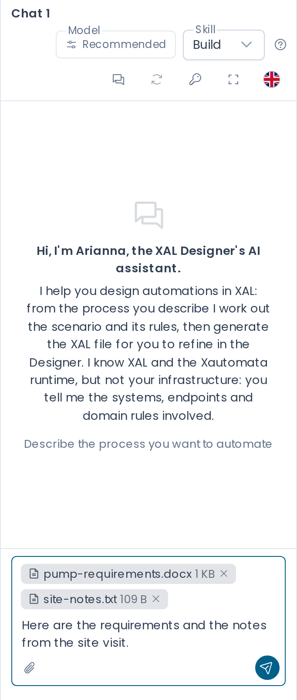
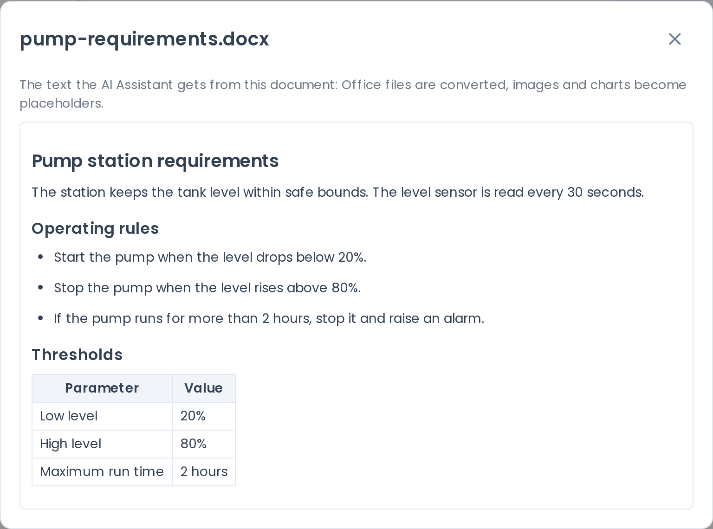
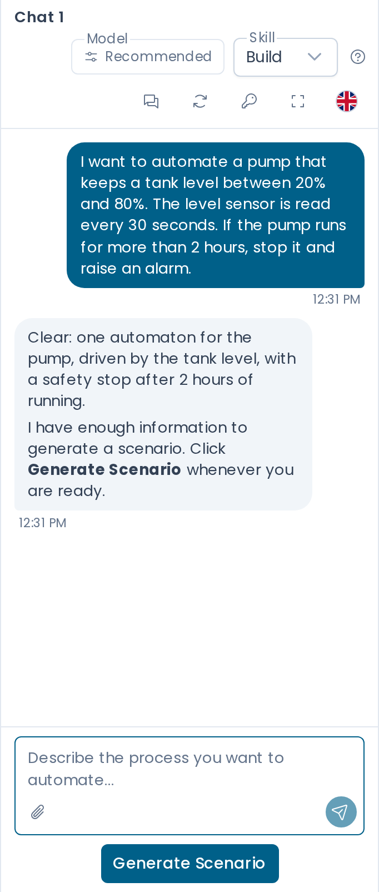
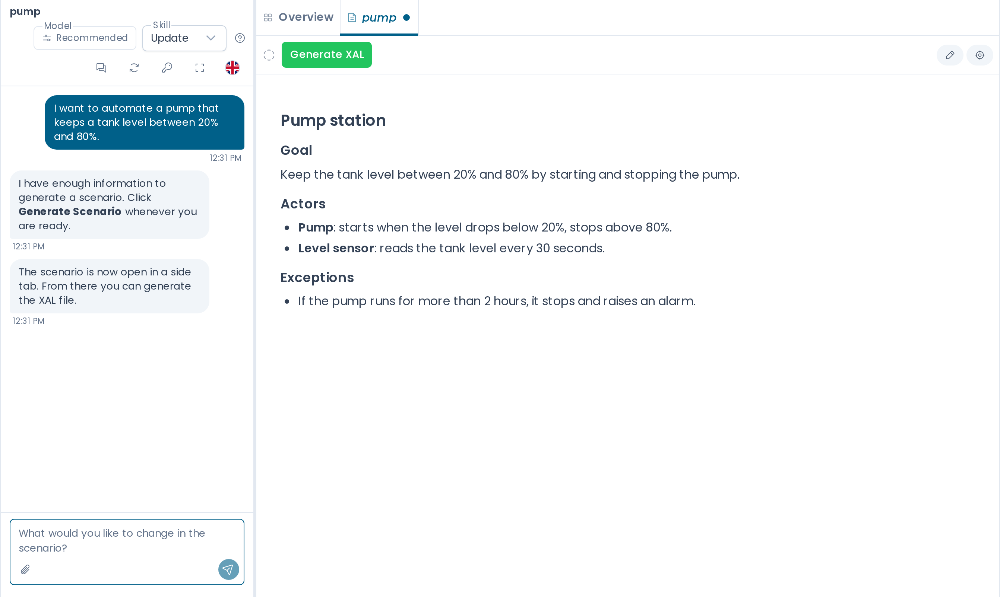

# Generating a Scenario

The scenario is the structured natural-language description of an automaton — the bridge between your intent and the XAL file. Arianna helps you build it through a conversational flow.

---

## Starting a chat session

You can start a scenario generation from two entry points:

**From a free session**: click **New** in the sessions panel, or the **New chat** icon (**+**) in the chat header if you have no sessions yet (see [Chat Sessions](sessions.md#creating-a-session)). The session starts with no linked file. When Arianna delivers the scenario, she proposes a file name and the session takes that name.

**From an existing file**: right-click a `.xal` or `.scenario.md` file in the **Repository Explorer** and select **New chat** (or **Open chat** if you have already written in that session). The session is linked to that file and takes its name. The file can be empty. If the XAL already has automata but no scenario, see [Generate Scenario from XAL](scenario_from_xal.md).

---

## Describing the process

Type a description of the automaton's behaviour in the chat input. There are no strict format requirements — plain language works well. Include:

- what condition or event the automaton monitors
- what states it can be in
- what actions or notifications it triggers
- any timing or threshold constraints

You can describe everything at once or build up the scenario through several exchanges. Arianna asks follow-up questions when the description is ambiguous or incomplete.

If the process is already described in a document, attach it to your message instead of retyping it.

---

## Attaching documents

To attach a document, click the **paperclip** icon in the input box and choose one or more files. You can also drag the files from your computer and drop them on the chat.

You can attach these types of file:

- **Text**: `.txt` and `.md`.
- **Office**: `.docx`, `.pptx` and `.xlsx`. Arianna gets their text, converted to Markdown: headings, lists and tables are kept, and images and charts become a placeholder. A message tells you which files were converted.

The old Office formats (`.doc`, `.ppt`, `.xls`) are not accepted: save the file as `.docx`, `.pptx` or `.xlsx` and attach it again.

Each attached document appears in the input box with its name and size. Click **×** to remove it. If you attach a file with the same name again, it replaces the first one. You can send attachments with or without a message.

/// caption
Fig.1 - Two documents attached, ready to send
///

Click the name of a document to see the text Arianna gets from it. A `.txt` file is shown as it is; the other documents are shown formatted. For an Office file, this lets you check what the conversion kept.

/// caption
Fig.2 - The text Arianna gets from a Word document
///

After you send the message, the documents stay in it: click a name to see its text again.

### Limits
- The text of a document can be up to 200 KB. For a `.txt` or `.md` file, this is also the limit on the file.
- An Office file can be up to 10 MB before conversion. Its converted text must still fit in 200 KB.

!!! tip "Attach only what you need"
    Arianna reads the whole conversation again at every message, attachments included. A long document makes every following answer slower. If only a part of a document matters, attach that part.

---

## Generating the scenario

When Arianna considers the description sufficient to produce a minimal scenario, she tells you in the chat, and the **Generate Scenario** button appears under the input box.

/// caption
Fig.3 - Arianna has enough information: Generate Scenario appears
///

The button is not shown in the **Consult** skill. You can keep writing after it appears: the button stays until you click it.

Click **Generate Scenario**. Arianna produces a structured scenario in Markdown format. At the same time:

- the `.scenario.md` file is created in the **Repository Explorer**: next to the `.xal` file for a file session, in the `data/` folder for a free session. If a file with the same name already exists, a number is added, for example `pump(1).scenario.md`;
- the **scenario tab** opens in the editor, showing the rendered scenario;
- the skill changes to **Update**.

The `.xal` file does not exist yet: it is created when you click **Generate XAL** in the scenario tab, in the same folder as the scenario.

/// caption
Fig.4 - The scenario tab after generation
///

!!! tip "Another folder"
    The `data/` folder is only a proposal. To keep the files somewhere else, drag them to another folder in the **Repository Explorer**, or change the folder when you commit.

---

## Refining the scenario

Read the scenario in the tab. If something is incorrect or missing, describe the change in the chat. When Arianna has understood the change, the **Update Scenario** button appears under the input box. Click it: Arianna updates the scenario and changes as little as possible of the parts not affected. The scenario tab then shows what changed compared with the previous version.

!!! info "The scenario is the source of truth"
    During the generation phase, the scenario is what Arianna works from. The XAL has not been generated yet — refine the scenario until it accurately describes the intended behaviour before proceeding.

When the scenario is ready, proceed to [Generating XAL](generating_xal.md).
