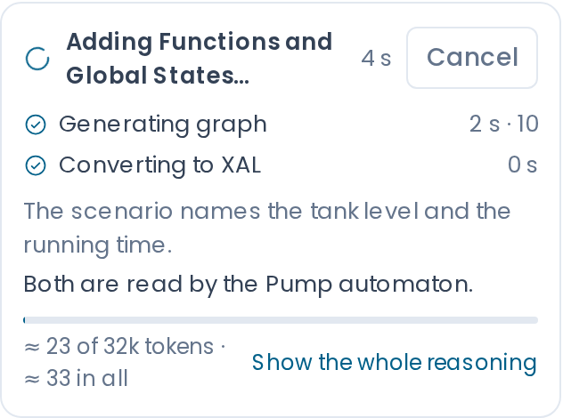
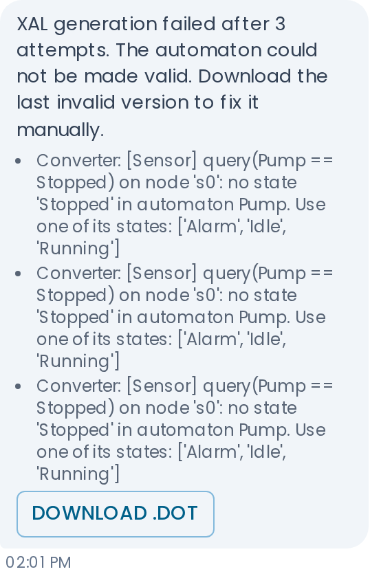

# Generare l'XAL

Una volta che lo scenario è pronto nel tab scenario, puoi generare il file XAL con un solo click.

---

## Avviare la generazione

Apri il tab scenario e clicca **Generate XAL** nella sua toolbar. Il pulsante verde compare quando lo scenario non ha ancora un XAL, oppure quando il suo XAL è stato caricato e non è mai stato generato da Arianna: in quel caso la generazione lo sostituisce.

Il pulsante è disabilitato mentre Arianna lavora e mentre i file si ricaricano. Quando l'XAL esiste e lo scenario è cambiato, il pulsante è **Update XAL**: vedi [Aggiornare l'XAL](updating_xal.md).

---

## I passi

Arianna lavora a passi. La [progress card](sessions.md#mentre-arianna-lavora) nella chat mostra il passo in corso ed elenca quelli già fatti, con il loro tempo:

1. **Generating graph**: Arianna disegna gli automi dello scenario come un grafo, nel formato intermedio GraphViz `.dot`.
2. **Converting to XAL**: il convertitore di Xautomata trasforma il grafo in XAL, e l'XAL viene validato.
3. **Adding Functions and Global States**: Arianna rilegge lo scenario e aggiunge a ogni automa le Action, le Metric e le variabili Global State.
4. Il file XAL viene salvato nel repository explorer, accanto allo scenario, e collegato alla chat.

/// caption
Fig.1 - La progress card al passo 3, con i primi due passi fatti
///

Clicca **Cancel** sulla card per fermare la generazione in qualsiasi passo. Non viene modificato nulla, e la chat lo conferma (*Cancelled: nothing was changed.*).

---

## Mentre l'XAL viene generato

Il file XAL resta bloccato fino alla fine della generazione, così le modifiche fatte nel frattempo non vengono sovrascritte:

- i tab degli automi del file sono in sola lettura e mostrano *Regenerating this automaton...*;
- nel repository explorer non puoi rinominare, spostare, eliminare, ripristinare o scartare il file e il suo scenario;
- non puoi fare il commit del file e del suo scenario;
- non puoi collegare o scollegare un repository o un branch.

Lo scenario si può ancora modificare: l'XAL nasce dallo scenario com'era quando hai cliccato **Generate XAL**.

---

## Dopo la generazione

La chat conferma dove è stato salvato l'XAL. I tab degli automi del file già aperti mostrano la nuova versione, e il badge di stato nella toolbar indica *Up to date*. Una generazione non si annulla con Ctrl+Z.

Se l'XAL contiene qualcosa che non funzionerà quando viene eseguito, Arianna aggiunge un avviso nella chat e indica cosa correggere nel Designer:

- Action o Metric che nessuno stato esegue;
- transizioni che aspettano un valore che nessuna Metric restituisce;
- Metric con più output, nessuno dei quali indicato come il valore che le transizioni confrontano.

Se alcune Action o Metric eseguono metodi Java, vengono generati anche gli stub Java, e la chat dice in quale file.

---

## Functions e variabili Global State

Nel passo 3 Arianna aggiunge a ogni automa:

- le **Functions**: le Action e le Metric descritte nello scenario, collegate agli stati che le eseguono;
- le variabili **Global State** elencate nello scenario, visibili nel pannello **Global State Variables**.

Questo passo parte da solo. Alcuni valori restano da completare nel Designer, per esempio i sistemi che le funzioni chiamano.

---

## Nuovi tentativi automatici

Se il convertitore rifiuta il grafo o l'XAL non è valido, Arianna riceve gli errori e corregge il grafo, fino a tre tentativi in tutto. La card mostra *Fixing validation errors (attempt 2/3)...*. Ogni tentativo riceve gli errori di tutti i precedenti, così lo stesso errore non si ripete.

Anche il passo 3 ha fino a tre tentativi. Se le Functions e le Global State rendono l'XAL non valido, per esempio due funzioni con lo stesso Id, Arianna le aggiunge di nuovo, con gli errori come indicazione.

!!! warning "Servizio di validazione non disponibile"
    Se il servizio di validazione non risponde, l'XAL viene salvato senza validazione e la chat lo segnala. Controlla l'XAL nel Designer quando il servizio torna disponibile.

---

## Se tutti i tentativi falliscono

Se i tre tentativi falliscono, la chat mostra gli errori di tutti i tentativi e due pulsanti:

- **Download XAL**: l'ultimo XAL generato, anche se non valido. Spesso basta una piccola modifica a mano per correggerlo. Il pulsante manca quando il convertitore ha rifiutato l'ultimo grafo, perché non c'è un XAL.
- **Download .dot**: l'ultimo grafo, se vuoi correggerlo a mano.

/// caption
Fig.2 - Tre tentativi rifiutati dal convertitore: si può scaricare solo il grafo
///

Puoi anche chiedere ad Arianna di modificare lo scenario e poi cliccare di nuovo **Generate XAL**.

!!! note
    Una generazione fallita non sovrascrive il file `.xal` nel repository. La versione precedente resta.
