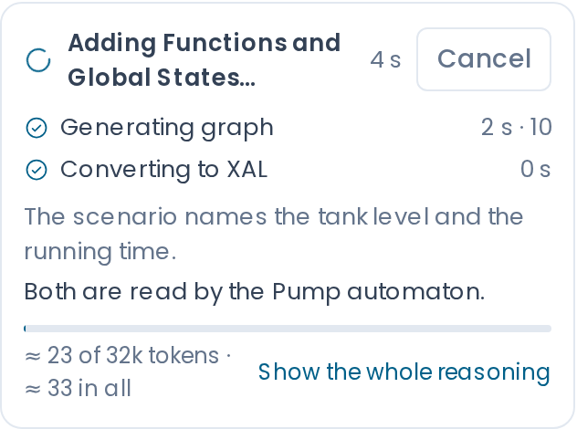
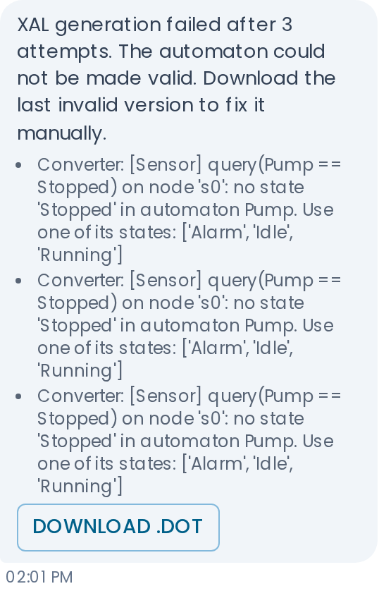

# Generating XAL

Once a scenario is ready in the scenario tab, you can generate the XAL file with a single click.

---

## Starting the generation

Open the scenario tab and click **Generate XAL** in its toolbar. The green button appears when the scenario has no XAL yet, or when its XAL was uploaded and never generated by Arianna: in that case the generation replaces it.

The button is disabled while Arianna is working and while the files are reloading. When the XAL exists and the scenario has changed, the button is **Update XAL**: see [Updating XAL](updating_xal.md).

---

## The steps

Arianna works in steps. The [progress card](sessions.md#while-arianna-works) in the chat shows the current step and lists the steps already done, with their time:

1. **Generating graph**: Arianna draws the automata of the scenario as a graph, in the intermediate GraphViz `.dot` format.
2. **Converting to XAL**: the Xautomata converter turns the graph into XAL, and the XAL is validated.
3. **Adding Functions and Global States**: Arianna reads the scenario again and adds the Actions, the Metrics and the Global State variables to each automaton.
4. The XAL file is saved in the repository explorer, next to the scenario, and linked to the chat.

/// caption
Fig.1 - The progress card at step 3, with the first two steps done
///

Click **Cancel** on the card to stop the generation at any step. Nothing is changed, and the chat says *Cancelled: nothing was changed.*

---

## While the XAL is generated

The XAL file is locked until the generation ends, so that the changes you make meanwhile are not overwritten:

- the automaton tabs of the file are read-only and show *Regenerating this automaton...*;
- in the repository explorer you cannot rename, move, delete, restore or discard the file and its scenario;
- you cannot commit the file and its scenario;
- you cannot connect or disconnect a repository or a branch.

You can still edit the scenario: the XAL comes from the scenario as it was when you clicked **Generate XAL**.

---

## After the generation

The chat confirms where the XAL was saved. The open automaton tabs of the file show the new version, and the status badge in the toolbar shows *Up to date*. You cannot undo a generation with Ctrl+Z.

If the XAL contains something that will not work when it runs, Arianna adds a warning in the chat and says what to fix in the Designer:

- Actions or Metrics that no state runs;
- transitions that wait for a value that no Metric returns;
- Metrics with several outputs, none of them marked as the value the transitions compare.

If some Actions or Metrics run Java methods, the Java stubs are generated too, and the chat says in which file.

---

## Functions and Global State variables

In step 3, Arianna adds to each automaton:

- the **Functions**: the Actions and the Metrics described in the scenario, linked to the states that run them;
- the **Global State** variables listed in the scenario, shown in the **Global State Variables** panel.

This step runs by itself. Some values are left for you to complete in the Designer, such as the systems that the functions call.

---

## Automatic retry

If the converter rejects the graph or the XAL is not valid, Arianna receives the errors and corrects the graph, up to three attempts in all. The card shows *Fixing validation errors (attempt 2/3)...*. Each attempt receives the errors of all the previous ones, so the same mistake is not repeated.

Step 3 also has up to three attempts. If the Functions and the Global States make the XAL invalid, for example two functions with the same Id, Arianna adds them again, with the errors as a hint.

!!! warning "Validation service unavailable"
    If the validation service cannot be reached, the XAL is saved without validation and the chat says so. Check the XAL in the Designer when the service is available again.

---

## If all attempts fail

If the three attempts fail, the chat shows the errors of all the attempts and two buttons:

- **Download XAL**: the last XAL generated, even if invalid. Often a small manual edit is enough to fix it. The button is not there when the converter rejected the last graph, because there is no XAL.
- **Download .dot**: the last graph, if you want to correct it by hand.

/// caption
Fig.2 - Three attempts rejected by the converter: only the graph can be downloaded
///

You can also ask Arianna to change the scenario and then click **Generate XAL** again.

!!! note
    A failed generation does not overwrite the `.xal` file in the repository. The previous version is kept.
