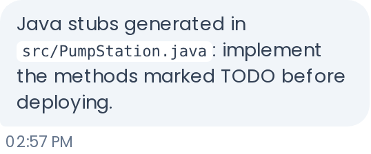
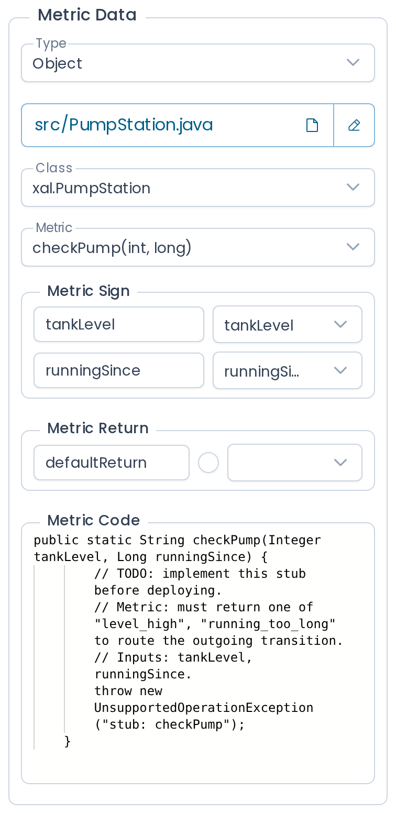

# Stub Java

Alcune Action e Metric eseguono un metodo Java. Per ognuna, il Designer scrive un metodo vuoto — uno **stub** — in una classe Java, così allo sviluppatore resta solo da scrivere il codice.

Non c'è un pulsante: gli stub seguono l'XAL da soli. Sono costruiti a partire dall'XAL, non dall'AI, quindi non usano la tua chiave API.

---

## Quando vengono generati

Gli stub vengono generati in due momenti:

- **dopo Generate XAL e Update XAL**: la chat dice in quale file;
- **quando apri la finestra del commit**: si aggiornano gli stub di ogni XAL modificato dall'ultimo commit. Una funzione che hai aggiunto a mano nel Designer riceve il suo metodo, e il file `.java` compare tra le modifiche.

/// caption
Fig.1 - La chat dice dove sono gli stub
///

Ricevono gli stub solo gli XAL che hanno una chat di Arianna. Se lavori su un XAL senza Arianna, non viene creato nessun file `.java`: i metodi li scrivi tu.

---

## Il file Java

C'è una classe Java per ogni XAL. Il suo nome viene dalla **Class** delle Action e delle Metric. Arianna dà la stessa classe a tutti gli automi di uno scenario: `xal.` seguito dal nome dello scenario, per esempio `xal.PumpStation`. Quando lo scenario non ha un nome, la classe è `xal.Utils`.

Il file viene salvato nella cartella `src/`, per esempio `src/PumpStation.java`. Se il file è già nel repository, il Designer vi aggiunge i nuovi metodi.

Per tenere il file in un'altra cartella, cambiala nella finestra del commit oppure trascina il file nell'albero dei file. Le Action e le Metric dell'XAL seguono il nuovo percorso. Il file `.java` non si sposta quando sposti l'XAL.

Il file `.java` viene committato insieme al suo XAL e al suo scenario: nella finestra del commit, selezionando uno dei tre si selezionano anche gli altri due (vedi [Commit e push](../publishing/commit.md)). Prima del commit, il suo menu nell'albero dei file offre **Download** e **Remove file**.

---

## Cosa contiene uno stub

Ogni stub ha:

- un commento con la descrizione dello stato che esegue il metodo, presa dallo scenario;
- i parametri, in quest'ordine: il risultato della Query, se la funzione ne ha una; la sorgente dati, se ne ha una; poi gli input, con il tipo della loro variabile di Global State;
- il tipo restituito: niente per un'Action senza output, il tipo dell'output quando ce n'è uno, una mappa quando sono più di uno. Una Metric restituisce una `String`: il valore che sceglie la transizione in uscita;
- nel corpo, un `TODO`, i valori che una Metric deve restituire e gli input. Finché non lo implementi, il metodo lancia un'eccezione.

| Tipo XAL | Tipo Java |
|---|---|
| `string` | `String` |
| `int` | `Integer` |
| `long` | `Long` |
| `bool` | `Boolean` |
| `object` | `Object` |
| `list[string]` | `ArrayList<String>` |
| `map[string,object]` | `HashMap<String, Object>` |

!!! warning "Non cambiare i tipi dei parametri"
    La piattaforma trova il metodo dai tipi esatti dei suoi parametri. Se cambi `Integer` in `int`, o `ArrayList` in `List`, il codice compila, ma il metodo non viene trovato quando l'automa è in esecuzione.

---

## Lo stub nel Designer

Seleziona uno stato e apri la sua sezione **Action** o **Metric**. Il riquadro **Action Data** o **Metric Data** mostra il file Java, la **Class**, il metodo, i suoi parametri e, in fondo, il codice del metodo. Il codice è in sola lettura.

/// caption
Fig.2 - Lo stub di una Metric nel Designer
///

---

## Implementare e aggiornare i metodi

Il codice dei metodi lo scrivi nel file `.java`, fuori dal Designer.

Quando gli stub vengono generati di nuovo, i metodi già presenti nella classe restano come sono, implementati o no: si aggiungono solo i metodi mancanti. Tieni presente che:

- un metodo viene riconosciuto solo dal nome. Se gli input di una funzione cambiano nell'XAL, aggiorna a mano la firma del suo metodo;
- se non c'è una copia locale del file, la generazione parte dalla versione nel repository, e la chat lo dice;
- i metodi che nessuna Action o Metric chiama più vengono elencati in chat, ma restano nel file: toglili a mano se non ti servono più. La chat ti dice anche quali di questi chiama ancora un altro XAL con la stessa classe.

Se nessuna Action o Metric dell'XAL ha una **Class**, non viene scritto nessun file: la chat ti chiede di impostare la Class nella sezione Action o Metric del nodo. Gli stub vengono poi generati al prossimo commit.

Le Action e le Metric vere e proprie le aggiunge Arianna durante la generazione dell'XAL (vedi [Generare l'XAL](generating_xal.md)).
