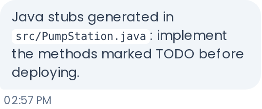
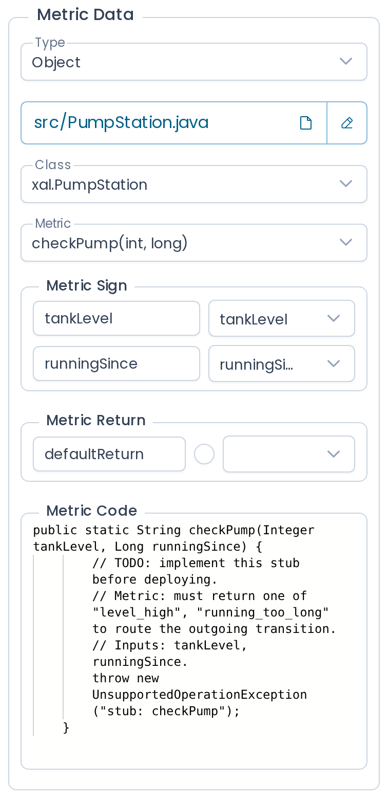

# Java Stubs

Some Actions and Metrics run a Java method. For each of them, the Designer writes an empty method — a **stub** — in a Java class, so that a developer only has to fill in the code.

There is no button: the stubs follow the XAL by themselves. They are built from the XAL, not by the AI, so they do not use your API key.

---

## When the stubs are generated

The stubs are generated at two moments:

- **after Generate XAL and Update XAL**: the chat says in which file;
- **when you open the commit dialog**: the stubs of every XAL changed since the last commit are brought up to date. A function you added by hand in the Designer gets its method, and the `.java` file appears among the changes.

/// caption
Fig.1 - The chat says where the stubs are
///

Only an XAL with an Arianna chat gets stubs. If you work on an XAL without Arianna, no `.java` file is created: you write the methods yourself.

---

## The Java file

There is one Java class for each XAL. Its name comes from the **Class** of the Actions and Metrics. Arianna gives the same class to all the automata of a scenario: `xal.` followed by the scenario name, for example `xal.PumpStation`. When the scenario has no name, the class is `xal.Utils`.

The file is saved in the `src/` folder, for example `src/PumpStation.java`. If the file is already in the repository, the Designer adds the new methods to it.

To keep the file in another folder, change its folder in the commit dialog, or drag it in the file tree. The Actions and Metrics of the XAL follow the new path. The `.java` file does not move when you move the XAL.

The `.java` file is committed together with its XAL and its scenario: in the commit dialog, selecting one of the three selects the other two (see [Commit and Push](../publishing/commit.md)). Before the commit, its menu in the file tree offers **Download** and **Remove file**.

---

## What a stub contains

Each stub has:

- a comment with the description of the state that runs the method, taken from the scenario;
- the parameters, in this order: the result of the Query, if the function has one; the data source, if it has one; then the inputs, with the type of their Global State variable;
- the return type: nothing for an Action without outputs, the type of the output when there is one, a map when there are several. A Metric returns a `String`: the value that chooses the outgoing transition;
- in the body, a `TODO`, the values a Metric must return, and the inputs. Until you implement it, the method throws an exception.

| XAL type | Java type |
|---|---|
| `string` | `String` |
| `int` | `Integer` |
| `long` | `Long` |
| `bool` | `Boolean` |
| `object` | `Object` |
| `list[string]` | `ArrayList<String>` |
| `map[string,object]` | `HashMap<String, Object>` |

!!! warning "Keep the parameter types"
    The platform finds the method by the exact types of its parameters. If you change `Integer` to `int`, or `ArrayList` to `List`, the code compiles, but the method is not found when the automaton runs.

---

## The stub in the Designer

Select a state and open its **Action** or **Metric** section. The **Action Data** or **Metric Data** box shows the Java file, the **Class**, the method, its parameters and, at the bottom, the code of the method. The code is read-only.

/// caption
Fig.2 - The stub of a Metric in the Designer
///

---

## Implementing and updating the methods

You write the code of the methods in the `.java` file, outside the Designer.

When the stubs are generated again, the methods already in the class are kept as they are, implemented or not: only the missing methods are added. Keep in mind:

- a method is recognized by its name only. If the inputs of a function change in the XAL, update the signature of its method by hand;
- if there is no local copy of the file, the generation starts from the version in the repository, and the chat says so;
- the methods that no Action or Metric calls any more are listed in the chat, but they stay in the file: remove them by hand if you no longer need them. The chat also tells you which of them another XAL with the same class still calls.

If no Action or Metric of the XAL has a **Class**, no file is written: the chat asks you to set the Class in the Action or Metric section of the node. The stubs are then generated at the next commit.

The Actions and Metrics themselves are added by Arianna while generating the XAL (see [Generating XAL](generating_xal.md)).
