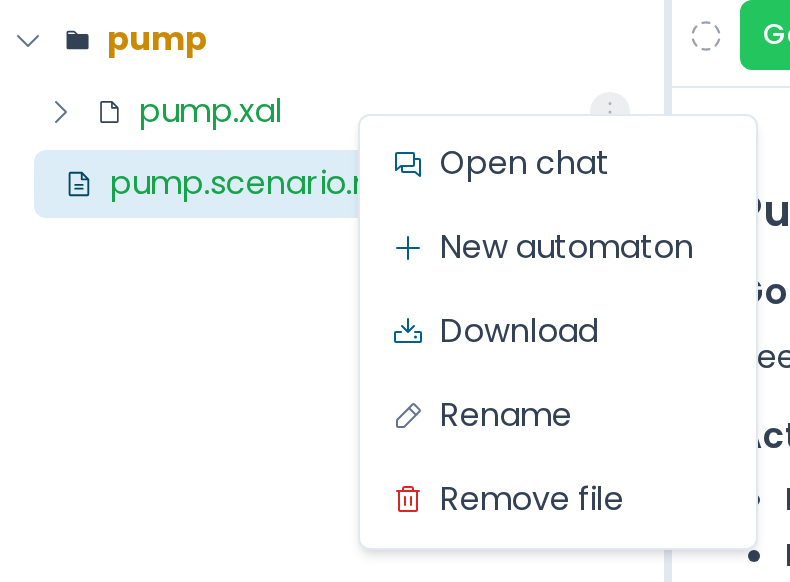
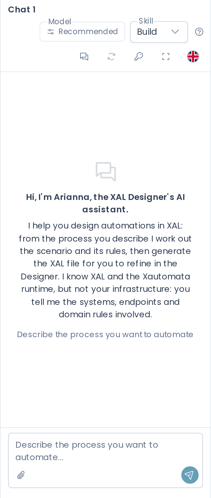
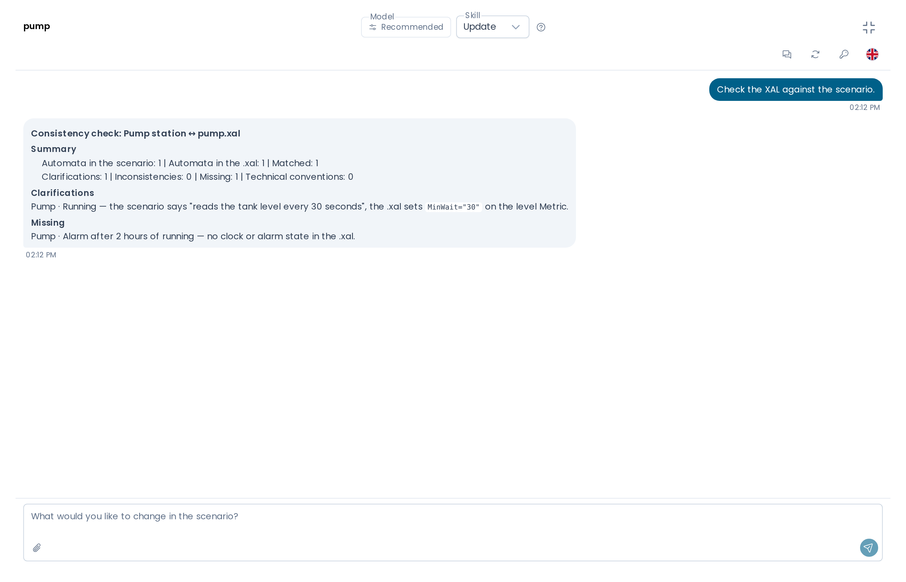
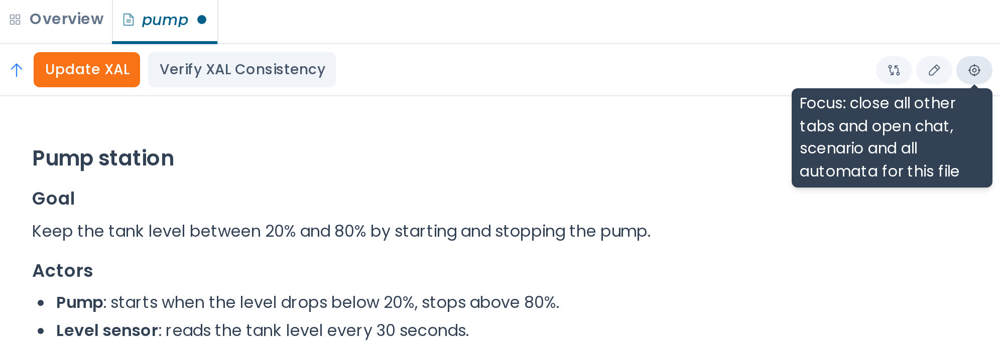

# AI Assistant — Panoramica

Arianna è l'assistente AI integrato nel XAL Designer. Ti aiuta a partire da una descrizione in linguaggio naturale di un processo e arrivare a un file XAL valido e strutturato — mantenendo i due artefatti sincronizzati man mano che uno o l'altro evolve.

---

## Il modello dei file

Capire come Arianna organizza il proprio lavoro è fondamentale prima di usarla. Sono sempre coinvolti tre artefatti, collegati per struttura.

### Sessione chat, scenario e file XAL

Ogni sessione chat è legata esattamente a un file XAL. La sessione ricorda la cronologia della conversazione, lo scenario generato e l'ultimo XAL prodotto. Questo collegamento è permanente per tutta la vita della sessione: la chat lavora *su quel file*, indipendentemente da quale tab è attiva nell'editor.

Lo **scenario** è la descrizione strutturata in linguaggio naturale dell'automa — l'artefatto intermedio tra la tua intenzione e l'XAL. Vive in un file `.scenario.md` dedicato, che Arianna crea automaticamente.

I tre artefatti formano una triade:

```
patch_oracle.xal            ← il file dell'automa
patch_oracle.scenario.md    ← lo scenario (satellite, stesso base name)
                            ← la sessione chat (collegata a patch_oracle.xal)
```

!!! info "Una sessione per file"
    Non possono coesistere due sessioni chat collegate allo stesso file XAL. Se apri una chat per un file che ha già una sessione, quella esistente viene riattivata.

### Il file satellite

Il file scenario è un **satellite** del file XAL: vive sempre nella stessa directory e condivide lo stesso base name, con estensione `.scenario.md` al posto di `.xal`. Questa co-location è strutturale — il collegamento tra i due non viene mai memorizzato esplicitamente; è derivato dal path.

Il file scenario può esistere prima del file XAL (Arianna lo crea non appena lo scenario è pronto), ma non può mai trovarsi in una directory diversa. Quando rinomini o sposti un file XAL non ancora committato, il file scenario si sposta con lui e la sessione chat lo segue.

### Un solo tab scenario alla volta

L'editor consente di avere aperto un solo tab scenario alla volta. È una scelta intenzionale: il tab scenario e la sessione chat attiva sono sempre sincronizzati, e avere più tab scenario aperti simultaneamente violerebbe questo contratto. Se passi a una sessione chat diversa, il tab scenario corrente viene chiuso e lo scenario della nuova sessione (se presente) viene aperto al suo posto.

Mentre modifichi lo scenario non puoi passare a un altro: il Designer mostra l'avviso *Unsaved scenario*. Prima salva o annulla la modifica.

---

## Aprire una sessione chat

Per collegare una sessione chat a un file XAL, clicca con il tasto destro sul file nel **Repository Explorer**.

La voce del menu contestuale cambia a seconda che esista già una sessione per quel file:

| Voce | Condizione | Effetto |
|---|---|---|
| **Open chat** | La chat del file ha già dei messaggi | Apre il pannello AI Assistant su quella chat; apre il tab scenario se lo scenario è presente |
| **New chat** | Il file non ha ancora una chat, o la sua chat è ancora vuota | Crea una chat collegata al file, con il nome del file. Una chat vuota viene riaperta, non duplicata |

La stessa voce è disponibile sui file `.scenario.md`: lo scenario e l'XAL condividono la stessa chat.

I file non ancora committati hanno nel menu anche **Download** e **Remove file**, e un file XAL anche **Rename**.


/// caption
Fig.1 - La voce "Open chat" nel menu contestuale del Repository Explorer
///

---

## Il pannello della chat

### La presentazione di Arianna

Una chat nuova, vuota, si apre con una breve presentazione: cosa fa Arianna e cosa devi dirle tu. Conosce XAL e il runtime di Xautomata, ma non i tuoi sistemi, i tuoi endpoint e le regole del tuo dominio. La presentazione sparisce al primo messaggio.

La chat [User Guide](sessions.md#user-guide) mostra una presentazione più breve.


/// caption
Fig.2 - Una chat nuova: Arianna si presenta
///

### Schermo intero

Le risposte lunghe, come un report di consistenza, si leggono meglio a schermo intero. Clicca **Full screen** nell'intestazione della chat: la chat copre tutta la finestra, con la stessa intestazione, gli stessi messaggi e lo stesso campo di testo. Per tornare indietro clicca **Exit full screen** in alto a destra, oppure premi **Esc**.

Passando dall'una all'altra modalità non perdi niente: il messaggio non ancora inviato, la skill e una risposta in corso restano come sono.


/// caption
Fig.3 - La chat a schermo intero. Il pulsante in alto a destra la riporta nel pannello laterale
///

---

## Il tab scenario

Quando Arianna genera uno scenario, il Designer apre un **tab scenario** nell'editor. Mostra lo scenario in Markdown renderizzato, con una toolbar sopra.

### La toolbar

La toolbar mostra solo le azioni che valgono per lo stato attuale di scenario e XAL.

A sinistra:

- il **badge di stato**: un'icona che ti dice se scenario e XAL sono allineati. Passa il mouse sopra per leggere lo stato;
- **Generate XAL** o **Update XAL**, quando l'XAL manca o è rimasto indietro rispetto allo scenario: vedi [Generare l'XAL](generating_xal.md) e [Aggiornare l'XAL](updating_xal.md);
- **Sync Scenario**, quando l'XAL è stato modificato a mano: vedi [Sincronizzare lo scenario](syncing_scenario.md);
- **Verify XAL Consistency**, quando c'è un XAL da verificare: vedi [Verificare la consistenza](verify_consistency.md).

La tabella in [Aggiornare l'XAL](updating_xal.md#quando-compare-update-xal) elenca ogni stato con il suo badge e i suoi pulsanti.

A destra, tre pulsanti rotondi:

| Pulsante | Effetto |
|---|---|
| **Show changes since the last commit** | Mostra le modifiche dello scenario rispetto a una versione precedente. Compare quando c'è più di una versione. Vedi [Cronologia dello scenario](scenario_history.md) |
| **Edit scenario** | Apre lo scenario come testo. Clicca **Save** per tenere le modifiche o **Cancel** per scartarle. Mentre modifichi, la toolbar mostra solo questi due pulsanti |
| **Focus** | Concentra il workspace su questo file (vedi sotto) |


/// caption
Fig.4 - Il tab scenario. Qui lo scenario è cambiato dopo l'ultima generazione: freccia blu e Update XAL. Il mouse è su Focus
///

### Il pulsante Focus

Cliccando **Focus**:

1. Si chiudono i tab degli automi di altri file XAL
2. Si aprono tutti gli automi definiti nel file XAL collegato
3. Si mostra il tab scenario e si apre il pannello AI Assistant sulla chat del file, creandola se non c'è

Usa Focus quando vuoi concentrare il workspace su un unico file — per esempio, dopo aver navigato tra più automi e voler avere una vista pulita di quello su cui stai lavorando.

---

## Cosa può fare Arianna

Una volta aperta una sessione chat, Arianna può aiutarti con le seguenti attività. Ognuna è descritta in una pagina dedicata.

| Attività | Quando usarla |
|---|---|
| [Generare uno scenario](generating_scenario.md) | Hai una descrizione in linguaggio naturale e vuoi produrre uno scenario strutturato |
| [Generare l'XAL](generating_xal.md) | Lo scenario è pronto e vuoi generare il file XAL |
| [Aggiornare l'XAL](updating_xal.md) | Lo scenario è cambiato e vuoi propagare le modifiche all'XAL esistente |
| [Stub Java](java_stubs.md) | L'XAL esegue metodi Java e vuoi sapere dove va il loro codice |
| [Sincronizzare lo scenario](syncing_scenario.md) | Hai modificato l'XAL manualmente e vuoi aggiornare lo scenario di conseguenza |
| [Verificare la consistenza](verify_consistency.md) | Vuoi controllare che scenario e XAL siano semanticamente allineati |
| [Generare uno scenario dall'XAL](scenario_from_xal.md) | Hai un file XAL esistente senza scenario e vuoi ricostruirne uno |
| [Cronologia dello scenario](scenario_history.md) | Vuoi vedere come è cambiato lo scenario dall'ultimo commit, o riportare indietro una versione precedente |
| [Sessioni chat](sessions.md) | Gestire più sessioni, skill e flussi guidati |
