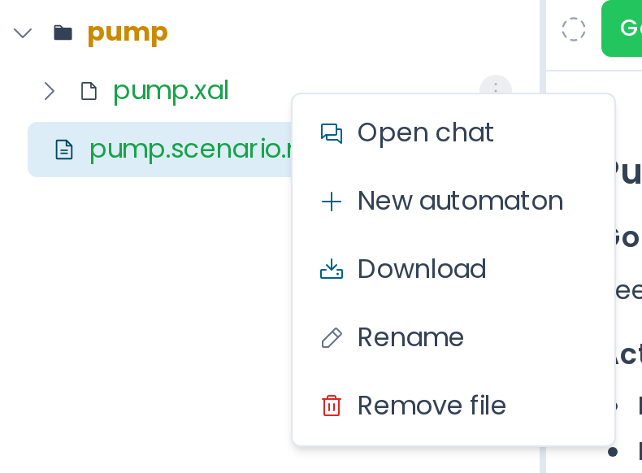
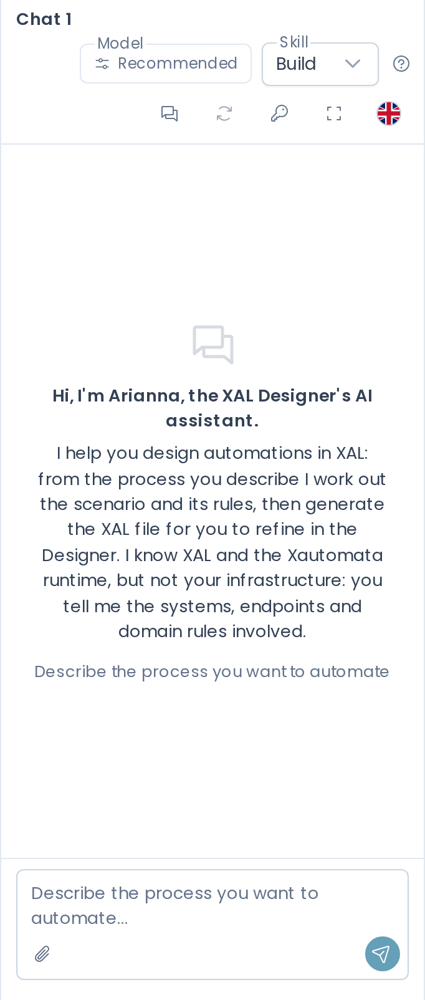
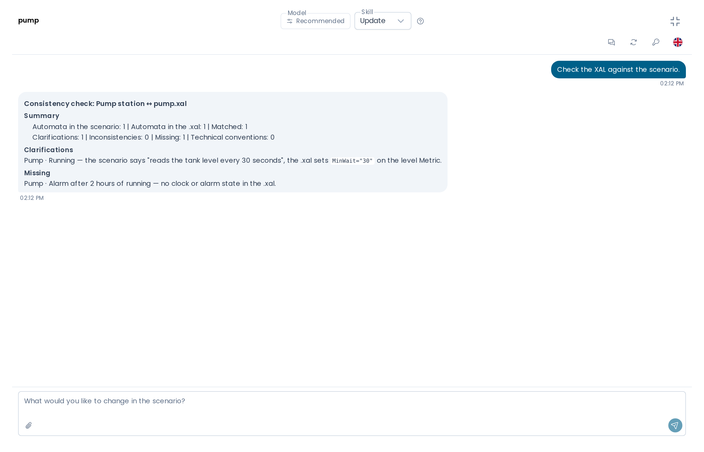
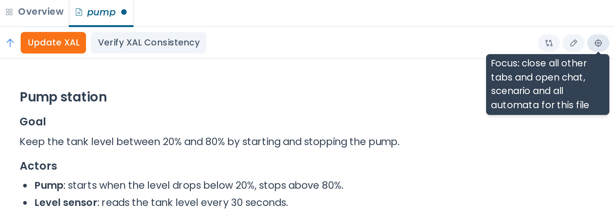

# AI Assistant — Overview

Arianna is the AI assistant built into the XAL Designer. It helps you go from a natural-language description of a process to a valid, structured XAL file — and keeps the two artefacts in sync as either one evolves.

---

## The file model

Understanding how Arianna organises its work is essential before using it. Three artefacts are always involved, and they are linked by design.

### Chat session, scenario, and XAL file

Every chat session is tied to exactly one XAL file. The session remembers the conversation history, the generated scenario, and the last XAL it produced. This link is permanent for the lifetime of the session: the chat always works *on that file*, regardless of which tab is active in the editor.

The **scenario** is the structured natural-language description of the automaton — the intermediate artefact between your intent and the XAL. It lives in a dedicated `.scenario.md` file that Arianna creates automatically.

The three artefacts form a triad:

```
patch_oracle.xal            ← the automaton file
patch_oracle.scenario.md    ← the scenario (satellite, same base name)
                            ← the chat session (linked to patch_oracle.xal)
```

!!! info "One session per file"
    Two chat sessions cannot be linked to the same XAL file at the same time. If you open a chat for a file that already has one, the existing session is reactivated.

### The satellite file

The scenario file is a **satellite** of the XAL file: it always lives in the same directory and shares the same base name, with a `.scenario.md` extension instead of `.xal`. This co-location is structural — the link between the two is never stored explicitly; it is derived from the path.

The scenario file can exist before the XAL file (Arianna creates it as soon as the scenario is ready), but it can never exist in a different directory. When you rename or move an XAL file that is not committed yet, the scenario file moves with it and the chat session follows.

### One scenario tab at a time

The editor allows only one scenario tab open at a time. This is intentional: the scenario tab and the active chat session are always in sync, and having multiple scenario tabs open simultaneously would break that contract. If you switch to a different chat session, the current scenario tab is closed and the new session's scenario (if any) is opened in its place.

While you are editing the scenario, you can't switch to another one: the Designer shows the *Unsaved scenario* warning. Save or cancel the edit first.

---

## Opening a chat session

To link a chat session to an XAL file, right-click the file in the **Repository Explorer**.

The context menu entry changes depending on whether a session already exists for that file:

| Entry | Condition | Effect |
|---|---|---|
| **Open chat** | The file's chat already has messages | Opens the AI Assistant panel on that chat; opens the scenario tab if a scenario is present |
| **New chat** | The file has no chat yet, or its chat is still empty | Creates a chat linked to this file, named after the file. An empty chat is reopened, not duplicated |

The same entry is available on `.scenario.md` files: the scenario and the XAL share the same chat.

Files that are not committed yet also have **Download** and **Remove file** in the menu, and an XAL file has **Rename** too.


/// caption
Fig.1 - The "Open chat" entry in the Repository Explorer context menu
///

---

## The chat panel

### Arianna's introduction

A new, empty chat starts with a short introduction: what Arianna does, and what you need to tell her. She knows XAL and the Xautomata runtime, but not your systems, endpoints, and domain rules. The introduction disappears with your first message.

The [User Guide](sessions.md#user-guide) chat shows a shorter introduction.


/// caption
Fig.2 - A new chat: Arianna introduces herself
///

### Full screen

Long answers, such as a consistency report, are easier to read in full screen. Click **Full screen** in the chat header: the chat covers the whole window, with the same header, messages, and input box. To go back, click **Exit full screen** at the top right, or press **Esc**.

Nothing is lost when you switch: your unsent message, the skill, and an answer in progress stay as they are.


/// caption
Fig.3 - The chat in full screen. The button at the top right brings it back to the side panel
///

---

## The scenario tab

When Arianna generates a scenario, the Designer opens a **scenario tab** in the editor. It shows the scenario in rendered Markdown, with a toolbar above it.

### The toolbar

The toolbar shows only the actions that apply to the current state of scenario and XAL.

On the left:

- the **status badge**: an icon that tells you whether scenario and XAL are aligned. Move the mouse over it to read the state;
- **Generate XAL** or **Update XAL**, when the XAL is missing or behind the scenario: see [Generating XAL](generating_xal.md) and [Updating XAL](updating_xal.md);
- **Sync Scenario**, when the XAL was edited by hand: see [Syncing the Scenario](syncing_scenario.md);
- **Verify XAL Consistency**, when there is an XAL to check: see [Verifying Consistency](verify_consistency.md).

The table in [Updating XAL](updating_xal.md#when-update-xal-appears) lists every state with its badge and buttons.

On the right, three round buttons:

| Button | Effect |
|---|---|
| **Show changes since the last commit** | Shows the changes of the scenario, compared with an earlier version. It appears once there is more than one version |
| **Edit scenario** | Opens the scenario as text. Click **Save** to keep the changes or **Cancel** to drop them. While you edit, the toolbar shows only these two buttons |
| **Focus** | Concentrates the workspace on this file (see below) |


/// caption
Fig.4 - The scenario tab. Here the scenario changed after the last generation: blue arrow and Update XAL. The mouse is on Focus
///

### The Focus button

Clicking **Focus**:

1. Closes the automaton tabs of other XAL files
2. Opens all automata defined in the linked XAL file
3. Shows the scenario tab and opens the AI Assistant panel on the file's chat, creating the chat if there is none

Use Focus when you want to concentrate the workspace on a single file — for example, after switching between several automata and wanting a clean view of the one you are currently working on.

---

## What Arianna can do

Once a chat session is open, Arianna can help you with the following tasks. Each is covered in a dedicated page.

| Task | When to use |
|---|---|
| [Generating a Scenario](generating_scenario.md) | You have a natural-language description and want to produce a structured scenario |
| [Generating XAL](generating_xal.md) | A scenario is ready and you want to generate the XAL file |
| [Updating XAL](updating_xal.md) | The scenario has changed and you want to propagate the changes to the existing XAL |
| [Syncing the Scenario](syncing_scenario.md) | You have edited the XAL manually and want to update the scenario to match |
| [Verifying Consistency](verify_consistency.md) | You want to check that scenario and XAL are semantically aligned |
| [Generate Scenario from XAL](scenario_from_xal.md) | You have an existing XAL file with no scenario and want to reconstruct one |
| [Chat Sessions](sessions.md) | Managing multiple sessions, skills, and guided flows |
