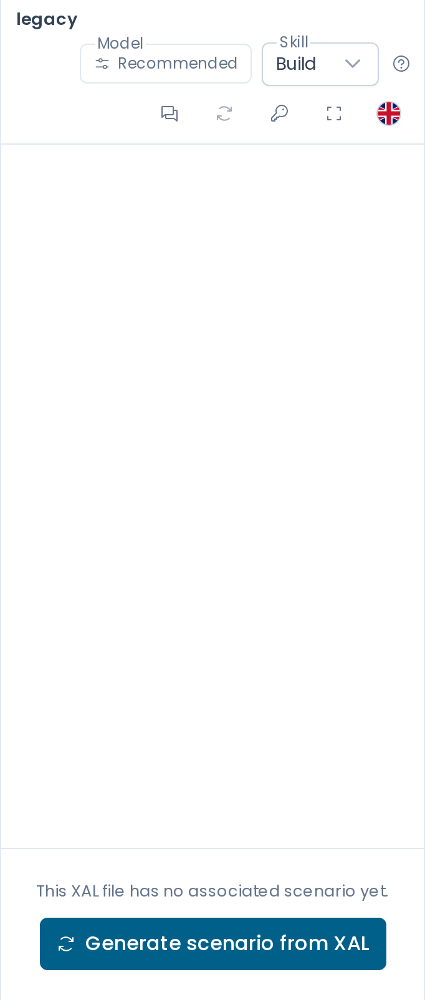

# Generare uno scenario dall'XAL

Se hai un file XAL esistente senza uno scenario associato, Arianna può ricostruirne uno leggendo la struttura dell'automa.

---

## Quando usarla

Questo flusso è utile quando:

- stai lavorando con un file XAL legacy creato manualmente o con un altro strumento
- hai ricevuto un file XAL e vuoi una descrizione leggibile di cosa fa
- vuoi fare ad Arianna domande su un automa esistente

---

## Avviare il flusso

Clicca con il tasto destro il file XAL nel **Repository Explorer** e seleziona **New chat** (oppure **Open chat**). Se il file ha degli automi ma non ha ancora uno scenario, la chat mostra *This XAL file has no associated scenario yet.* e, al posto del campo di testo, il pulsante **Generate scenario from XAL**.

/// caption
Fig.1 - Una chat su un file XAL senza scenario
///

Clicca **Generate scenario from XAL**. Arianna legge tutto l'XAL e scrive uno scenario strutturato. Il file `.scenario.md` viene creato accanto al file `.xal` e si apre il tab scenario.

!!! tip "Solo domande, senza scenario"
    Se vuoi solo fare domande sull'XAL, seleziona la skill **Consult** nell'intestazione della chat. Il campo di testo ricompare e Arianna risponde su stati e transizioni dell'XAL senza creare uno scenario. Vedi [Skill](sessions.md#skill).

---

## Il flusso guidato di verifica

Ricostruire uno scenario da un XAL è un'operazione inversa: Arianna deduce l'intenzione dalla struttura, e questo può introdurre imprecisioni, soprattutto negli automi complessi. Dopo la generazione dello scenario, Arianna ti guida in una verifica:

1. **Suggerimento di verifica**: un messaggio in chat dice che lo scenario è stato dedotto dall'XAL e può contenere imprecisioni, con il pulsante **Verify Scenario Consistency**. Finché non esegui la verifica, il pulsante **Verify XAL Consistency** nel tab scenario mostra un pallino.
2. **Verifica di consistenza**: clicca **Verify Scenario Consistency** nel messaggio, oppure **Verify XAL Consistency** nel tab scenario. Il report compare in chat (vedi [Verificare la consistenza](verify_consistency.md)). Dopo la prima verifica, il pulsante nel messaggio si disattiva.
3. **Direzione di lavoro**: dopo il report, Arianna aggiunge un messaggio: *The XAL is the source of truth. Any inconsistencies should be resolved by editing the scenario — not the XAL. Ask me for help refining it.*
4. **Update scenario from report**: clicca questo pulsante, sotto il messaggio, perché Arianna corregga lo scenario dove il report ha trovato differenze. Cambia solo lo scenario; l'XAL resta com'è.

---

## Affinare lo scenario

Dopo la verifica, affina lo scenario descrivendo le correzioni in chat, poi clicca **Update Scenario**. Lo scopo di questo flusso è uno scenario che descriva quello che fa l'XAL, non un XAL diverso.

Quando lo scenario è accurato, passa alla skill **Consult** per fare domande sull'automa, oppure committa entrambi i file nel repository.
