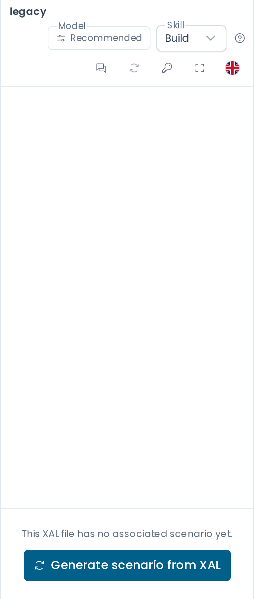

# Generate Scenario from XAL

If you have an existing XAL file with no associated scenario, Arianna can reconstruct one by reading the automaton structure.

---

## When to use it

This flow is useful when:

- you are working with a legacy XAL file that was created manually or by another tool
- you received an XAL file and want a human-readable description of what it does
- you want to ask Arianna questions about an existing automaton

---

## Starting the flow

Right-click the XAL file in the **Repository Explorer** and select **New chat** (or **Open chat**). If the file has automata but no scenario yet, the chat shows *This XAL file has no associated scenario yet.* and the **Generate scenario from XAL** button in place of the input box.

/// caption
Fig.1 - A chat on an XAL file with no scenario
///

Click **Generate scenario from XAL**. Arianna reads the whole XAL and writes a structured scenario. The `.scenario.md` file is created next to the `.xal` file and the scenario tab opens.

!!! tip "Only questions, no scenario"
    If you only want to ask about the XAL, select the **Consult** skill in the chat header. The input box comes back and Arianna answers about the XAL's states and transitions without creating a scenario. See [Skills](sessions.md#skills).

---

## The guided verification flow

Reconstructing a scenario from an XAL is a reverse operation: Arianna infers the intent from the structure, and this can introduce inaccuracies, especially in complex automata. After the scenario is generated, Arianna guides you through a check:

1. **Check suggestion**: a message in the chat says that the scenario was inferred from the XAL and may contain inaccuracies, with a **Verify Scenario Consistency** button. Until you run the check, the **Verify XAL Consistency** button in the scenario tab shows a dot.
2. **Consistency check**: click **Verify Scenario Consistency** in the message, or **Verify XAL Consistency** in the scenario tab. The report appears in the chat (see [Verifying Consistency](verify_consistency.md)). After the first check, the button in the message is disabled.
3. **Working direction**: after the report, Arianna adds a message: *The XAL is the source of truth. Any inconsistencies should be resolved by editing the scenario — not the XAL. Ask me for help refining it.*
4. **Update scenario from report**: click this button, under the message, to have Arianna fix the scenario where the report found differences. Only the scenario changes; the XAL stays as it is.

---

## Refining the scenario

After the check, refine the scenario by describing corrections in the chat, then click **Update Scenario**. The goal of this flow is a scenario that describes what the XAL does, not a different XAL.

When the scenario is accurate, switch to the **Consult** skill to ask questions about the automaton, or commit both files to the repository.
