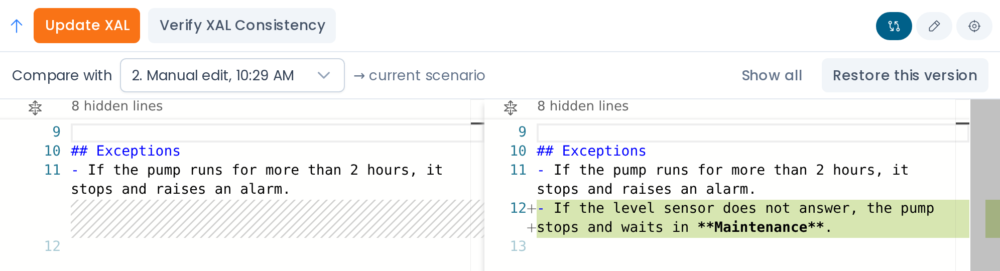
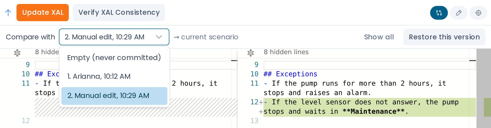

# Cronologia dello scenario

Ogni volta che lo scenario cambia, il Designer conserva la versione precedente. Puoi confrontare lo scenario attuale con qualsiasi versione salvata dall'ultimo commit e riportarne indietro una precedente.

---

## Quali versioni vengono conservate

Viene salvata una nuova versione ogni volta che lo scenario cambia. L'elenco delle versioni indica cosa l'ha salvata:

| Nome nell'elenco | Quando viene salvata |
|---|---|
| **Committed version** | Lo scenario com'è nel repository: è sempre la prima versione |
| **Empty (never committed)** | La prima versione di uno scenario che non è ancora nel repository |
| **Arianna** | Arianna genera o aggiorna lo scenario |
| **Sync Scenario** | Esegui [Sync Scenario](syncing_scenario.md) |
| **Manual edit** | Salvi le tue modifiche con **Edit scenario** |
| **Discarded changes** | Usi **Discard changes** sul file `.scenario.md` nell'albero dei file |
| **Restored** | Ripristini una versione precedente (vedi sotto) |

Un salvataggio con lo stesso testo della versione precedente non ne aggiunge una nuova.

La cronologia conserva la versione committata e fino a 20 versioni successive. Quando sono di più, si perde la più vecchia tra le successive. La versione committata resta sempre.

La cronologia appartiene alla chat del file ed è salvata nel tuo browser: resta dopo un ricaricamento della pagina, ma non la vedi da un altro browser.

!!! note "Dopo un commit la cronologia riparte"
    Quando il file dello scenario cambia nel repository — dopo un tuo commit o quello di un collega — la cronologia riparte dalla nuova versione committata.

---

## Vedere le modifiche

Il pulsante del diff (**Show changes since the last commit**) è in alto a destra nel tab scenario. Compare quando lo scenario ha più di una versione. Cliccalo e il tab scenario mostra le modifiche al posto dello scenario formattato: a sinistra una versione precedente, a destra lo scenario attuale.

/// caption
Fig.1 - Lo scenario confrontato con la versione precedente
///

La barra sopra le modifiche contiene:

- **Compare with** (confronta con): la versione a sinistra. Di default è quella subito prima dell'attuale. Ogni voce mostra un numero, cosa l'ha salvata e l'ora;
- **Show all** / **Compact**: mostra tutto lo scenario, oppure solo le righe cambiate e qualche riga intorno;
- **Restore this version**: vedi sotto.

/// caption
Fig.2 - Le versioni di uno scenario che non è ancora nel repository
///

Clicca di nuovo il pulsante del diff (**Hide changes**) per tornare allo scenario formattato.

Le modifiche si aprono da sole dopo che Arianna aggiorna lo scenario e dopo un sync, così vedi subito cosa è cambiato. Non si aprono dopo la prima generazione: non c'è ancora niente da confrontare.

---

## Ripristinare una versione

1. Apri le modifiche e scegli la versione in **Compare with**.
2. Clicca **Restore this version**.

La versione a sinistra diventa lo scenario attuale e le modifiche si chiudono. Non si perde niente: il testo che avevi prima del ripristino resta nella cronologia come nuova versione, quindi puoi ripristinarlo allo stesso modo.

Nella chat, Arianna scrive quale versione è stata ripristinata. Legge anche lei questo messaggio, quindi nelle richieste successive sa del ripristino.

Tieni presente che:

- non puoi ripristinare mentre Arianna sta lavorando;
- una versione **Empty (never committed)** non si può ripristinare: **Restore this version** non compare;
- ripristinare la **Committed version** equivale a scartare le modifiche: il file torna alla versione del repository e non ha più niente da committare;
- un ripristino cambia solo lo scenario, mai l'XAL. Se ripristini la versione da cui è stato generato l'XAL, scenario e XAL tornano allineati. Qualsiasi altra versione porta lo scenario avanti rispetto all'XAL, e compare **Update XAL** (vedi [Aggiornare l'XAL](updating_xal.md)).
