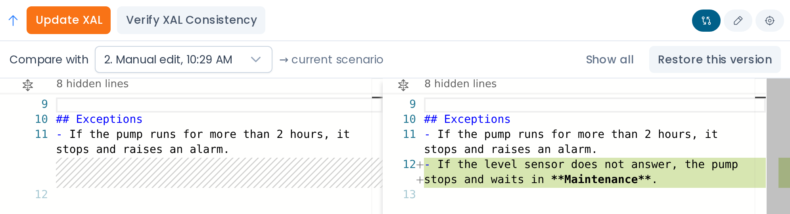
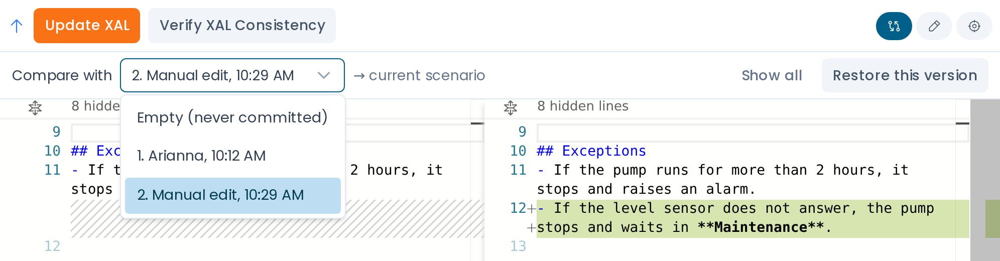

# Scenario History

Every time the scenario changes, the Designer keeps the version before. You can compare the current scenario with any version saved since the last commit, and bring an earlier one back.

---

## Which versions are kept

A new version is saved each time the scenario changes. The list of versions names what saved it:

| Name in the list | When it is saved |
|---|---|
| **Committed version** | The scenario as it is in the repository: always the first version |
| **Empty (never committed)** | The first version of a scenario that is not in the repository yet |
| **Arianna** | Arianna generates or updates the scenario |
| **Sync Scenario** | You run [Sync Scenario](syncing_scenario.md) |
| **Manual edit** | You save your changes with **Edit scenario** |
| **Discarded changes** | You use **Discard changes** on the `.scenario.md` file in the file tree |
| **Restored** | You restore an earlier version (see below) |

A save with the same text as the version before does not add a new one.

The history keeps the committed version and up to 20 later versions. When there are more, the oldest later version is dropped. The committed version always stays.

The history belongs to the chat of the file and is stored in your browser: it survives a page reload, but you do not see it from another browser.

!!! note "The history starts again after a commit"
    When the scenario file changes in the repository — after your commit or a teammate's — the history starts again from the new committed version.

---

## Viewing the changes

The diff button (**Show changes since the last commit**) is at the top right of the scenario tab. It appears when the scenario has more than one version. Click it and the scenario tab shows the changes in place of the rendered scenario: on the left an earlier version, on the right the current scenario.

/// caption
Fig.1 - The scenario compared with the version before
///

The bar above the changes has:

- **Compare with**: the version on the left. By default it is the version just before the current one. Each entry shows a number, what saved it, and the time;
- **Show all** / **Compact**: shows the whole scenario, or only the changed lines and a few lines around them;
- **Restore this version**: see below.

/// caption
Fig.2 - The versions of a scenario that is not in the repository yet
///

Click the diff button again (**Hide changes**) to go back to the rendered scenario.

The changes open by themselves after Arianna updates the scenario and after a sync, so you see at once what changed. They do not open after the first generation: there is nothing to compare with yet.

---

## Restoring a version

1. Open the changes and pick the version in **Compare with**.
2. Click **Restore this version**.

The version on the left becomes the current scenario and the changes close. Nothing is lost: the text you had before the restore stays in the history as a new version, so you can restore it in the same way.

In the chat, Arianna writes which version was restored. She reads this message too, so she knows about the restore in the next requests.

Keep in mind:

- you cannot restore while Arianna is working;
- an **Empty (never committed)** version cannot be restored: **Restore this version** is not shown;
- restoring the **Committed version** is the same as discarding the changes: the file goes back to the repository version and has nothing left to commit;
- a restore changes only the scenario, never the XAL. If you restore the version the XAL was generated from, scenario and XAL are aligned again. Any other version makes the scenario ahead of the XAL, and **Update XAL** appears (see [Updating XAL](updating_xal.md)).
