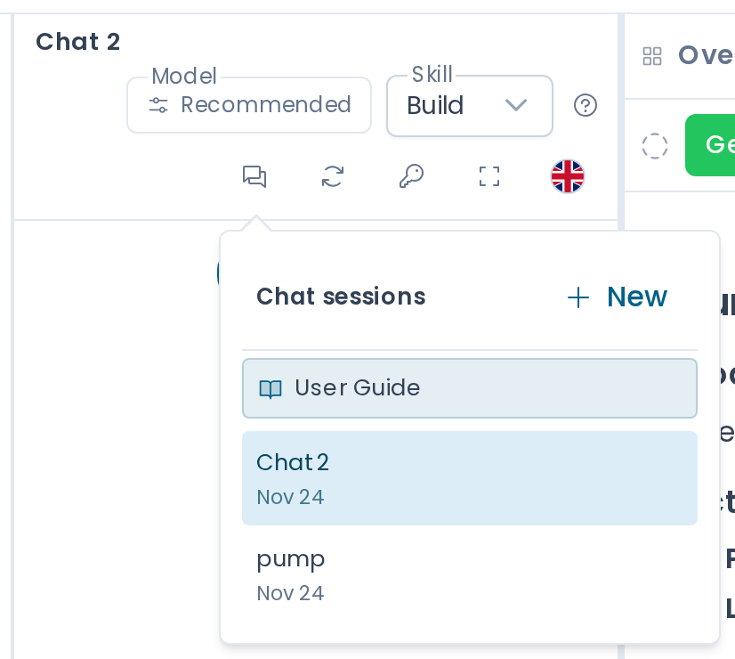
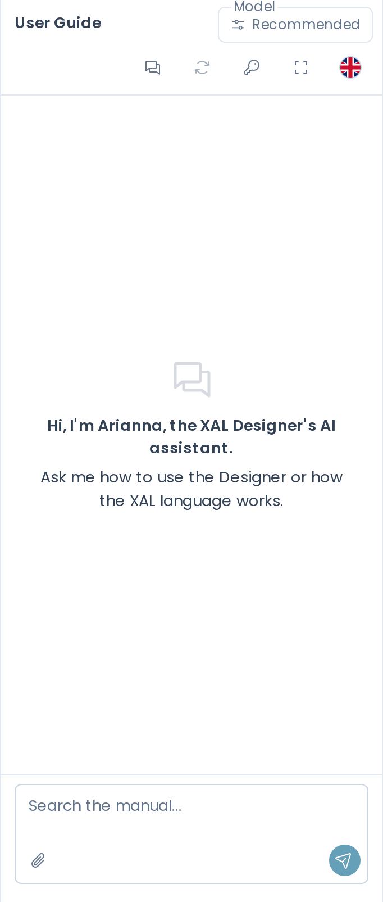
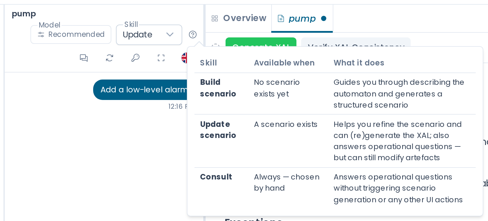
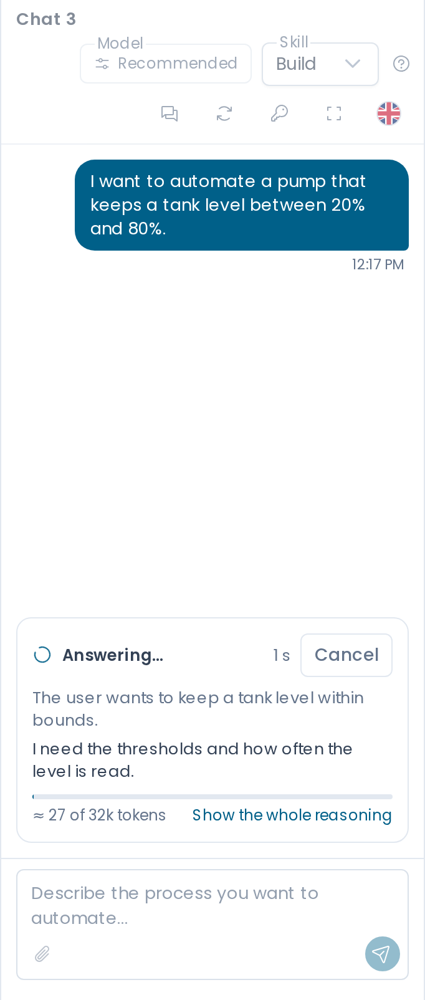

# Sessioni chat

Il pannello AI Assistant può contenere più sessioni chat. Ogni sessione conserva i propri messaggi; una sessione collegata a un file conserva anche il suo scenario e il suo XAL. Questa pagina descrive il pannello delle sessioni, la User Guide, le skill e cosa vedi mentre Arianna lavora.

---

## Il pannello sessioni

Clicca l'icona **Chat sessions** (sessioni chat) nell'intestazione della chat per aprire il pannello sessioni. La **User Guide** è sempre la prima. Seguono le tue sessioni, dalla più recente, ognuna con la data dell'ultima attività.

/// caption
Fig.1 - Il pannello Chat sessions
///

Clicca una sessione per passarci. Se la sessione ha uno scenario, il suo tab scenario si apre nell'editor.

Il pannello mostra solo le sessioni del repository e del branch a cui sei connesso (vedi [Dove restano le sessioni](#dove-restano-le-sessioni)).

---

## Gestire le sessioni

### Creare una sessione
Ci sono due tipi di sessione:

- **Sessione file**: collegata a un file XAL. Clicca con il tasto destro su un file `.xal` o `.scenario.md` nel **Repository Explorer** e seleziona **New chat**. C'è una sola sessione per file: quando ci hai scritto, la voce del menu diventa **Open chat** e ti riporta a quella sessione. La sessione prende il nome del file.
- **Sessione libera**: non collegata a nessun file. Clicca **New** nel pannello sessioni. Se non hai ancora sessioni, clicca l'icona **New chat** (**+**) nell'intestazione della chat. La sessione si chiama *Chat 1*, *Chat 2* e così via.

**New** è disabilitato quando la sessione attiva è già una sessione nuova e vuota.

### Resettare una sessione
Clicca l'icona **Reset history** (le frecce circolari) nell'intestazione della chat. I messaggi vengono cancellati; il file collegato, lo scenario e il tab scenario restano come sono. L'icona è disabilitata quando la sessione non ha messaggi.

Usalo per liberare contesto quando la conversazione è diventata lunga ma lo scenario è ancora valido.

!!! warning
    Non c'è conferma: i messaggi vengono cancellati subito.

### Eliminare una sessione
Nel pannello sessioni, passa il mouse su una sessione e clicca l'**icona del cestino**. La sessione e i suoi messaggi vengono rimossi subito, senza conferma. I file `.scenario.md` e `.xal` nel repository non vengono toccati.

### Messaggi non inviati
Ogni sessione conserva il proprio testo non inviato e i propri allegati. Se inizi a scrivere in una sessione e passi a un'altra, ritrovi la bozza quando torni. Le bozze si perdono quando ricarichi la pagina.

---

## Dove restano le sessioni

Le sessioni sono salvate nel browser:

- **Repository e branch**: una sessione appartiene al repository e al branch a cui eri connesso quando l'hai creata. Quando cambi branch, il pannello mostra le sessioni del nuovo branch. Le altre tornano quando torni sul branch di prima.
- **File che hai creato**: la sessione di un file che hai creato e non hai ancora committato segue il file quando cambi branch e tieni i tuoi file.
- **Chiave API**: quando cambi la chiave API, le sessioni restano (vedi [Configurazione](setup.md#rimuovere-la-chiave)).
- **File eliminati**: se elimini un file, la sua sessione resta, senza lo scenario o l'XAL di quel file.
- **Sessioni vecchie**: le sessioni non usate da 60 giorni vengono cancellate all'avvio del Designer.

---

## User Guide

La **User Guide** (guida utente) è una sessione sempre presente, fissata in cima al pannello sessioni con l'icona di un libro. Chiedile come si usa il Designer o come funziona il linguaggio XAL: Arianna risponde a partire da questo manuale.

/// caption
Fig.2 - La sessione User Guide
///

La User Guide non è collegata a nessun file, non ha il selettore **Skill** e non si può eliminare. Usala per cercare un'informazione senza interrompere il lavoro, poi torna alla tua sessione.

---

## Skill

Ogni sessione, tranne la User Guide, ha un selettore **Skill** nell'intestazione della chat. La skill stabilisce cosa può fare Arianna nella sessione.

| Skill | Disponibile quando | Cosa fa Arianna |
|---|---|---|
| **Build** | Non esiste ancora uno scenario | Ti guida nella descrizione dell'automa e genera uno scenario strutturato |
| **Update** | Lo scenario esiste | Ti aiuta ad affinare lo scenario e può (ri)generare l'XAL; risponde anche a domande operative, ma può ancora modificare gli artefatti |
| **Consult** | Sempre — la scegli tu | Risponde a domande sullo scenario e sull'XAL senza modificarli e senza avviare altre azioni |

Arianna seleziona per te **Build** o **Update**, a seconda che la sessione abbia uno scenario. L'altra è disabilitata. Seleziona **Consult** quando vuoi solo fare domande.

Clicca l'icona **?** accanto al selettore per aprire la legenda delle skill.

/// caption
Fig.3 - La legenda delle skill
///

Quando cambi skill a mano, Arianna scrive in chat un breve messaggio che dice cosa fa la nuova skill.

!!! info
    Cambiare skill non cancella la cronologia della conversazione. Il prossimo messaggio che invii utilizzerà semplicemente le istruzioni della nuova skill.

---

## Mentre Arianna lavora

Mentre Arianna risponde o esegue un'operazione, come Generate XAL, in fondo alla chat compare una **progress card** (scheda di avanzamento). Mostra:

- l'operazione in corso, per esempio *Answering...*, e il tempo trascorso;
- le ultime righe del ragionamento di Arianna: quella in basso è ciò su cui Arianna sta lavorando adesso;
- una barra con i token usati finora;
- **Show the whole reasoning**, per leggere il ragionamento completo.

/// caption
Fig.4 - La progress card mentre Arianna risponde
///

Arianna esegue un'operazione alla volta: mentre lavora, l'intestazione della chat e la casella di testo sono bloccate.

Per fermare Arianna, clicca **Cancel** sulla card. La chat mostra *Stopped.* Quello che Arianna aveva già salvato resta: per esempio, uno scenario salvato prima che cliccassi **Cancel**.

Quando l'operazione finisce, la card scompare e in chat resta una riga *Reasoning · durata · token*. Cliccala per rileggere il ragionamento.

!!! note
    I testi dentro la chat, come **Cancel** o **Update scenario from report**, seguono la [lingua](setup.md#lingua) di Arianna. Con la lingua IT li vedi in italiano: per esempio **Annulla**. Questo manuale li riporta in inglese.

---

## Flussi guidati

Diverse azioni in Arianna attivano **flussi guidati** — sequenze di passi che Arianna esegue automaticamente o ti invita a eseguire, senza che tu debba navigare l'interfaccia manualmente.

### Flusso post-generazione (Generate scenario from XAL)

Dopo aver generato uno scenario da un XAL esistente, Arianna invia in chat un prompt che ti invita a verificare la consistenza, con un pulsante **Verify Scenario Consistency** inline nel messaggio. Dopo la verifica, un secondo messaggio stabilisce la direzione di lavoro per la sessione (vedi [Generare uno scenario dall'XAL](scenario_from_xal.md)).

### Update scenario from report

Dopo ogni verifica di consistenza, Arianna aggiunge un messaggio con il pulsante **Update scenario from report** (aggiorna lo scenario dal report). Cliccalo e Arianna aggiorna lo scenario per correggere quello che il report elenca; l'XAL non cambia. Funziona solo il pulsante dell'ultimo report.

In **Consult** il pulsante è disabilitato: passa alla skill **Build** o **Update** per usarlo.

### Prompt post-sync

Dopo il completamento di **Sync Scenario**, Arianna invia un breve messaggio in chat suggerendo una verifica di consistenza, con il pulsante **Verify Scenario Consistency** inline — un promemoria che la sincronizzazione aggiorna lo scenario per corrispondere all'XAL, ma non garantisce che nessun dettaglio vada perso.

### Retry automatico in caso di validazione fallita

Quando **Generate XAL** o **Update XAL** produce un XAL non valido, Arianna riprova automaticamente, fino a tre tentativi in tutto, e a ogni tentativo passa a Claude gli errori trovati fino a quel momento. La progress card mostra il tentativo in corso, per esempio *Fixing validation errors (attempt 2/3)...*.

Se tutti e tre i tentativi falliscono, un messaggio in chat mette a disposizione:

- gli errori di validazione in chiaro, per capire cosa è andato storto
- un pulsante **Download XAL** per l'ultimo file generato — spesso quasi corretto — quando c'è
- un pulsante **Download .dot**, se vuoi correggere il sorgente GraphViz manualmente

### Pulsanti azione inline

In alcuni messaggi chat — in particolare quelli generati dai flussi guidati — Arianna include **pulsanti azione inline** direttamente nel messaggio. Questi avviano la corrispondente azione del Designer (come **Verify Scenario Consistency**) senza che tu debba trovare il pulsante nel tab scenario. Cliccare il pulsante inline ha esattamente lo stesso effetto che cliccare il pulsante nell'interfaccia.
