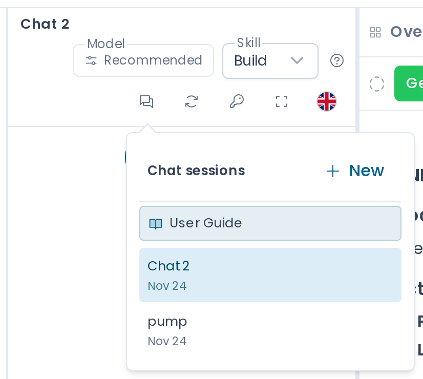
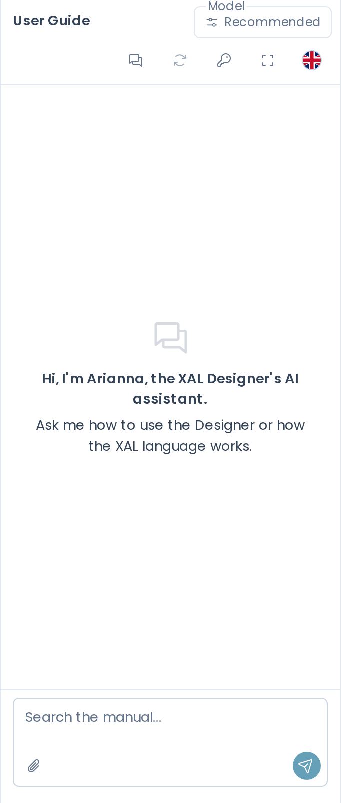
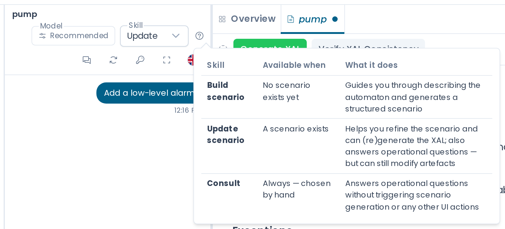
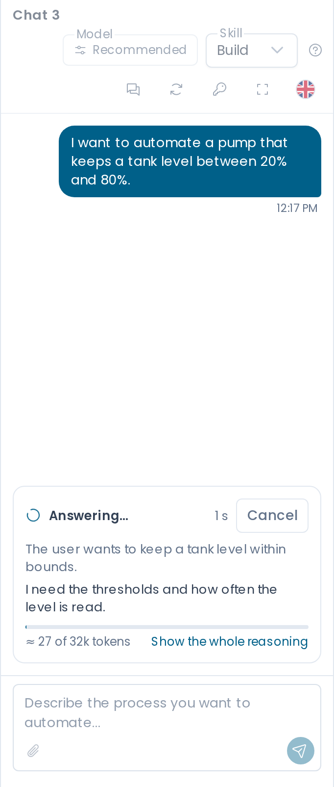

# Chat Sessions

The AI Assistant panel can hold several chat sessions. Each session keeps its own messages; a session linked to a file also keeps its scenario and XAL. This page covers the sessions panel, the User Guide, the skills, and what you see while Arianna works.

---

## The sessions panel

Click the **Chat sessions** icon in the chat header to open the sessions panel. The **User Guide** is always first. Your sessions follow, the most recent first, each with the date of its last activity.

/// caption
Fig.1 - The Chat sessions panel
///

Click a session to switch to it. If the session has a scenario, its scenario tab opens in the editor.

The panel lists only the sessions of the repository and branch you are connected to (see [Where your sessions are kept](#where-your-sessions-are-kept)).

---

## Managing sessions

### Creating a session
There are two kinds of session:

- **File session**: linked to an XAL file. Right-click a `.xal` or `.scenario.md` file in the **Repository Explorer** and select **New chat**. There is one session per file: once you have written in it, the menu item becomes **Open chat** and takes you back to it. The session takes the name of the file.
- **Free session**: not linked to any file. Click **New** in the sessions panel. If you have no sessions yet, click the **New chat** icon (**+**) in the chat header. The session is named *Chat 1*, *Chat 2*, and so on.

**New** is disabled when the active session is already a new, empty one.

### Resetting a session
Click the **Reset history** icon (the circular arrows) in the chat header. The messages are cleared; the linked file, the scenario and the scenario tab stay as they are. The icon is disabled when the session has no messages.

Use this to free up context when the conversation has become long but the scenario is still good.

!!! warning
    There is no confirmation: the messages are cleared at once.

### Deleting a session
In the sessions panel, move the mouse over a session and click the **trash icon**. The session and its messages are removed at once, with no confirmation. The `.scenario.md` and `.xal` files in the repository are not affected.

### Unsent messages
Each session keeps its own unsent text and attachments. If you start writing in a session and switch to another one, you find your draft again when you come back. Drafts are lost when you reload the page.

---

## Where your sessions are kept

Sessions are saved in your browser:

- **Repository and branch**: a session belongs to the repository and branch you were connected to when you created it. When you switch branch, the panel shows the sessions of the new branch. The others come back when you return.
- **Files you created**: the session of a file you created and haven't committed yet follows the file when you switch branch and keep your files.
- **API key**: when you change the API key, your sessions are kept (see [Setup](setup.md#removing-the-key)).
- **Deleted files**: if you delete a file, its session stays, without that file's scenario or XAL.
- **Old sessions**: sessions not used for 60 days are deleted when the Designer starts.

---

## User Guide

The **User Guide** is a session that is always there, pinned at the top of the sessions panel with a book icon. Ask it how to use the Designer or how the XAL language works: Arianna answers from this manual.

/// caption
Fig.2 - The User Guide session
///

The User Guide is not linked to any file, has no **Skill** selector and can't be deleted. Use it to look something up without interrupting your work, then switch back to your session.

---

## Skills

Each session, except the User Guide, has a **Skill** selector in the chat header. A skill sets what Arianna can do in the session.

| Skill | Available when | What Arianna does |
|---|---|---|
| **Build** | No scenario exists yet | Guides you through describing the automaton and generates a structured scenario |
| **Update** | A scenario exists | Helps you refine the scenario and can (re)generate the XAL; also answers operational questions, but can still modify artefacts |
| **Consult** | Always — chosen by hand | Answers questions about the scenario and the XAL without changing them or starting any other action |

Arianna selects **Build** or **Update** for you, depending on whether the session has a scenario. The other one is disabled. Select **Consult** when you only want to ask questions.

Click the **?** icon next to the selector to open the skill legend.

/// caption
Fig.3 - The skill legend
///

When you change skill by hand, Arianna writes a short message in the chat that says what the new skill does.

!!! info
    Switching skill does not lose the conversation history. The next message you send will simply use the new skill's instructions.

---

## While Arianna works

While Arianna answers or runs an operation, such as Generate XAL, a **progress card** appears at the bottom of the chat. It shows:

- the operation in progress, for example *Answering...*, and the time elapsed;
- the last lines of Arianna's reasoning: the bottom one is what Arianna is working on now;
- a bar with the tokens used so far;
- **Show the whole reasoning**, to read the reasoning in full.

/// caption
Fig.4 - The progress card while Arianna answers
///

Arianna runs one operation at a time: while it works, the chat header and the input box are locked.

To stop Arianna, click **Cancel** on the card. The chat shows *Stopped.* What Arianna had already saved stays: for example, a scenario saved before you clicked **Cancel**.

When the operation ends, the card disappears and a line *Reasoning · duration · tokens* stays in the chat. Click it to read the reasoning again.

!!! note
    The texts inside the chat, such as **Cancel** or **Update scenario from report**, follow Arianna's [language](setup.md#language). This manual shows them in English.

---

## Guided flows

Several actions in Arianna trigger **guided flows** — sequences of steps that Arianna carries out automatically or prompts you to carry out, without requiring you to navigate the interface manually.

### Post-generation flow (Generate scenario from XAL)

After generating a scenario from an existing XAL, Arianna sends a prompt in the chat inviting you to verify consistency, with an inline **Verify Scenario Consistency** button. After the check, a second message sets the working direction for the session (see [Generate Scenario from XAL](scenario_from_xal.md)).

### Update scenario from report

After every consistency check, Arianna adds a message with the **Update scenario from report** button. Click it and Arianna updates the scenario to fix what the report lists; the XAL is not changed. Only the button of the latest report works.

The button is disabled in **Consult**: switch the skill to **Build** or **Update** to use it.

### Post-sync prompt

After **Sync Scenario** completes, Arianna sends a short message in the chat suggesting a consistency check, with an inline **Verify Scenario Consistency** button — a reminder that syncing updates the scenario to match the XAL, but does not guarantee that no details were lost.

### Automatic retry on XAL validation failure

When **Generate XAL** or **Update XAL** produces an invalid XAL, Arianna retries automatically, up to three attempts in all, and tells Claude the errors found so far on each attempt. The progress card shows the current attempt, for example *Fixing validation errors (attempt 2/3)...*.

If all three attempts fail, a message in the chat provides:

- the validation errors in plain text, so you can understand what went wrong
- a **Download XAL** button for the last generated file — often nearly correct — when there is one
- a **Download .dot** button, if you want to correct the GraphViz source manually

### Inline action buttons

In some chat messages — particularly those generated by guided flows — Arianna includes **inline action buttons** directly in the message. These trigger the corresponding Designer action (such as **Verify Scenario Consistency**) without requiring you to find the button in the scenario tab. Clicking the inline button has exactly the same effect as clicking the button in the UI.
