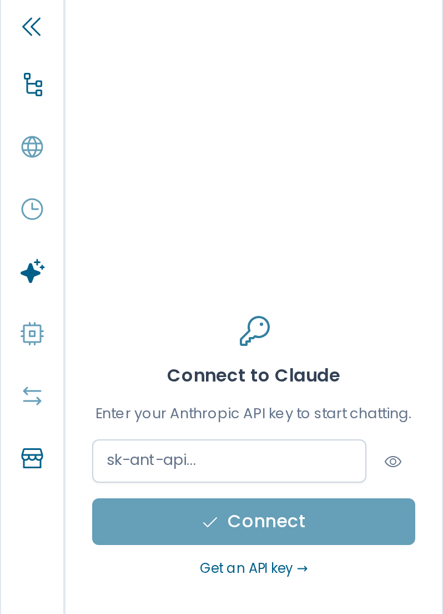
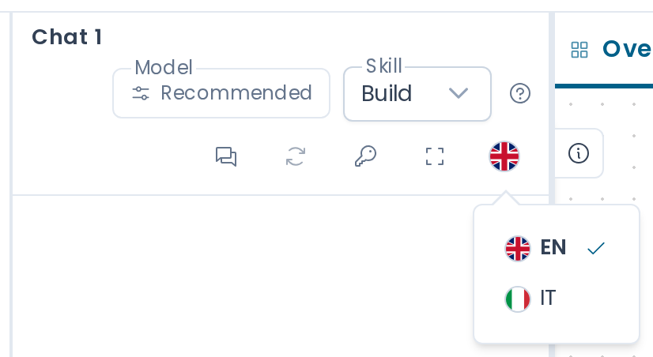
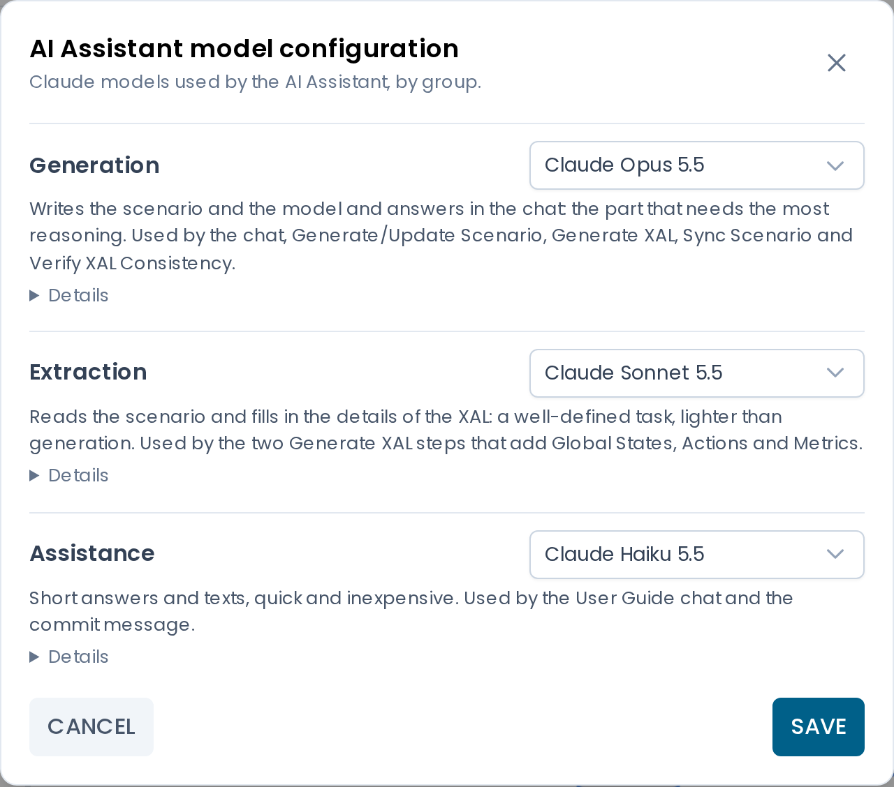

# Configurazione

Arianna richiede una API key di Anthropic per funzionare. La chiave viene salvata localmente nel tuo browser e non viene mai inviata ai server di Xautomata — viene usata esclusivamente per le chiamate dirette all'API di Claude.

Questa pagina descrive anche le due preferenze della chat: la lingua delle risposte e i modelli di Claude.

---

## Inserire la chiave

Clicca sull'icona **AI Assistant** (la scintilla) nella barra laterale sinistra per aprire il pannello AI Assistant. Se non è configurata nessuna chiave, compare la schermata **Connect to Claude**.

Incolla la tua API key di Anthropic e clicca **Connect**. Clicca sull'**icona a forma di occhio** accanto al campo per mostrare o nascondere la chiave. La chiave viene validata immediatamente; se non è valida o non ha i permessi necessari, sotto il campo compare un messaggio di errore.

Se non hai ancora una chiave, clicca **Get an API key →** per aprire la console di Anthropic.

/// caption
Fig.1 - La schermata Connect to Claude
///

---

## Rimuovere la chiave

Per cancellare la chiave salvata — ad esempio prima di lasciare un computer condiviso — apri il pannello AI Assistant e clicca sull'**icona a forma di chiave** (Change API key) nell'intestazione della chat. Arianna si disconnette e compare di nuovo la schermata **Connect to Claude**.

Le sessioni chat restano: quando inserisci di nuovo una chiave, le ritrovi come le avevi lasciate.

---

!!! warning "Sicurezza della chiave"
    La tua API key è salvata nel local storage del browser. Non usare Arianna su un computer condiviso o pubblico senza rimuovere la chiave al termine della sessione.

---

## Lingua

La lingua di risposta di Arianna è una preferenza globale che si applica a tutte le sessioni chat. Controlla sia la lingua con cui Claude risponde, sia i testi dell'interfaccia all'interno del pannello chat (placeholder, messaggi di stato vuoto e call-to-action).

Per cambiare la lingua, clicca sull'**icona della bandiera** nell'intestazione della chat. Si apre un piccolo popover con le opzioni disponibili — attualmente **EN** (inglese, predefinito) e **IT** (italiano). La lingua attiva ha un segno di spunta. Seleziona quella desiderata per applicarla immediatamente; la preferenza viene salvata in un cookie del browser e persiste tra le sessioni.

/// caption
Fig.2 - Il popover della lingua
///

!!! note
    L'impostazione della lingua è indipendente dalla lingua in cui scrivi. Anche se scrivi in inglese, Claude risponderà nella lingua impostata qui — e viceversa.

---

## Modelli

Arianna usa tre modelli di Claude, uno per ogni gruppo di attività:

| Gruppo | Cosa fa |
|---|---|
| **Generation** | Scrive lo scenario e l'XAL e risponde in chat. Lo usano la chat, Generate/Update Scenario, Generate XAL, Sync Scenario e Verify XAL Consistency. |
| **Extraction** | Legge lo scenario e completa i dettagli dell'XAL (Global State, Action e Metric) durante Generate XAL. |
| **Assistance** | Risposte e testi brevi: la chat User Guide e il messaggio di commit. |

Il pulsante **Model** nell'intestazione della chat mostra la configurazione attiva:

- **Recommended** (consigliata): i modelli provati da Xautomata. È quella predefinita.
- **Custom** (personalizzata): hai cambiato almeno un modello. Il pulsante diventa arancione, con il tooltip *Untested model configuration*.

Il pulsante compare quando è aperta una sessione chat (vedi Fig.2).

Per cambiare i modelli, clicca il pulsante **Model**. Si apre il dialog **AI Assistant model configuration**:

1. Per ogni gruppo, scegli un modello dall'elenco. L'elenco mostra i modelli che la tua API key può usare.
2. Clicca **Details** sotto un gruppo per vedere le impostazioni di ragionamento (*reasoning*) e di impegno (*effort*). Sono in sola lettura.
3. Clicca **Save**. Per tornare ai modelli consigliati, clicca **Restore default** (compare solo con una configurazione personalizzata), poi **Save**.

/// caption
Fig.3 - Il dialog AI Assistant model configuration
///

!!! warning "Configurazione non provata"
    Con una configurazione personalizzata il dialog mostra un avviso: il risultato può essere diverso da quello della configurazione consigliata. Succede lo stesso se la tua API key non può usare un modello consigliato: Arianna usa un altro modello al suo posto, e il dialog ti dice quale.

Come la lingua, la configurazione dei modelli viene salvata in un cookie del browser e vale per tutte le sessioni chat.
