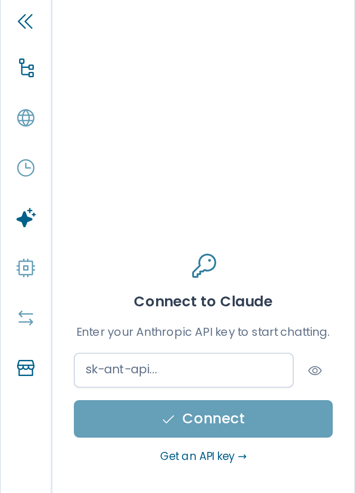
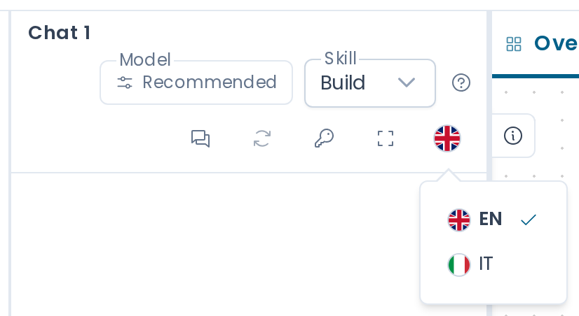
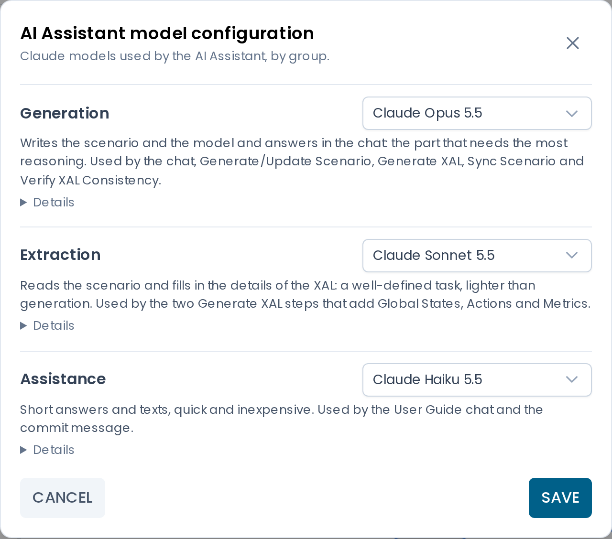

# Setup

Arianna requires an Anthropic API key to function. The key is stored locally in your browser and never sent to Xautomata's servers — it is used exclusively for direct calls to the Claude API.

This page also covers the two preferences of the chat: the response language and the Claude models.

---

## Entering the key

Click the **AI Assistant** icon (the sparkle) in the left sidebar to open the AI Assistant panel. If no key is configured, the **Connect to Claude** screen appears.

Paste your Anthropic API key and click **Connect**. Click the **eye icon** next to the field to show or hide the key. The key is validated immediately; if it is invalid or has insufficient permissions, an error message is shown under the field.

If you don't have a key yet, click **Get an API key →** to open the Anthropic console.

/// caption
Fig.1 - The Connect to Claude screen
///

---

## Removing the key

To clear the stored key — for example, when logging out of a shared machine — open the AI Assistant panel and click the **key icon** (Change API key) in the chat header. Arianna disconnects and the **Connect to Claude** screen appears again.

Your chat sessions are kept: when you enter a key again, you find them as you left them.

---

!!! warning "Key security"
    Your API key is stored in your browser's local storage. Do not use Arianna on a shared or public computer without removing the key when you are done.

---

## Language

Arianna's response language is a global preference that applies to all chat sessions. It controls both the language Claude responds in and the UI text inside the chat panel (placeholders, empty-state labels, and call-to-action messages).

To change the language, click the **flag icon** in the chat header. A small popover appears with the available options — currently **EN** (English, default) and **IT** (Italian). The active language has a check mark. Select one to apply it immediately; the preference is saved in a browser cookie and persists across sessions.

/// caption
Fig.2 - The language popover
///

!!! note
    The language setting is independent of the language you type in. Even if you write in Italian, Claude will respond in the language set here — and vice versa.

---

## Models

Arianna uses three Claude models, one for each group of tasks:

| Group | What it does |
|---|---|
| **Generation** | Writes the scenario and the XAL and answers in the chat. Used by the chat, Generate/Update Scenario, Generate XAL, Sync Scenario and Verify XAL Consistency. |
| **Extraction** | Reads the scenario and fills in the details of the XAL (Global States, Actions and Metrics) during Generate XAL. |
| **Assistance** | Short answers and texts: the User Guide chat and the commit message. |

The **Model** button in the chat header shows the active configuration:

- **Recommended**: the models tested by Xautomata. This is the default.
- **Custom**: you changed at least one model. The button turns orange, with the tooltip *Untested model configuration*.

The button appears once a chat session is open (see Fig.2).

To change the models, click the **Model** button. The **AI Assistant model configuration** dialog opens:

1. For each group, select a model from the list. The list shows the models your API key can use.
2. Click **Details** under a group to see its reasoning and effort settings. These are read-only.
3. Click **Save**. To go back to the recommended models, click **Restore default** (shown only for a custom configuration), then **Save**.

/// caption
Fig.3 - The AI Assistant model configuration dialog
///

!!! warning "Untested configuration"
    With a custom configuration the dialog shows a warning: the output may differ from the recommended one. The same happens if your API key can't use a recommended model: Arianna uses another model instead, and the dialog tells you which one.

Like the language, the model configuration is saved in a browser cookie and applies to all chat sessions.
