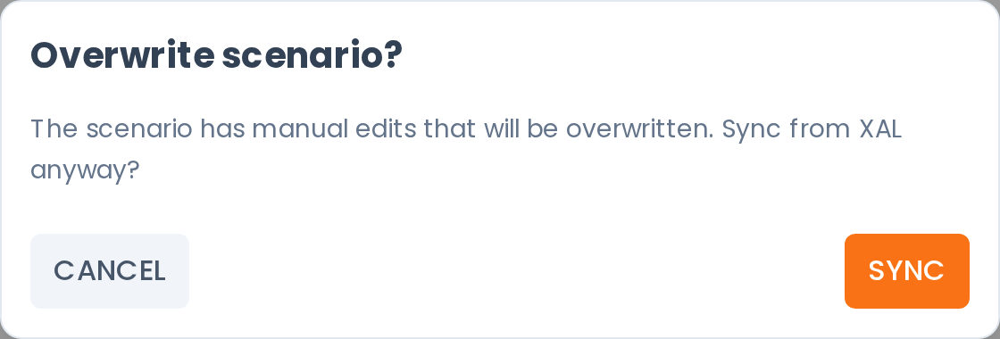
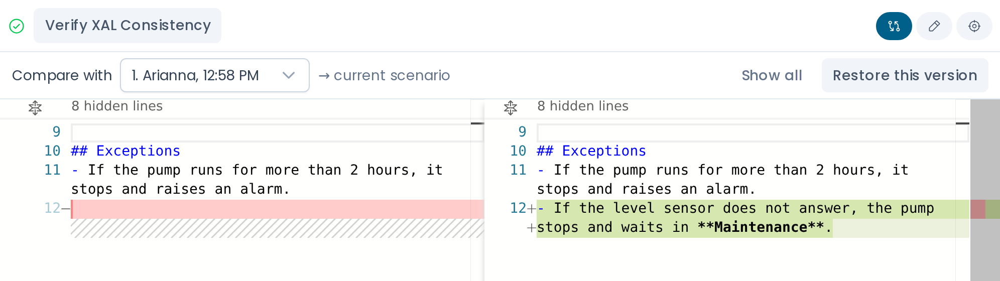

# Sincronizzare lo scenario

Quando modifichi un automa direttamente nel Designer — aggiungendo stati, cambiando transizioni o aggiustando parametri — l'XAL cambia ma lo scenario no. Usa **Sync Scenario** per aggiornare lo scenario in modo che rifletta lo stato corrente dell'XAL.

---

## Quando usarla

Sync Scenario è utile quando:

- hai affinato il grafo dell'automa manualmente dopo una generazione e vuoi che lo scenario rimanga una descrizione accurata
- vuoi mantenere i due artefatti allineati prima di committare

!!! note "Generare uno scenario per un file che non ne ha"
    Se hai un file XAL senza uno scenario associato, usa [Generare uno scenario dall'XAL](scenario_from_xal.md): Sync Scenario aggiorna uno scenario che esiste già.

---

## Quando compare Sync Scenario

Il pulsante **Sync Scenario** compare nella toolbar del tab scenario solo quando l'XAL è stato modificato a mano dopo la sua ultima generazione:

- **È cambiato solo l'XAL**: Sync Scenario è l'unica azione. Cliccalo e il sync parte.
- **Sono cambiati sia l'XAL sia lo scenario**: la toolbar ha una cornice gialla e un'icona di avviso, con **Update XAL** accanto a **Sync Scenario**. Un sync sovrascriverebbe le modifiche fatte allo scenario, quindi prima chiede conferma. Clicca **Sync** per proseguire, oppure **Cancel**.

/// caption
Fig.1 - La conferma quando sono cambiati entrambi i file
///

Quando scenario e XAL sono allineati, il pulsante non c'è.

---

## Eseguire il sync

Arianna legge l'XAL attuale e aggiorna solo le parti dello scenario che corrispondono a ciò che è cambiato: non riscrive tutto il documento. Mentre lavora, il tab scenario mostra un indicatore di caricamento e in chat compare la [progress card](sessions.md#mentre-arianna-lavora). Se clicchi **Cancel**, non cambia niente.

La precisione dell'aggiornamento dipende da ciò che è disponibile:

| Situazione | Cosa riceve Arianna | Risultato |
|---|---|---|
| La sessione conosce l'XAL dell'ultima generazione o dell'ultimo sync | Lo scenario e le modifiche fatte all'XAL da allora | Aggiornamento mirato: cambiano solo le sezioni dello scenario interessate |
| La sessione non lo conosce, per esempio un XAL generato in un altro browser | Lo scenario e tutto l'XAL | Aggiornamento completo: Arianna usa lo scenario esistente come riferimento di stile e struttura |

---

## Dopo la sincronizzazione

Il file `.scenario.md` viene sovrascritto e il tab scenario si apre sulle modifiche: a sinistra la versione precedente, a destra quella nuova. Clicca l'icona del diff (**Hide changes**) in alto a destra per tornare allo scenario formattato.

/// caption
Fig.2 - Il tab scenario dopo un sync, aperto sulle modifiche
///

In chat, Arianna conferma dove ha salvato lo scenario e consiglia una verifica di consistenza, con più insistenza dopo un aggiornamento completo. Eseguila con **Verify XAL Consistency** nel tab scenario: il sync potrebbe aver perso qualche dettaglio (vedi [Verificare la consistenza](verify_consistency.md)).

!!! info "L'XAL è la fonte di verità durante un sync"
    Sync Scenario porta sempre lo scenario verso l'XAL, mai il contrario. Se vuoi aggiornare l'XAL in base a uno scenario modificato, usa invece [Update XAL](updating_xal.md).
