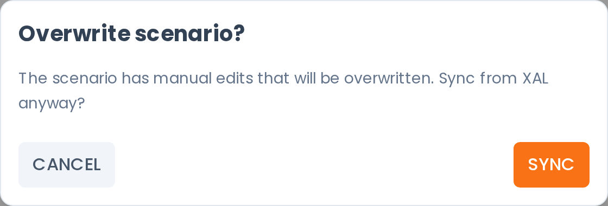
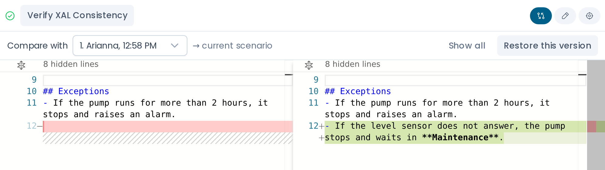

# Syncing the Scenario

When you edit an automaton directly in the Designer — adding states, changing transitions, or adjusting parameters — the XAL changes but the scenario does not. Use **Sync Scenario** to update the scenario to reflect the current state of the XAL.

---

## When to use it

Sync Scenario is useful when:

- you have refined the automaton graph manually after a generation and want the scenario to remain an accurate description
- you want to keep the two artefacts aligned before committing

!!! note "Generating a scenario for a file that has none"
    If you have an XAL file with no associated scenario, use [Generate Scenario from XAL](scenario_from_xal.md) instead: Sync Scenario updates an existing scenario.

---

## When Sync Scenario appears

The **Sync Scenario** button appears in the toolbar of the scenario tab only when the XAL was edited by hand after its last generation:

- **Only the XAL changed**: Sync Scenario is the only action. Click it and the sync starts.
- **Both the XAL and the scenario changed**: the toolbar has a yellow frame and a warning icon, with **Update XAL** next to **Sync Scenario**. A sync would overwrite the changes made to the scenario, so it asks for confirmation first. Click **Sync** to go on, or **Cancel**.

/// caption
Fig.1 - The confirmation when both files changed
///

When the scenario and the XAL are aligned, the button is not shown.

---

## Running the sync

Arianna reads the current XAL and updates only the parts of the scenario that correspond to what changed: it does not rewrite the whole document. While she works, the scenario tab shows a spinner and the [progress card](sessions.md#while-arianna-works) appears in the chat. If you click **Cancel**, nothing is changed.

The precision of the update depends on what is available:

| Situation | What Arianna receives | Result |
|---|---|---|
| The session knows the XAL of the last generation or sync | The scenario and the changes made to the XAL since then | Targeted update: only the affected sections of the scenario change |
| The session does not know it, for example an XAL generated in another browser | The scenario and the whole XAL | Full update: Arianna uses the existing scenario as a reference for style and structure |

---

## After syncing

The `.scenario.md` file is overwritten and the scenario tab opens on the changes: on the left the previous version, on the right the new one. Click the diff icon (**Hide changes**) at the top right to go back to the rendered scenario.

/// caption
Fig.2 - The scenario tab after a sync, open on the changes
///

In the chat, Arianna confirms where she saved the scenario and recommends a consistency check, more strongly after a full update. Run it with **Verify XAL Consistency** in the scenario tab: the sync could have missed some details (see [Verifying Consistency](verify_consistency.md)).

!!! info "The XAL is the source of truth during a sync"
    Sync Scenario always moves the scenario towards the XAL, never the other way. If you want to update the XAL to match a changed scenario, use [Update XAL](updating_xal.md) instead.
