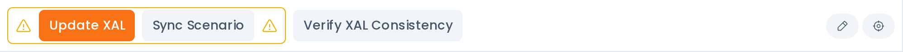

# Aggiornare l'XAL

Quando lo scenario cambia dopo che l'XAL è già stato generato, usa **Update XAL** per portare le modifiche nel file esistente senza rigenerarlo da zero. Le modifiche che hai fatto a mano sull'XAL vengono mantenute.

---

## Quando compare Update XAL

La toolbar del tab scenario mostra solo le azioni che si possono fare. La prima icona è il badge di stato: passaci sopra con il mouse per leggere lo stato.

| Situazione | Badge | Toolbar |
|---|---|---|
| Nessun XAL, oppure un XAL caricato e mai generato da Arianna | Cerchio grigio | **Generate XAL** (verde): vedi [Generare l'XAL](generating_xal.md) |
| Scenario e XAL allineati | Spunta verde, *Up to date* | Nessun pulsante di generazione |
| Lo scenario è cambiato dall'ultima generazione | Freccia blu | **Update XAL** (arancione) |
| L'XAL è stato modificato a mano, lo scenario no | Matita arancione | Solo **Sync Scenario**: vedi [Sincronizzare lo scenario](syncing_scenario.md) |
| Sono cambiati entrambi | Avviso giallo | **Update XAL** (arancione) e **Sync Scenario**, in una cornice gialla con un'icona di avviso |

/// caption
Fig.1 - Scenario e XAL cambiati entrambi: Update XAL e Sync Scenario nella cornice gialla
///

Quando sono cambiati entrambi i file, ogni azione sovrascrive le modifiche dell'altro file: **Update XAL** riscrive l'XAL a partire dallo scenario, **Sync Scenario** riscrive lo scenario a partire dall'XAL. Update XAL parte subito, senza conferma, e mantiene le modifiche fatte a mano che riesce a riportare (vedi sotto).

---

## Cosa cambia rispetto a Generate XAL

Quando genera per la prima volta, Arianna costruisce il grafo dell'automa da zero. In fase di aggiornamento, riceve il **grafo esistente** insieme al nuovo scenario e produce solo le modifiche necessarie — preservando stati, transizioni e identificatori di nodo invariati.

Questo approccio chirurgico evita ristrutturazioni non necessarie di un automa che potrebbe essere già parzialmente o completamente corretto.

Il contesto che Arianna riceve dipende da ciò che è disponibile nella sessione corrente:

| Disponibile | Contesto passato ad Arianna |
|---|---|
| File `.dot` di una generazione precedente | Nuovo scenario + `.dot` esistente (preferito — massimo contesto strutturale) |
| Nessun `.dot`, ma XAL presente | Nuovo scenario + XAL esistente (usato come riferimento strutturale) |

Il file `.dot` viene conservato internamente dalla sessione dopo ogni generazione. Non è visibile nel repository explorer, ma viene usato automaticamente da **Update XAL** quando disponibile.

Il resto funziona come in una generazione: gli stessi [passi e la progress card](generating_xal.md#i-passi), il file bloccato fino alla fine, **Cancel** per fermare.

---

## Modifiche fatte a mano

Se hai modificato l'XAL nel Designer dopo l'ultima generazione, **Update XAL** riporta le tue modifiche nel nuovo XAL. Di solito sono i valori che Arianna lascia da completare a te, per esempio:

- gli input degli automi che un automa crea;
- i sistemi che una funzione chiama (nome, classe e percorso), e i suoi input e output;
- il testo delle query;
- i tipi e i valori delle variabili Global State.

Vengono riportate anche le Functions e le variabili Global State che hai aggiunto o tolto a mano.

Alcune modifiche non vengono riportate:

- stati, transizioni e automi aggiunti o tolti a mano: la struttura dell'automa viene dallo scenario, quindi descrivili nello scenario;
- le modifiche su un elemento che l'aggiornamento ha tolto;
- le modifiche su un valore che l'aggiornamento ha cambiato a sua volta;
- le modifiche che farebbero riferimento a una funzione o a una variabile Global State che non esiste più;
- tutte le modifiche, se insieme renderebbero l'XAL non valido.

Dopo l'aggiornamento la chat elenca le modifiche riportate e quelle no, ognuna con il motivo. Rifai nel Designer quelle che ti servono ancora.

---

## Dopo l'aggiornamento

Il file XAL viene sovrascritto con la nuova versione e ricaricato nel grafo. Il badge di stato torna a indicare *Up to date*. La chat mostra gli stessi avvisi che compaiono dopo una [generazione](generating_xal.md#dopo-la-generazione).

Se l'aggiornamento introduce errori di validazione, si applicano lo stesso [retry automatico e il fallback con download](generating_xal.md#se-tutti-i-tentativi-falliscono) previsti per una generazione iniziale.
