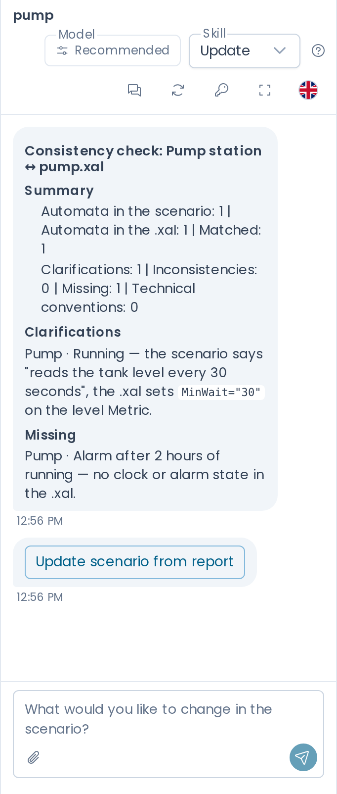

# Verificare la consistenza

**Verify XAL Consistency** confronta lo scenario con il file XAL: Arianna controlla che ogni elemento descritto nello scenario abbia un costrutto corrispondente nell'XAL e segnala le differenze.

---

## Quando usarla

Esegui una verifica di consistenza:

- dopo aver generato uno scenario da un XAL esistente, per individuare eventuali errori di interpretazione nella generazione inversa
- dopo aver sincronizzato lo scenario, per confermare che l'aggiornamento abbia catturato tutte le modifiche
- prima di committare, come validazione finale che i due artefatti siano concordi

---

## Avviare la verifica

Clicca **Verify XAL Consistency** nella toolbar del tab scenario. Il pulsante c'è quando esistono sia lo scenario sia l'XAL. Mentre Arianna lavora, la [progress card](sessions.md#mentre-arianna-lavora) mostra *Verifying consistency...*; clicca **Cancel** per fermare la verifica.

Il report arriva come messaggio in chat. Poi il pulsante sparisce dalla toolbar: il report resta valido finché né lo scenario né l'XAL cambiano. Quando uno dei due cambia, il pulsante ricompare.

/// caption
Fig.1 - Il report e il pulsante Update scenario from report
///

---

## Cosa contiene il report

Per ogni automa, Arianna confronta lo scenario con l'XAL: gli stati (iniziale e finali), le transizioni, le query verso altri automi, i clock e i loro reset, i Global State. Segnala anche i difetti strutturali dell'XAL, per esempio uno stato finale che un altro automa interroga ma non potrà mai vedere.

Ogni differenza ricade in una di queste categorie:

| Categoria | Significato |
|---|---|
| **Precisazioni** | L'XAL risolve qualcosa che lo scenario lasciava aperto, per esempio un controllo "ogni 30 secondi" scritto come tempo di attesa. Non è un problema: ti dice come è stata risolta l'ambiguità. |
| **Inconsistenze** | Qualcosa nell'XAL che non corrisponde a nessuna lettura ragionevole dello scenario, o che non può funzionare. Sono problemi. |
| **Mancanze** | Qualcosa che lo scenario descrive e che nell'XAL non ha corrispondenza, spesso tolto mentre si rifiniva l'automa nel Designer. |
| **Convenzioni tecniche** | Parametri standard mancanti dove un automa ne crea un altro. |

Una categoria senza voci non compare nel report.

La verifica non controlla la sintassi dell'XAL, già validata quando l'XAL viene generato, né gli altri file XAL che l'automa richiama.

---

## Agire sul report

Per ogni voce, decidi quale dei due file è giusto:

- **L'XAL è giusto, lo scenario deve cambiare**: clicca **Update scenario from report** sotto il report. Arianna aggiorna lo scenario per correggere quello che il report elenca; l'XAL non cambia. Se l'XAL è stato modificato a mano, puoi usare anche [Sync Scenario](syncing_scenario.md).
- **Lo scenario è giusto, l'XAL deve cambiare**: modifica l'automa nel Designer, oppure descrivi la modifica ad Arianna e poi usa [Update XAL](updating_xal.md).

**Update scenario from report** funziona solo sull'ultimo report, e solo finché lo scenario è quello verificato. Con la skill **Consult** è disattivato: passa a **Build** o **Update** per usarlo.
