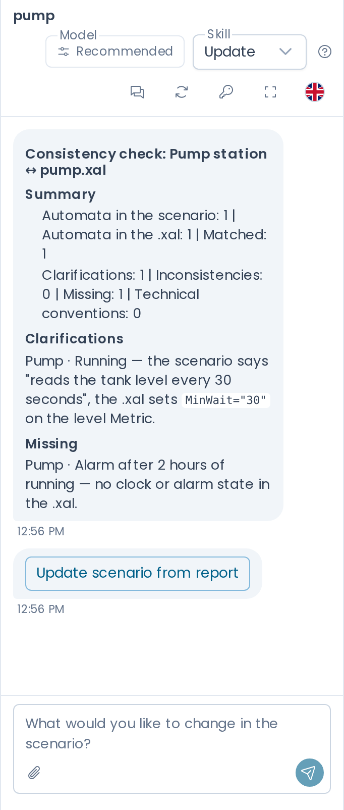

# Verifying Consistency

**Verify XAL Consistency** compares the scenario with the XAL file: Arianna checks that every element described in the scenario has a matching construct in the XAL, and reports the differences.

---

## When to use it

Run a consistency check:

- after generating a scenario from an existing XAL, to catch any misinterpretations in the reverse generation
- after syncing the scenario, to confirm that the update captured all the changes
- before committing, as a final validation that the two artefacts agree

---

## Running the check

Click **Verify XAL Consistency** in the toolbar of the scenario tab. The button is there when the scenario and the XAL both exist. While Arianna works, the [progress card](sessions.md#while-arianna-works) shows *Verifying consistency...*; click **Cancel** to stop the check.

The report arrives as a message in the chat. Then the button disappears from the toolbar: the report is still valid while neither the scenario nor the XAL changes. When one of them changes, the button comes back.

/// caption
Fig.1 - The report and the Update scenario from report button
///

---

## What the report contains

For each automaton, Arianna compares the scenario with the XAL: the states (initial and final), the transitions, the queries to other automata, the clocks and their resets, and the Global States. It also reports structural defects of the XAL, such as a final state that another automaton queries but can never see.

Each difference falls into one of these categories:

| Category | Meaning |
|---|---|
| **Clarifications** | The XAL resolves something the scenario left open, for example a check "every 30 seconds" written as a wait time. Not a problem: it tells you how the ambiguity was resolved. |
| **Inconsistencies** | Something in the XAL that matches no reasonable reading of the scenario, or that cannot work. These are problems. |
| **Missing** | Something the scenario describes that has no match in the XAL, often left out while refining the automaton in the Designer. |
| **Technical conventions** | Standard parameters missing where an automaton creates another one. |

A category with no items is left out of the report.

The check does not cover the XAL syntax, which is validated when the XAL is generated, nor other XAL files that the automaton calls.

---

## Acting on the report

Decide which of the two files is right for each item:

- **The XAL is right, the scenario must change**: click **Update scenario from report** under the report. Arianna updates the scenario to fix what the report lists; the XAL is not changed. You can also use [Sync Scenario](syncing_scenario.md) when the XAL was edited by hand.
- **The scenario is right, the XAL must change**: edit the automaton in the Designer, or describe the change to Arianna and then use [Update XAL](updating_xal.md).

**Update scenario from report** works only on the latest report, and only while the scenario is the one that was checked. It is disabled in the **Consult** skill: switch to **Build** or **Update** to use it.
