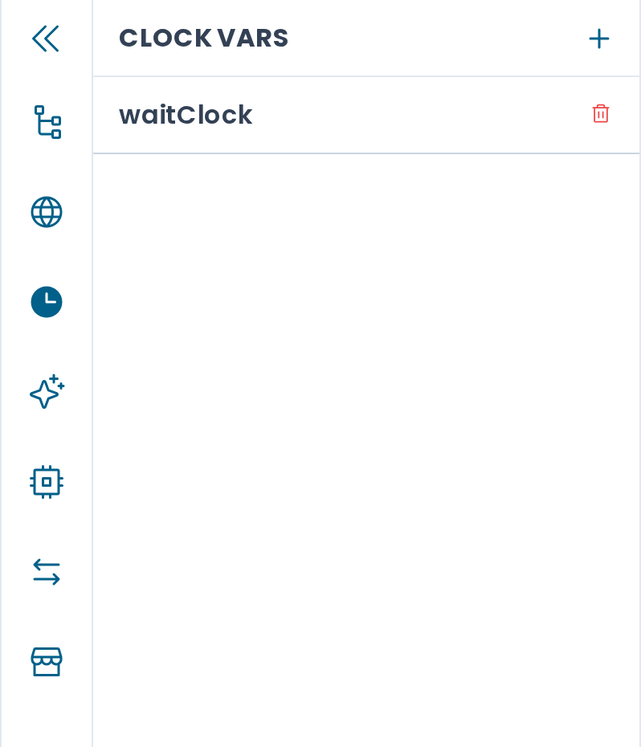

# Variabili Clock

Le variabili Clock sono identificatori di timer utilizzati nelle transizioni per misurare il tempo trascorso e applicare condizioni basate sul tempo.

Per visualizzare e gestire le variabili Clock, fai clic su **Clock Vars** (icona dell'orologio) nella barra laterale sinistra. Il pannello mostra tutti i Clock definiti per l'automa attivo. È attivo solo quando un automa è aperto.

/// caption
Fig.1 - Il pannello Clock Vars
///

---

## Aggiungere un Clock

1. Fai clic su **+** in alto a destra nel pannello. Compare una nuova riga con il campo del nome già aperto.
2. Scrivi il nome e premi **Invio**.

Un Clock ha solo un **nome**, che si usa nei vincoli Clock e nei reset Clock sulle transizioni. A differenza delle variabili di stato globale, i Clock non hanno tipo, valore né stella — sono puramente contatori di tempo.

Il nome segue le stesse regole delle variabili di stato globale: solo lettere, cifre e `_`, senza iniziare con una cifra, e due Clock dello stesso automa non possono avere lo stesso nome. Se il nome non è valido, sotto il campo compare un messaggio in rosso.

Per rinominare un Clock, fai clic sul suo nome. Se svuoti il nome, il Clock viene eliminato.

Ogni modifica si salva da sola e si può annullare con **Ctrl+Z**, come nel pannello [Global States](global_state.md#modificare-una-variabile).

---

## Eliminare un Clock

Fai clic sull'**icona del cestino** nella riga del Clock per rimuoverlo.

!!! warning
    Il designer non controlla se il Clock è ancora usato: lo elimina anche quando una transizione lo cita in un vincolo Clock o in un reset Clock. Togli prima il Clock da quelle transizioni. Per l'interprete un vincolo Clock che cita un Clock inesistente non è valido.

---

## Usare i Clock nelle transizioni

Una volta definito un Clock, diventa disponibile nella sezione **Clocks** del pannello di configurazione della transizione:

- **Vincolo Clock** (*clock constraint*) — una condizione come `waitClock >= 5 min` che deve valere perché la transizione scatti
- **Clock Reset Variables** — i Clock da far ripartire da zero quando la transizione scatta

I passi sono in [Metric Value e Clock](../transitions/metric_clocks.md#vincoli-clock). Per una spiegazione completa di come i Clock guidano la logica basata sul tempo, vedi [Clocks and Time](../../concepts/clocks.md).
