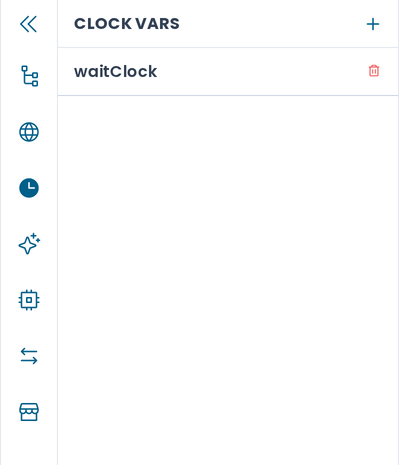

# Clock Variables

Clock variables are timer identifiers used in transitions to measure elapsed time and enforce time-based conditions.

To view and manage clock variables, click **Clock Vars** (clock icon) in the left sidebar. The panel shows all clocks defined for the active automaton. It is active only when an automaton is open.

/// caption
Fig.1 - The Clock Vars panel
///

---

## Adding a clock

1. Click **+** at the top right of the panel. A new row appears with the name field open.
2. Type the name and press **Enter**.

A clock has only a **name**, used in clock constraints and clock resets on transitions. Unlike global state variables, clocks have no type, value or star — they are purely time counters.

The name follows the same rules as global state variables: only letters, digits and `_`, not starting with a digit, and no two clocks of the same automaton with the same name. If the name is not valid, a red message appears under the field.

To rename a clock, click its name. If you clear the name, the clock is deleted.

Every change is saved automatically and can be undone with **Ctrl+Z**, as in the [Global States](global_state.md#editing-a-variable) panel.

---

## Deleting a clock

Click the **trash icon** on the clock's row to remove it.

!!! warning
    The designer does not check whether the clock is still used: it deletes it even when a transition refers to it in a clock constraint or a clock reset. Remove the clock from those transitions first. A clock constraint that names a clock that does not exist is invalid for the interpreter.

---

## Using clocks in transitions

Once a clock is defined, it becomes available in the **Clocks** section of the transition configuration panel:

- **Clock constraint** — a condition such as `waitClock >= 5 min` that must hold for the transition to fire
- **Clock Reset Variables** — the clocks to restart from zero when the transition fires

See [Metric Value and Clocks](../transitions/metric_clocks.md#clock-constraints) for the steps. For a full explanation of how clocks drive time-based logic, see [Clocks and Time](../../concepts/clocks.md).
