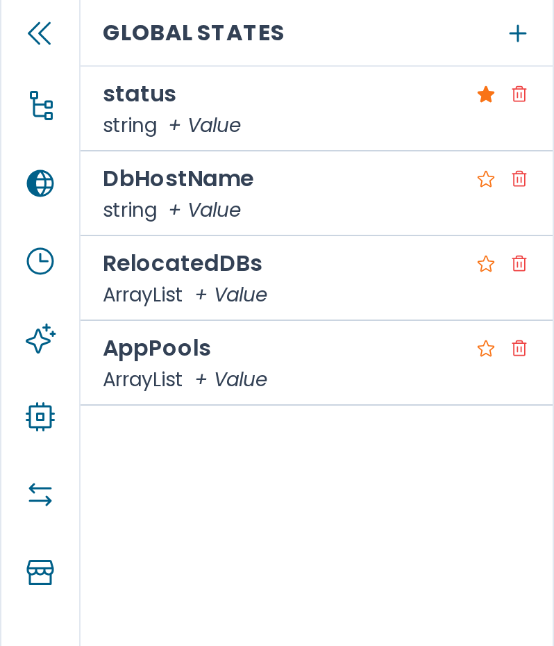

# Variabili di Stato Globale

Le variabili di stato globale memorizzano dati che persistono per l'intero ciclo di vita di un'istanza di automa. Fungono da memoria dell'automa — conservano valori che stati e transizioni possono leggere e scrivere.

Per visualizzare e gestire le variabili di stato globale, fai clic su **Global States** (icona del globo) nella barra laterale sinistra. Il pannello mostra tutte le variabili definite per l'automa attivo. È attivo solo quando un automa è aperto.

/// caption
Fig.1 - Il pannello Global States, con la variabile status contrassegnata dalla stella
///

---

## Aggiungere una variabile

1. Fai clic su **+** in alto a destra nel pannello. Compare una nuova riga con il campo del nome già aperto.
2. Scrivi il nome e premi **Invio**.
3. Fai clic su **+ Type** e **+ Value** per compilare gli altri campi.

Ogni variabile ha:

| Campo | Descrizione |
|---|---|
| **Name** | L'identificatore usato per fare riferimento alla variabile in tutto l'automa. Obbligatorio. |
| **Type** | Il tipo di dato: `string`, `int`, `long`, `bool`, `object`, oppure una collezione come `list[string]` o `map[string, int]`. Facoltativo. |
| **Value** | Il valore iniziale della variabile quando parte un'istanza dell'automa. Facoltativo. |
| **★** | Variabile con la stella (*starred*): l'interprete ne scrive il valore nei messaggi di log sull'istanza, per esempio quando una funzione fallisce. Fai clic sulla stella per attivarla o disattivarla. |

Il nome può contenere solo lettere, cifre e `_`, e non può iniziare con una cifra. Due variabili dello stesso automa non possono avere lo stesso nome. Se il nome non è valido, sotto il campo compare un messaggio in rosso e la variabile non viene salvata finché non lo correggi.

---

## Modificare una variabile

Fai clic su un nome, un tipo o un valore per modificarlo sul posto. Premi **Invio** o fai clic altrove per confermare.

- Se svuoti il tipo o il valore, il campo viene tolto dalla variabile.
- Se svuoti il nome, la variabile viene eliminata.

Per eliminare una variabile, fai clic sull'**icona del cestino** nella sua riga.

Ogni modifica si salva da sola: mentre il pannello la salva, in alto a destra nel canvas compare **Applying changes…**. Puoi annullare e ripetere le modifiche con i pulsanti in basso nel canvas, oppure con **Ctrl+Z** e **Ctrl+Y** (vedi [L'interfaccia](../getting_started/interface.md#canvas)).

!!! warning
    Il designer non controlla se una variabile è ancora usata prima che tu la elimini o la rinomini. Aggiorna prima i parametri, i Path e i vincoli Clock che la usano.

Mentre [Arianna](../arianna/overview.md) rigenera il file dell'automa, il pannello è in sola lettura e mostra **Regenerating this automaton...**.

---

## Come vengono usate le variabili

Le variabili di stato globale sono referenziate in:

- **Parametri di input e output delle Metric** — per passare valori a una funzione Metric o acquisirne i risultati
- **Parametri di input e output delle Action** — per fornire contesto a un'Action o memorizzarne l'output
- **Parametri di input delle TransitionNew** — per passare dati a un automa figlio nel momento in cui viene istanziato
- **Vincoli Clock** — quando una variabile memorizza un valore soglia usato in una condizione temporale

!!! info
    Nei parametri, l'XAL indica una variabile con il suo nome. Nei vincoli Clock, nelle query e nel file o nell'automa scelti da **Global States**, la indica come `this.GLOBALSTATE_<nome>`. Il prefisso lo aggiunge il designer — non è mai necessario digitarlo a mano (vedi [Referenziare le variabili](../../reference/global_state_clocks.md#referenziare-le-variabili)).
