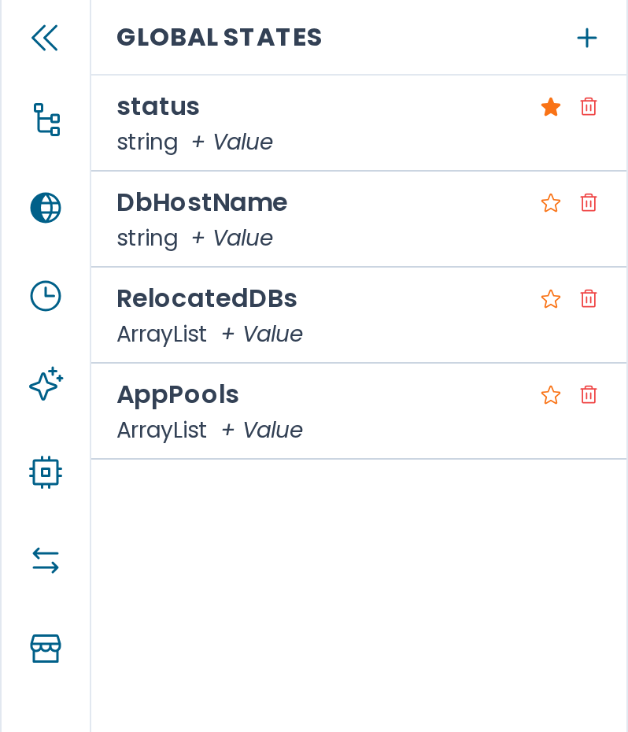

# Global State Variables

Global state variables store data that persists across the entire lifecycle of an automaton instance. They act as the automaton's memory — holding values that states and transitions can read and write.

To view and manage global state variables, click **Global States** (globe icon) in the left sidebar. The panel shows all variables defined for the active automaton. It is active only when an automaton is open.

/// caption
Fig.1 - The Global States panel, with the variable status starred
///

---

## Adding a variable

1. Click **+** at the top right of the panel. A new row appears with the name field open.
2. Type the name and press **Enter**.
3. Click **+ Type** and **+ Value** to fill the other fields.

Each variable has:

| Field | Description |
|---|---|
| **Name** | The identifier used to reference the variable throughout the automaton. Required. |
| **Type** | The data type: `string`, `int`, `long`, `bool`, `object`, or a collection such as `list[string]` or `map[string, int]`. Optional. |
| **Value** | The starting value of the variable when an instance of the automaton starts. Optional. |
| **★** | Starred variable: the interpreter writes its value in the log messages about the instance, for example when a function fails. Click the star to turn it on or off. |

The name must contain only letters, digits and `_`, and must not start with a digit. Two variables of the same automaton cannot have the same name. If the name is not valid, a red message appears under the field and the variable is not saved until you correct it.

---

## Editing a variable

Click a name, a type or a value to edit it in place. Press **Enter** or click elsewhere to confirm.

- If you clear the type or the value, the field is removed from the variable.
- If you clear the name, the variable is deleted.

To delete a variable, click the **trash icon** on its row.

Every change is saved automatically: while the panel saves it, **Applying changes…** appears at the top right of the canvas. You can undo and redo the changes with the buttons at the bottom of the canvas, or with **Ctrl+Z** and **Ctrl+Y** (see [The Interface](../getting_started/interface.md#canvas)).

!!! warning
    The designer does not check whether a variable is still used before you delete or rename it. Update the parameters, paths and clock constraints that use it first.

While [Arianna](../arianna/overview.md) regenerates the file of the automaton, the panel is read-only and shows **Regenerating this automaton...**.

---

## How variables are used

Global state variables are referenced in:

- **Metric input and output parameters** — passing values to a metric function or capturing its results
- **Action input and output parameters** — providing context to an action or storing its output
- **TransitionNew input parameters** — passing data to a child automaton at the moment it is spawned
- **Clock constraints** — when a variable stores a threshold value used in a time condition

!!! info
    In the parameters, the XAL refers to a variable by its name. In clock constraints, queries, and the file or automaton chosen from **Global States**, it refers to it as `this.GLOBALSTATE_<name>`. The designer adds this prefix for you — you never need to type it manually (see [Referencing variables](../../reference/global_state_clocks.md#referencing-variables)).
