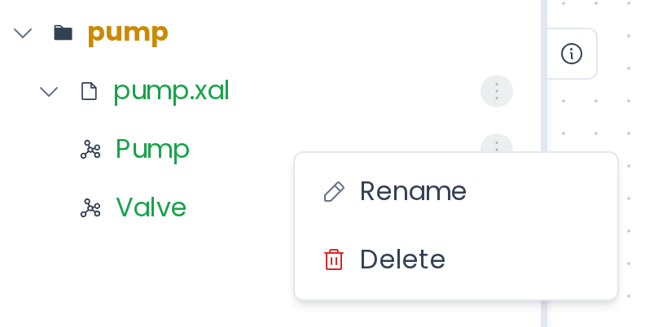
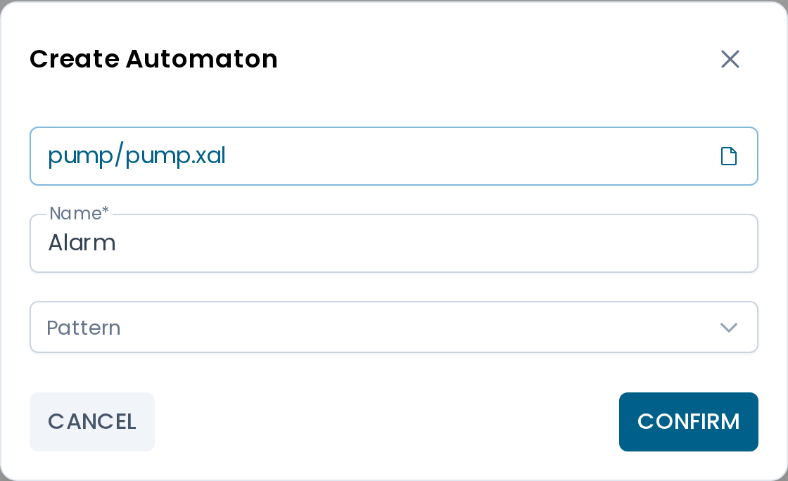

# Gestione degli Automi

Crei, rinomini ed elimini gli automi dall'**Explorer** nella barra laterale sinistra.

Fai clic con il tasto destro su un file XAL o su un automa, oppure sul pulsante **⋮** in fondo alla sua riga, per aprirne il menu. Il tasto destro sul tab di un automa nel canvas apre le stesse azioni dell'automa.

/// caption
Fig.1 - Il menu di un automa nell'Explorer
///

Per creare un nuovo file XAL, fai clic su **+** in fondo all'Explorer. Il nuovo file contiene già un automa con lo stesso nome del file.

---

## Creare un automa

Fai clic con il tasto destro sul file XAL e scegli **New automaton**. Si apre la finestra **Create Automaton**.

/// caption
Fig.2 - La finestra Create Automaton
///

| Campo | Descrizione |
|---|---|
| **File** | Il file XAL in cui viene creato l'automa. Già compilato con il file su cui hai fatto clic. Fai clic sull'icona del file per sceglierne un altro. |
| **Name** | Il nome dell'automa. Obbligatorio. Usa solo lettere e numeri. Deve essere unico nel file. |
| **Pattern** | Non ancora disponibile. |

Fai clic su **Confirm**. L'automa si apre in un nuovo tab, con un solo stato `init` che è già lo stato iniziale.

---

## Rinominare un automa

Fai clic con il tasto destro sull'automa e scegli **Rename**. L'automa si apre nel suo tab e si apre la finestra **Edit Automaton**.

Scrivi il nuovo nome e fai clic su **Save**. Valgono le stesse regole della creazione: solo lettere e numeri, unico nel file.

Per annullare una rinomina, premi **Ctrl+Z** nel tab dell'automa.

!!! warning
    Il designer non aggiorna i riferimenti al vecchio nome. Ogni altro automa che fa riferimento a questo per nome, tramite una `TransitionNew` o una query Metric, va aggiornato a mano.

---

## Eliminare un automa

Fai clic con il tasto destro sull'automa e scegli **Delete**. Conferma con **Delete**. Il tab dell'automa si chiude.

Non puoi annullare un'eliminazione con **Ctrl+Z**. Cosa succede dopo dipende dall'automa:

- **Un automa che è nel repository** resta nell'Explorer, segnato come rimosso, fino al commit. Per recuperarlo, fai clic con il tasto destro e scegli **Restore automaton**, poi conferma con **Restore**. L'automa torna alla versione del repository.
- **Un automa che hai creato e non hai mai committato** va perso.

L'eliminazione arriva nel repository solo quando fai il [commit](../publishing/commit.md).

---

## Scartare le modifiche a un automa

Quando un automa ha modifiche non committate, il suo menu mostra anche **Discard changes**. Vedi [Commit e Push](../publishing/commit.md#chiudere-un-tab-con-modifiche-non-committate).

!!! note
    Mentre Arianna rigenera un file XAL, le azioni sul file e sui suoi automi sono disattivate. Vedi [Generare l'XAL](../arianna/generating_xal.md#mentre-lxal-viene-generato).
