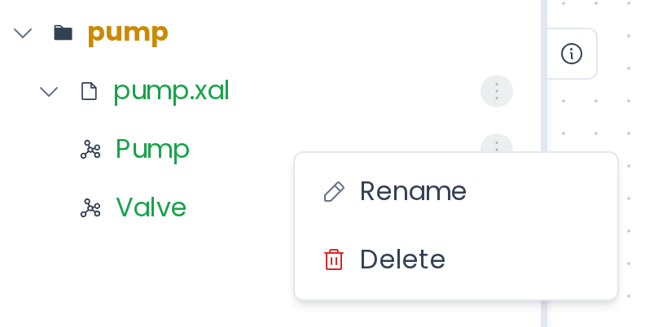
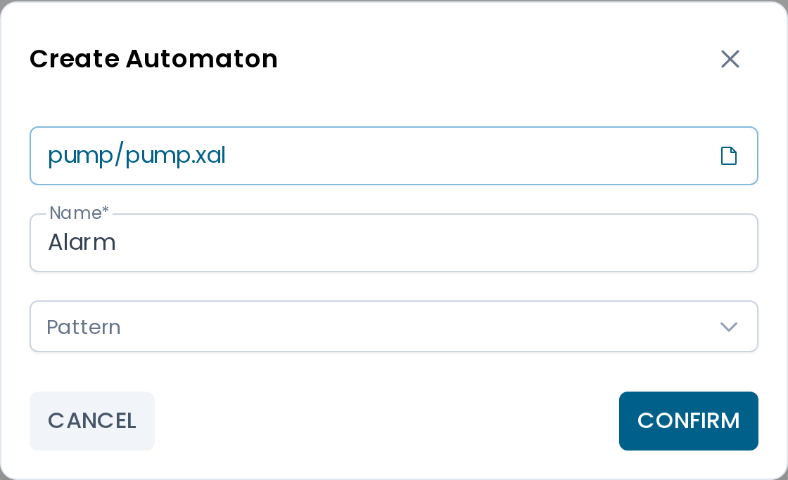

# Managing Automata

You create, rename and delete automata from the **Explorer** in the left sidebar.

Right-click a XAL file or an automaton, or click the **⋮** button at the end of its row, to open its menu. Right-clicking an automaton tab on the canvas opens the same automaton actions.

/// caption
Fig.1 - The menu of an automaton in the Explorer
///

To create a new XAL file, click **+** at the bottom of the Explorer. The new file already contains one automaton with the same name as the file.

---

## Creating an automaton

Right-click the XAL file and select **New automaton**. The **Create Automaton** dialog opens.

/// caption
Fig.2 - The Create Automaton dialog
///

| Field | Description |
|---|---|
| **File** | The XAL file in which the automaton is created. Pre-filled with the file you right-clicked. Click the file icon to select a different one. |
| **Name** | The name of the automaton. Required. Use letters and numbers only. It must be unique in the file. |
| **Pattern** | Not available yet. |

Click **Confirm**. The automaton opens in a new tab, with a single state `init` that is already the initial state.

---

## Renaming an automaton

Right-click the automaton and select **Rename**. The automaton opens in its tab and the **Edit Automaton** dialog opens.

Type the new name and click **Save**. The same rules as for creation apply: letters and numbers only, unique in the file.

To undo a rename, press **Ctrl+Z** in the automaton tab.

!!! warning
    The designer does not update the references to the old name. Any other automaton that references this one by name, through a `TransitionNew` or a metric query, must be updated manually.

---

## Deleting an automaton

Right-click the automaton and select **Delete**. Confirm with **Delete**. The tab of the automaton closes.

You cannot undo a deletion with **Ctrl+Z**. What happens next depends on the automaton:

- **An automaton that is in the repository** stays in the Explorer, marked as removed, until you commit. To get it back, right-click it and select **Restore automaton**, then confirm with **Restore**. The automaton goes back to the version in the repository.
- **An automaton you created and never committed** is lost.

The deletion reaches the repository only when you [commit](../publishing/commit.md).

---

## Discarding the changes to an automaton

When an automaton has changes that are not committed, its menu also shows **Discard changes**. See [Commit and Push](../publishing/commit.md#closing-a-tab-with-uncommitted-changes).

!!! note
    While Arianna regenerates a XAL file, the actions on that file and on its automata are disabled. See [Generating XAL](../arianna/generating_xal.md#while-the-xal-is-generated).
