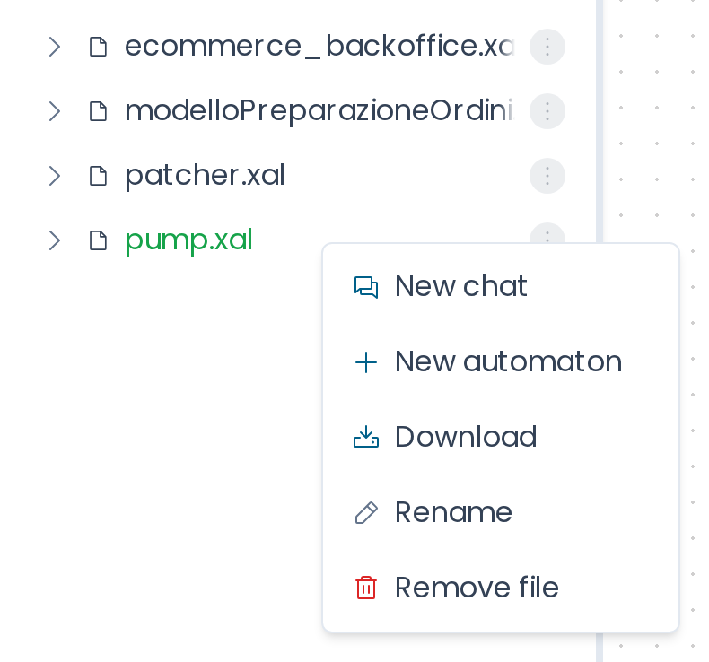

# I File nell'Explorer

L'**Explorer** nella barra laterale sinistra mostra le cartelle e i file del branch collegato: i file XAL, i loro scenari (`.scenario.md`) e i file che aggiungi tu, compresi i file Java. Una cartella compare solo se contiene un file XAL o uno scenario.

Per collegare un repository o aprire un file, vedi [Aprire un File](opening_file.md).

---

## Colori dei file

Il colore di un nome indica il suo stato rispetto al repository.

| Colore | Significato |
|---|---|
| Normale | Uguale al repository |
| Verde | Un file o un automa nuovo, non ancora nel repository |
| Giallo | Un file o un automa con modifiche non ancora committate |
| Rosso, barrato | Un automa che hai eliminato: viene tolto dal repository al prossimo commit |

Un nome barrato con un'icona di avviso è un file che il designer non riesce a leggere. Non puoi aprirlo.

---

## Il menu del file

Fai clic con il tasto destro su un file, oppure sul pulsante **⋮** in fondo alla sua riga, per aprire il suo menu.

/// caption
Fig.1 - Il menu di un file XAL nuovo
///

Le voci dipendono dal file:

| Voce | Compare per | Cosa fa |
|---|---|---|
| **New chat** / **Open chat** | File XAL e scenari | Apre la chat di Arianna del file. Vedi [Sessioni chat](../arianna/sessions.md). |
| **New automaton** | File XAL | Aggiunge un automa al file. Vedi [Gestione degli Automi](../automata/managing.md#creare-un-automa). |
| **Download** | File nuovi | Salva il file sul tuo computer. |
| **Rename** | File XAL nuovi | Rinomina il file. Vedi [Rinominare un file](#rinominare-un-file). |
| **Remove file** | File nuovi | Toglie il file dall'Explorer, dopo una conferma. I suoi tab si chiudono. |
| **Discard changes** | Scenari con modifiche | Riporta lo scenario alla versione del repository. |

Un file che è già nel repository non si può scaricare, rinominare o togliere dall'Explorer.

!!! note
    Mentre Arianna rigenera un file XAL, le voci che modificano il file o il suo scenario sono disattivate. Vedi [Generare l'XAL](../arianna/generating_xal.md#mentre-lxal-viene-generato).

---

## Aggiungere file

In fondo all'Explorer:

- **+** apre la finestra **New XAL file**. Scrivi un nome e fai clic su **Create**. L'estensione `.xal` viene aggiunta da sola. Il file nuovo contiene un automa con lo stesso nome e si apre in un tab.
- **Upload File** carica un file dal tuo computer: un file XAL, uno scenario o un file Java.

Un file nuovo parte dalla cartella principale del repository. Se lì c'è già un file con lo stesso nome, quello nuovo prende un numero: `pump.xal` diventa `pump(1).xal`.

L'Explorer non ha un comando per creare una cartella. Sposta il file in una cartella che esiste già (vedi sotto), oppure scegli la sua cartella al momento del commit: una cartella che non esiste ancora viene creata dal commit. Vedi [Scegliere la cartella di un file nuovo](../publishing/commit.md#scegliere-la-cartella-di-un-file-nuovo).

---

## Spostare un file

Puoi spostare solo i file nuovi.

1. Trascina il file su una cartella. La cartella si evidenzia.
2. Per portare un file fuori dalle sue cartelle, rilascialo sul riquadro **Move to root /** che compare sotto i file mentre trascini.

L'Explorer scorre quando trascini il file vicino al suo bordo superiore o inferiore.

- Un file XAL e il suo scenario restano insieme: quando ne sposti uno, si sposta anche l'altro.
- Quando sposti un file Java, il file XAL che lo usa viene aggiornato con il nuovo percorso.
- Se nella cartella c'è già un file con lo stesso nome, il file spostato prende un numero.

Un file XAL nuovo il cui scenario è già nel repository non può lasciare quella cartella, e viceversa. Il designer mostra **Cannot move file**.

---

## Rinominare un file

Puoi rinominare solo i file XAL nuovi.

1. Apri il menu del file e scegli **Rename**. La finestra **Rename file** mostra il nome senza l'estensione.
2. Scrivi il nuovo nome e fai clic su **Rename**.

Il nome può contenere solo lettere e numeri: spazi, trattini, underscore e altri caratteri non sono accettati. L'estensione `.xal` resta.

Lo scenario del file viene rinominato insieme a lui, e la chat di Arianna segue il file. Se il nome è già usato nella cartella, il file prende un numero.

Un file XAL nuovo il cui scenario è già nel repository non si può rinominare. Il designer mostra **Cannot rename**.

---

## Ricaricare i file

La freccia accanto al titolo **EXPLORER** ricarica i file dal repository. Chiude tutti i tab e cancella la cronologia dell'undo.

Se hai modifiche non ancora committate, il designer chiede prima una conferma: il ricaricamento le scarta. Fai clic su **Reload anyway** per proseguire, oppure su **Cancel**. I file nuovi che hai aggiunto restano nell'Explorer.
