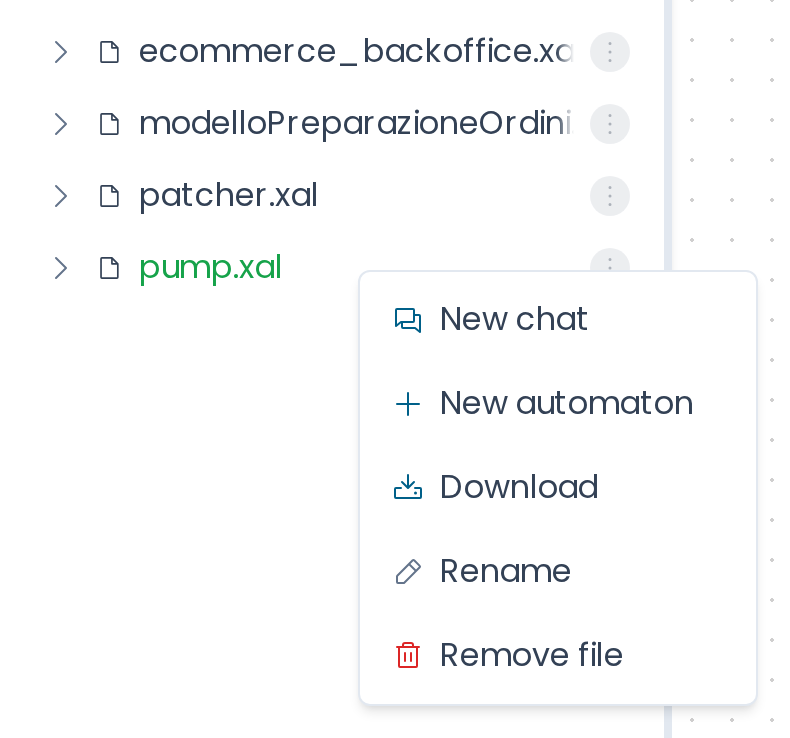

# Files in the Explorer

The **Explorer** in the left sidebar shows the folders and files of the connected branch: the XAL files, their scenarios (`.scenario.md`) and the files you add, Java files included. A folder appears only when it contains a XAL file or a scenario.

To connect a repository or open a file, see [Opening a File](opening_file.md).

---

## File colors

The color of a name tells you its state compared with the repository.

| Color | Meaning |
|---|---|
| Default | Same as in the repository |
| Green | A new file or automaton, not in the repository yet |
| Yellow | A file or automaton with changes that are not committed |
| Red, struck through | An automaton you deleted: it is removed from the repository at the next commit |

A name struck through with a warning icon is a file that the designer cannot read. You cannot open it.

---

## The file menu

Right-click a file, or click the **⋮** button at the end of its row, to open its menu.

/// caption
Fig.1 - The menu of a new XAL file
///

The items depend on the file:

| Item | Shown for | What it does |
|---|---|---|
| **New chat** / **Open chat** | XAL files and scenarios | Opens the Arianna chat of the file. See [Chat Sessions](../arianna/sessions.md). |
| **New automaton** | XAL files | Adds an automaton to the file. See [Managing Automata](../automata/managing.md#creating-an-automaton). |
| **Download** | New files | Saves the file on your computer. |
| **Rename** | New XAL files | Renames the file. See [Renaming a file](#renaming-a-file). |
| **Remove file** | New files | Removes the file from the Explorer, after a confirmation. Its tabs close. |
| **Discard changes** | Scenarios with changes | Brings the scenario back to the version in the repository. |

A file that is already in the repository cannot be downloaded, renamed or removed from the Explorer.

!!! note
    While Arianna regenerates a XAL file, the items that change the file or its scenario are disabled. See [Generating XAL](../arianna/generating_xal.md#while-the-xal-is-generated).

---

## Adding files

At the bottom of the Explorer:

- **+** opens the **New XAL file** dialog. Type a name and click **Create**. The `.xal` extension is added for you. The new file contains one automaton with the same name and opens in a tab.
- **Upload File** loads a file from your computer: a XAL file, a scenario or a Java file.

A new file starts at the top of the repository. If a file with the same name is already there, the new one gets a number: `pump.xal` becomes `pump(1).xal`.

The Explorer has no command to create a folder. Move the file into an existing folder (see below), or choose its folder when you commit: a folder that does not exist yet is created by the commit. See [Choosing the folder of a new file](../publishing/commit.md#choosing-the-folder-of-a-new-file).

---

## Moving a file

You can move only the new files.

1. Drag the file onto a folder. The folder is highlighted.
2. To move a file out of its folders, drop it on the **Move to root /** box that appears below the files while you drag.

The Explorer scrolls when you drag the file near its top or bottom edge.

- A XAL file and its scenario stay together: when you move one, the other moves too.
- When you move a Java file, the XAL file that uses it is updated with the new path.
- If the folder already has a file with the same name, the moved file gets a number.

A new XAL file whose scenario is already in the repository cannot leave that folder, and the other way around. The designer shows **Cannot move file**.

---

## Renaming a file

You can rename only the new XAL files.

1. Open the menu of the file and select **Rename**. The **Rename file** dialog shows the name without the extension.
2. Type the new name and click **Rename**.

The name can contain only letters and numbers: spaces, dashes, underscores and other characters are not accepted. The `.xal` extension stays.

The scenario of the file is renamed with it, and the Arianna chat follows the file. If the name is already taken in the folder, the file gets a number.

A new XAL file whose scenario is already in the repository cannot be renamed. The designer shows **Cannot rename**.

---

## Reloading the files

The arrow next to the **EXPLORER** title reloads the files from the repository. It closes all the tabs and clears the undo history.

If you have changes that are not committed, the designer asks for confirmation first: the reload discards them. Click **Reload anyway** to go on, or **Cancel**. The new files you added stay in the Explorer.
