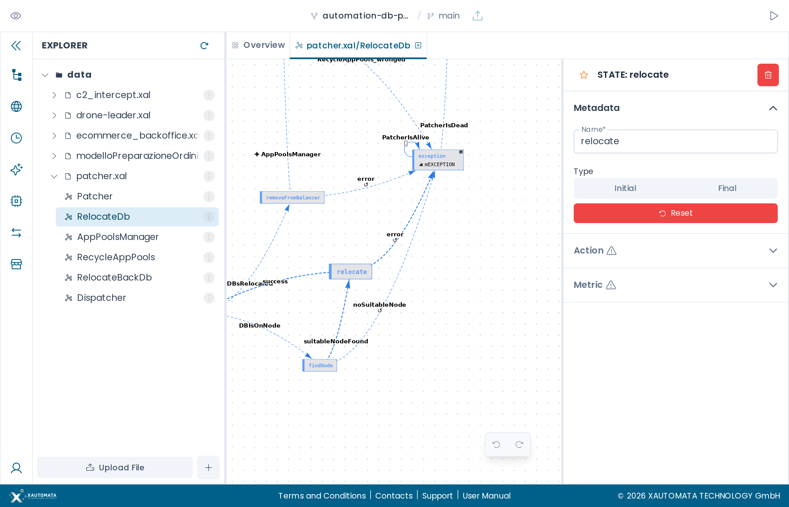

# L'Interfaccia

L'interfaccia del XAL Designer è organizzata in quattro aree principali che collaborano durante una sessione di modifica.

/// caption
Fig.1 - L'interfaccia del XAL Designer con un automa aperto e uno stato selezionato
///

---

## Barra superiore

La barra superiore fornisce accesso ai controlli globali.

| Elemento | Descrizione |
|---|---|
| **Occhio** (a sinistra) | **Full immersion**: nasconde la barra superiore e chiude la barra laterale sinistra, per dare più spazio al canvas. Fai clic sulla striscia sottile in alto per mostrare di nuovo la barra. |
| **Repository / branch** | Mostra il repository e il branch collegati. Fai clic per scegliere un altro repository o un altro branch. Prima del collegamento mostra **Connect to VCS**. |
| **Freccia di caricamento** | Apre la finestra [Commit & Push](../publishing/commit.md). Compare solo con un repository collegato ed è attiva quando ci sono modifiche da committare. |
| **Play** (a destra) | **Run-time instance**: apre la piattaforma di run-time di Xautomata in una nuova scheda del browser. |

---

## Barra laterale sinistra

La barra laterale fornisce accesso a tutti i pannelli e gli strumenti di modifica. Passa il mouse su un'icona per vederne il nome, fai clic per aprire il pannello corrispondente.

La doppia freccia in alto riduce il pannello aperto alle sole icone, e lo riapre.

| Icona | Nome | Descrizione |
|---|---|---|
| Albero | File | Apre l'**Explorer**: la struttura di file e automi del repository collegato |
| Globo | Global States | Gestisce le variabili di stato globale dell'automa attivo |
| Orologio | Clock Vars | Gestisce le variabili Clock dell'automa attivo |
| Microchip | New State | Aggiunge un nuovo stato all'automa attivo |
| Due frecce | New Transition | Aggiunge una nuova transizione all'automa attivo |
| Store | Marketplace | *(Coming soon)* |
| Scintilla | AI Assistant | Apre il pannello chat di [Arianna](../arianna/overview.md) |
| Utente (in basso) | User | Mostra il tuo account, con **Logout** (o **Connect to VCS** se non sei collegato) e l'interruttore **Dark Mode (beta)** |

Global States, Clock Vars, New State e New Transition sono attivi solo quando un automa è aperto.

Per creare, rinominare o eliminare un automa, fai clic con il tasto destro su un file o su un automa nell'Explorer (vedi [Gestione degli Automi](../automata/managing.md)). In fondo all'Explorer, **Upload File** carica un file XAL dal tuo computer e **+** crea un nuovo file XAL. Vedi [I File nell'Explorer](explorer.md).

---

## Canvas

Il canvas occupa l'area centrale dell'interfaccia.

Mostra una delle due viste in base al tab attivo:

- **Overview** — il grafico delle correlazioni che mostra tutti gli automi nel repository e le loro relazioni
- **Diagramma automa** — il grafico interattivo di un automa specifico, con gli stati come nodi e le transizioni come archi

È possibile scorrere il canvas facendo clic e trascinando su un'area vuota, e ingrandire o ridurre con la rotella del mouse. I singoli nodi possono essere trascinati per riposizionarli.

In fondo al canvas, due pulsanti forniscono le funzioni **undo** e **redo** per le modifiche all'automa. Puoi usare anche **Ctrl+Z** e **Ctrl+Y** (**Cmd** su macOS).

---

## Pannello destro

Il pannello destro mostra il modulo di configurazione per l'elemento attualmente selezionato nel canvas.

Si apre automaticamente quando si fa clic su un nodo stato o un arco transizione. Si chiude facendo clic su un'area vuota del canvas oppure premendo il pulsante **×** nell'intestazione del pannello.

Il contenuto del pannello cambia in base all'elemento selezionato:

- **Stato selezionato** — mostra le sezioni Metadata, Action e Metric dello stato
- **Transizione selezionata** — mostra le sezioni Metadata, Clocks e Parameters della transizione

Le modifiche apportate nel pannello vengono applicate immediatamente all'automa, con un breve ritardo di debounce.

---

## Tab

Ogni automa aperto appare come tab nella barra dei tab, accanto al tab persistente **Overview**. Quando lavori con Arianna, il tab dello scenario sta subito dopo Overview.

- Fai clic su un tab per portare il canvas su quell'automa. Passaci sopra con il mouse per vedere il percorso del file.
- Trascina un tab per cambiarne la posizione.
- Un **punto** su un tab segnala modifiche non committate. Quando passi il mouse sul tab, il punto diventa il pulsante **×**.
- Fai clic su **×**, o fai clic sul tab con il tasto centrale del mouse, per chiuderlo. Chiudere un tab non scarta le sue modifiche: vedi [Commit e Push](../publishing/commit.md#chiudere-un-tab-con-modifiche-non-committate).
- Fai clic con il tasto destro su un tab per **Close**, **Close all other tabs** e le stesse azioni del menu del file nell'Explorer.
