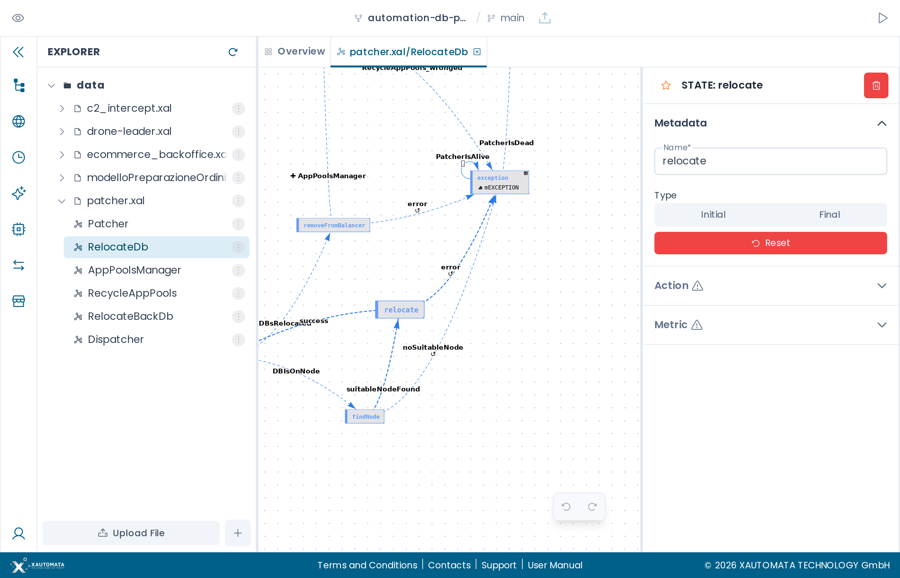

# The Interface

The XAL Designer interface is organized into four main areas that work together during an editing session.

/// caption
Fig.1 - The XAL Designer interface with an automaton open and a state selected
///

---

## Top bar

The top bar provides access to global controls.

| Element | Description |
|---|---|
| **Eye** (left) | **Full immersion**: hides the top bar and collapses the left sidebar, so the canvas gets more room. Click the thin strip at the top to show the bar again. |
| **Repository / branch** | Shows the connected repository and branch. Click it to choose another repository or branch. Before you connect, it reads **Connect to VCS**. |
| **Upload arrow** | Opens the [Commit & Push](../publishing/commit.md) dialog. It is visible only when a repository is connected, and active when there are changes to commit. |
| **Play** (right) | **Run-time instance**: opens the Xautomata run-time platform in a new browser tab. |

---

## Left sidebar

The sidebar provides access to all editing panels and tools. Hover an icon to see its name, click it to open the corresponding panel.

The double arrow at the top collapses the open panel to the icons only, and expands it again.

| Icon | Name | Description |
|---|---|---|
| Tree | File | Opens the **Explorer**: the file and automaton tree of the connected repository |
| Globe | Global States | Manages the global state variables of the active automaton |
| Clock | Clock Vars | Manages the clock variables of the active automaton |
| Microchip | New State | Adds a new state to the active automaton |
| Two arrows | New Transition | Adds a new transition to the active automaton |
| Store | Marketplace | *(Coming soon)* |
| Sparkle | AI Assistant | Opens the [Arianna](../arianna/overview.md) chat panel |
| User (bottom) | User | Shows your account, with **Logout** (or **Connect to VCS** when you are not connected) and the **Dark Mode (beta)** switch |

Global States, Clock Vars, New State and New Transition are active only when an automaton is open.

To create, rename or delete an automaton, right-click a file or an automaton in the Explorer (see [Managing Automata](../automata/managing.md)). At the bottom of the Explorer, **Upload File** loads a XAL file from your computer, and **+** creates a new XAL file.

---

## Canvas

The canvas occupies the central area of the interface.

It displays one of two views depending on the active tab:

- **Overview** — the correlation graph showing all automata in the repository and their relationships
- **Automaton diagram** — the interactive graph of a specific automaton, with states as nodes and transitions as edges

You can pan the canvas by clicking and dragging on an empty area, and zoom with the scroll wheel. Individual nodes can be dragged to reposition them.

At the bottom of the canvas, two buttons provide **undo** and **redo** for the changes to the automaton. You can also press **Ctrl+Z** and **Ctrl+Y** (**Cmd** on macOS).

---

## Right panel

The right panel shows the configuration form for the currently selected element on the canvas.

It opens automatically when you click on a state node or a transition edge. It closes when you click on an empty area of the canvas or press the **×** button in the panel header.

The panel content changes depending on what is selected:

- **State selected** — shows the state Metadata, Action, and Metric sections
- **Transition selected** — shows the transition Metadata, Clocks, and Parameters sections

Changes made in the panel are applied immediately to the automaton, with a short debounce delay.

---

## Tabs

Each open automaton appears as a tab in the tab bar, next to the persistent **Overview** tab. When you work with Arianna, the scenario tab sits right after Overview.

- Click a tab to switch the canvas to that automaton. Hover it to see the file path.
- Drag a tab to change its position.
- A **dot** on a tab signals uncommitted changes. When you hover the tab, the dot becomes the **×** button.
- Click **×**, or click the tab with the middle mouse button, to close it. Closing a tab does not discard its changes: see [Commit and Push](../publishing/commit.md#closing-a-tab-with-uncommitted-changes).
- Right-click a tab for **Close**, **Close all other tabs** and the same actions as the file menu in the Explorer.
