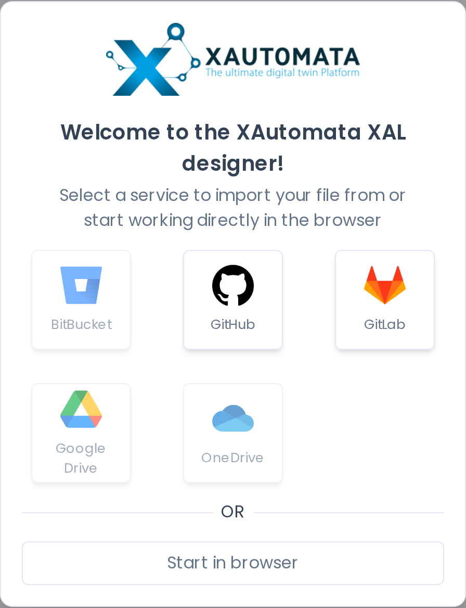
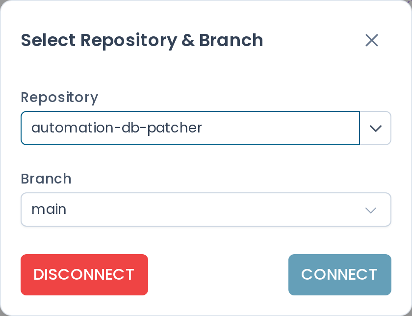
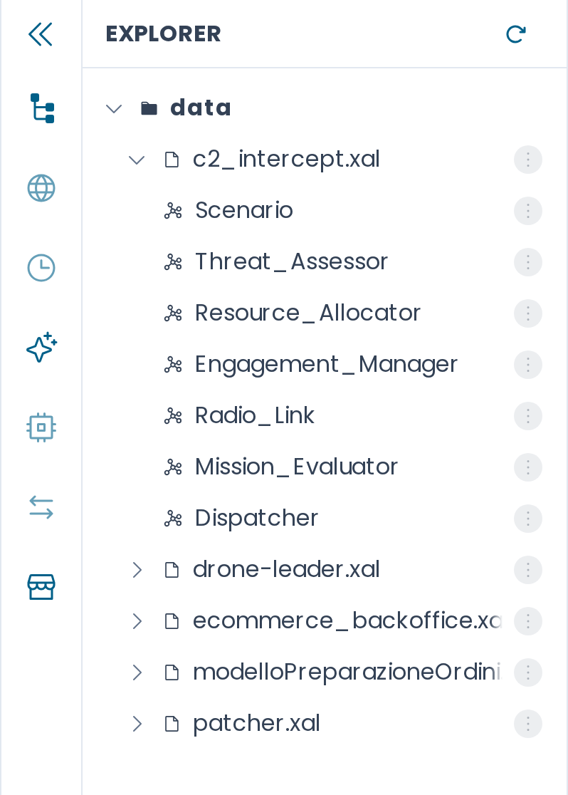

# Aprire un File

Quando apri il XAL Designer, una finestra di benvenuto ti fa scegliere da dove prendere i file XAL: da un repository o dal tuo computer.

/// caption
Fig.1 - La finestra di benvenuto
///

Se la finestra non compare, per esempio alla prima visita, quando c'è il banner dei cookie, fai clic su **Connect to VCS** nella barra superiore.

---

## Collegarsi a un repository

1. Seleziona **GitHub** o **GitLab**. Gli altri provider compaiono in grigio: non sono ancora disponibili.
2. Inserisci **Username** e **Personal Access Token**, poi fai clic su **Connect**. **Back** torna all'elenco dei provider.
3. Nella barra superiore, fai clic su **Select repository**. Si apre la finestra **Select Repository & Branch**.
4. In **Repository**, scrivi una parte del nome per filtrare l'elenco. Un lucchetto segna i repository privati. Se due repository hanno lo stesso nome, l'elenco mostra anche il proprietario.
5. In **Branch**, scegli il branch. Il primo branch dell'elenco è già selezionato.
6. Fai clic su **Connect**. Il designer carica i file del branch.

/// caption
Fig.2 - La finestra Select Repository & Branch
///

Se l'accesso non riesce, compare un messaggio di errore e puoi riprovare. Se hai accettato i cookie, il designer ricorda l'accesso per sette giorni: la volta successiva che lo apri, sei già collegato.

### L'Explorer

Una volta collegato, l'**Explorer** nella barra laterale sinistra mostra le cartelle e i file del branch. Fai clic su un file XAL per espanderlo e vedere gli automi che contiene. Fai clic su un automa per aprirlo in un nuovo tab nel canvas (vedi [Tab](interface.md#tab)).

La freccia accanto al titolo **EXPLORER** ricarica i file dal repository. Per aggiungere, spostare o rinominare i file, vedi [I File nell'Explorer](explorer.md).

/// caption
Fig.3 - L'Explorer con un file XAL espanso
///

---

## Cambiare repository o branch

Fai clic su repository e branch nella barra superiore. Si apre la finestra **Select Repository & Branch** con la scelta attuale: seleziona un altro repository o un altro branch e fai clic su **Connect**.

- I tab aperti vengono chiusi.
- Se hai modifiche non committate, il designer chiede conferma: **Connect anyway** le scarta.
- Se hai file che non sono ancora nel repository, per esempio file caricati da te, la finestra **Local files** chiede cosa farne: **Keep** li lascia nell'Explorer come file nuovi, **Discard** li elimina, insieme alla loro chat di Arianna.
- Mentre Arianna rigenera un file XAL non puoi cambiare: aspetta la fine, o annulla la rigenerazione dalla chat.

Per lasciare il repository, fai clic su **Disconnect** nella stessa finestra. Se hai modifiche non committate, il designer chiede prima conferma. Per uscire dal provider, usa **Logout** nel menu **User** in fondo alla barra laterale sinistra.

---

## Quando la sessione scade

Se l'accesso al provider scade, per esempio perché il token è stato revocato o è arrivato alla data di scadenza, il designer mostra la notifica **VCS Session Expired** e un'icona di avviso accanto al titolo **EXPLORER**. Per continuare, fai clic su **Connect to VCS** nella barra superiore e accedi di nuovo.

---

## Lavorare nel browser

Seleziona **Start in browser** per lavorare senza repository. L'Explorer parte vuoto. In fondo all'Explorer:

- **Upload File** carica un file dal tuo computer: un file XAL, uno scenario (`.scenario.md`) o un file Java. Se nell'Explorer c'è già un file con lo stesso nome, quello nuovo viene rinominato.
- **+** crea un nuovo file XAL.
- Il pulsante di **download** compare quando ci sono file nuovi. Apre la finestra **Download Files**: seleziona i file e fai clic su **Download**.

!!! warning
    Nel browser i tuoi file restano solo nella scheda del browser. Un ricaricamento della pagina li conserva, ma chiudendo la scheda vanno persi. Scarica i file prima di chiudere la scheda.

Puoi collegarti a un repository anche dopo, con **Connect to VCS** nella barra superiore. I tuoi file restano nell'Explorer come file nuovi, pronti per il [commit](../publishing/commit.md).
