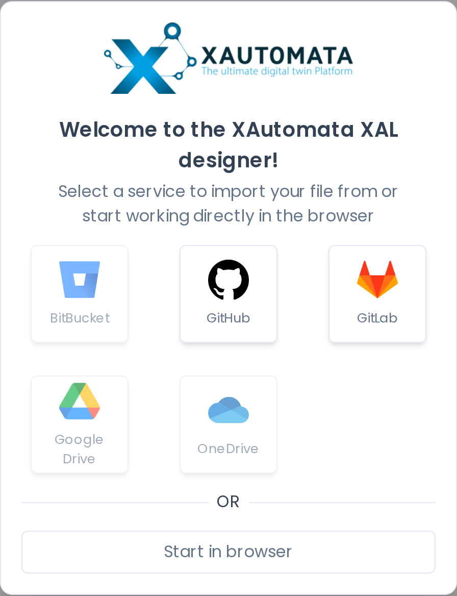
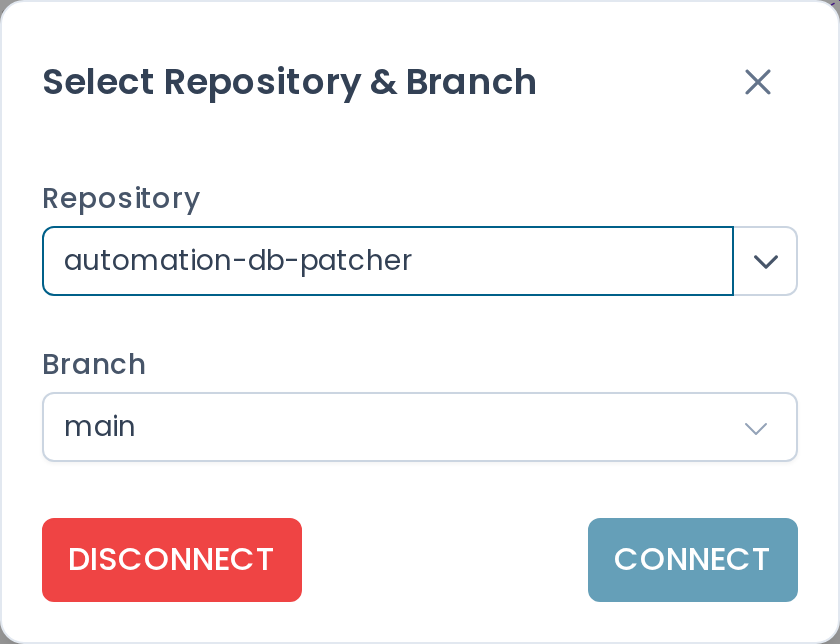
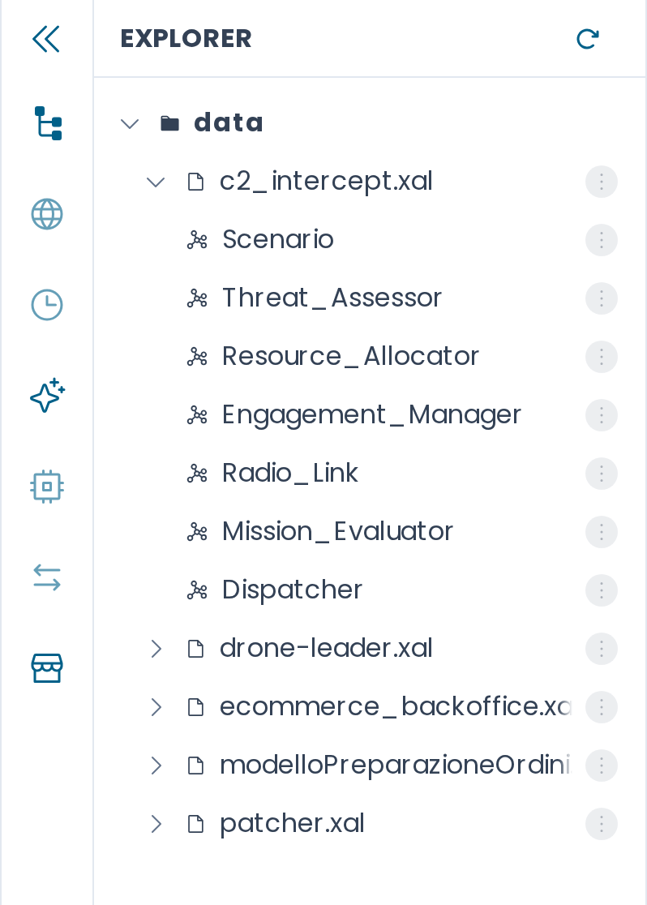

# Opening a File

When you open the XAL Designer, a welcome dialog lets you choose where your XAL files come from: a repository, or your computer.

/// caption
Fig.1 - The welcome dialog
///

If the dialog does not appear, for example on your first visit, when the cookie banner is shown, click **Connect to VCS** in the top bar.

---

## Connecting to a repository

1. Select **GitHub** or **GitLab**. The other providers are shown greyed out: they are not available yet.
2. Enter your **Username** and a **Personal Access Token**, then click **Connect**. **Back** returns to the provider list.
3. In the top bar, click **Select repository**. The **Select Repository & Branch** dialog opens.
4. In **Repository**, type part of the name to filter the list. A lock marks the private repositories. When two repositories have the same name, the list shows the owner too.
5. In **Branch**, choose the branch. The first branch of the list is selected for you.
6. Click **Connect**. The designer loads the files of the branch.

/// caption
Fig.2 - The Select Repository & Branch dialog
///

If the login fails, an error message appears and you can try again. If you accepted the cookies, the designer remembers the login for seven days: the next time you open it, you are already connected.

### The Explorer

Once connected, the **Explorer** in the left sidebar shows the folders and files of the branch. Click a XAL file to expand it and see the automata it contains. Click an automaton to open it as a new tab on the canvas (see [Tabs](interface.md#tabs)).

The arrow next to the **EXPLORER** title reloads the files from the repository.

/// caption
Fig.3 - The Explorer with a XAL file expanded
///

---

## Switching repository or branch

Click the repository and branch in the top bar. The **Select Repository & Branch** dialog opens with the current choice: select another repository or branch and click **Connect**.

- The open tabs are closed.
- If you have uncommitted changes, the designer asks for confirmation: **Connect anyway** discards them.
- If you have files that are not in the repository yet, for example files you uploaded, the **Local files** dialog asks what to do with them: **Keep** leaves them in the Explorer as new files, **Discard** deletes them, together with their Arianna chat.
- While Arianna is regenerating a XAL file, you cannot switch: wait for the end, or cancel the regeneration from the chat.

To leave the repository, click **Disconnect** in the same dialog. If you have uncommitted changes, the designer asks for confirmation first. To log out of the provider, use **Logout** in the **User** menu at the bottom of the left sidebar.

---

## When the session expires

If the login with the provider expires, for example because the token was revoked or reached its expiry date, the designer shows the **VCS Session Expired** notification and a warning icon next to the **EXPLORER** title. To continue, click **Connect to VCS** in the top bar and log in again.

---

## Working in the browser

Select **Start in browser** to work without a repository. The Explorer starts empty. At its bottom:

- **Upload File** loads a file from your computer: a XAL file, a scenario (`.scenario.md`) or a Java file. If the Explorer already has a file with the same name, the new one is renamed.
- **+** creates a new XAL file.
- The **download** button appears when there are new files. It opens the **Download Files** dialog: select the files and click **Download**.

!!! warning
    In the browser, your files live only in the browser tab. A page reload keeps them, but closing the tab loses them. Download your files before you close the tab.

You can connect to a repository later, with **Connect to VCS** in the top bar. Your files stay in the Explorer as new files, ready to [commit](../publishing/commit.md).
