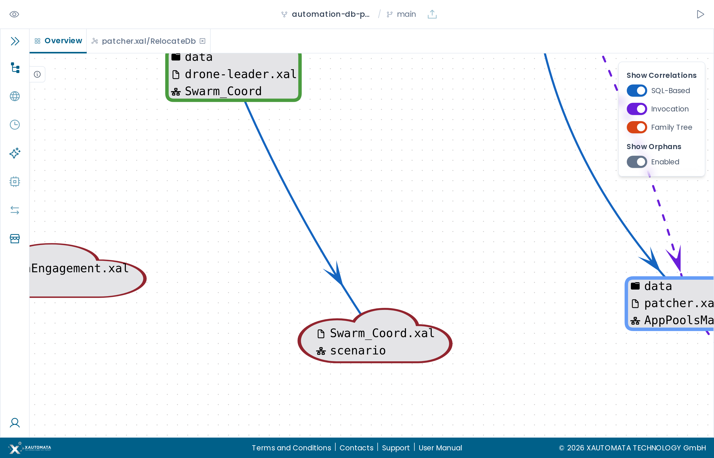

# XAL Designer — Overview

The XAL Designer is a web-based visual editor for creating and modifying automata defined in XAL files.

---

## What you can do

With the XAL Designer you can:

- connect to a Git repository (GitHub, GitLab, Bitbucket) or work directly in the browser
- browse and open XAL files from the repository explorer
- visualize the relationships between all automata in a repository through the Process Overview
- open individual automata and edit their states, transitions, and variables on an interactive canvas
- configure state metadata, actions, metrics, clock constraints, and parameter passing
- commit and push changes directly to the connected repository

---

## The interface at a glance

The designer is organized into three main areas.

The **left sidebar** provides navigation and editing tools. Its icons give access to:

| Icon | Panel |
|---|---|
| Tree | File (Explorer) |
| Globe | Global States |
| Clock | Clock Vars |
| Microchip | New State |
| Two arrows | New Transition |
| Store | Marketplace *(coming soon)* |
| Sparkle | AI Assistant (Arianna) |
| User (bottom) | Account, logout and dark mode |

The **top bar** shows the connected repository and branch, the Commit & Push button, and the buttons for full immersion and the run-time instance.

The **canvas** occupies the central area. It displays either the Process Overview graph or the interactive diagram of the currently open automaton.

The **right panel** displays the configuration form for the currently selected state or transition. It opens automatically when you click on a node or edge on the canvas.

---

## Tabs

Each automaton you open appears as a tab in the tab bar, next to the **Overview** tab. You can have multiple automata open at the same time and switch between them freely.

A dot indicator on a tab signals that the automaton has uncommitted changes.

See [The Interface](getting_started/interface.md) for every element in detail.

/// caption
Fig.1 - The XAL Designer interface on the Process Overview
///
