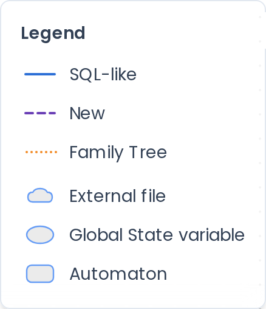
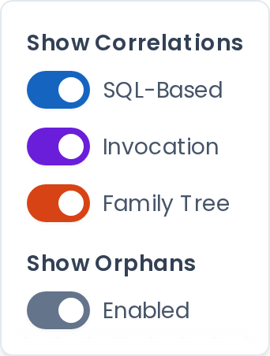

# Tipi di Correlazione

Il Process Overview mostra tre tipi di relazioni tra automi. Ogni tipo ha uno stile di linea e un colore propri, e puoi mostrare o nascondere ogni tipo in modo indipendente.

La **Legend** (il pulsante **ⓘ** in alto a sinistra del grafico) e il pannello dei filtri (in alto a destra) usano nomi diversi per due dei tipi:

| Legenda | Pannello dei filtri | Linea |
|---|---|---|
| SQL-like | SQL-Based | Blu continua |
| New | Invocation | Viola tratteggiata |
| Family Tree | Family Tree | Arancione punteggiata |

In modalità scura i colori sono più chiari.

/// caption
Fig.1 - La legenda: i tre stili di linea e le tre forme dei nodi
///

---

## SQL-like

Una correlazione **SQL-like** (linea blu continua) collega un automa a un altro di cui legge lo stato tramite una query.

Quando un'Action o una Metric dell'automa A ha una query che legge la tabella dell'automa B, il designer disegna un arco SQL-like da A verso B. Questo rappresenta una dipendenza dai dati: A osserva lo stato di B per guidare le proprie transizioni.

Il designer trova l'automa B dal nome della tabella, che unisce il nome del file e l'`Id` dell'automa (vedi [Query](../../reference/queries.md#convenzione-di-denominazione-delle-tabelle)). Cerca il file prima nella cartella dell'automa A e nelle cartelle superiori, poi in tutto il repository. Se non trova il file o l'automa, B è disegnato come una nuvola.

Quando selezioni un nodo, gli archi SQL-like mostrano l'`Id` delle Action e delle Metric che contengono la query. Se più query leggono lo stesso automa, l'arco le elenca tutte.

Questo è il tipo di correlazione più comune negli scenari di monitoraggio.

---

## New

Una correlazione **New** (linea viola tratteggiata) collega un automa genitore a un automa figlio che avvia.

Quando un automa ha una `TransitionNew` o una `TransitionNewMulti` che avvia un altro automa, il designer disegna un arco New dal genitore al figlio. Il figlio si trova dal **Target File** e dal **Target Automaton** della transizione (vedi [Istanziare automi figli](../transitions/transition_new.md)). Se il Target Automaton viene da una variabile di stato globale, il figlio è disegnato come un'ellisse.

Questo rappresenta una dipendenza del ciclo di vita: il genitore crea il figlio, e il figlio poi gira per conto suo.

---

## Family Tree

Una correlazione **Family Tree** (linea arancione punteggiata) collega un automa a un altro automa che esegue come sottoprocesso.

Quando un'Action o una Metric dell'automa A ha il tipo **Automaton** (vedi [Type Automaton](../states/actions.md#type-automaton)), il designer disegna un arco Family Tree da A verso l'automa che la funzione esegue. A differenza di una TransitionNew, la funzione aspetta che l'automa chiamato finisca, e ne riceve i valori di uscita.

Questo tipo di correlazione è meno comune degli altri due.

---

## Filtri e nodi orfani

Nel pannello dei filtri, sotto **Show Correlations**, un interruttore per ogni tipo mostra o nasconde i suoi archi.

Un **orfano** è un automa che non ha connessioni nella vista corrente: un automa isolato, oppure un automa le cui connessioni sono tutte di un tipo nascosto. L'interruttore **Show Orphans**, **Enabled** o **Disabled**, include o esclude i nodi orfani dal grafico. È disponibile solo quando almeno un tipo di correlazione è mostrato.

/// caption
Fig.2 - Il pannello dei filtri
///
