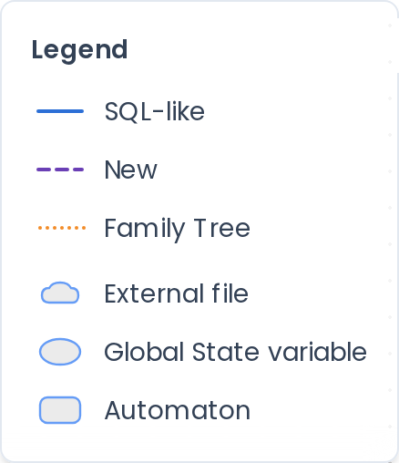
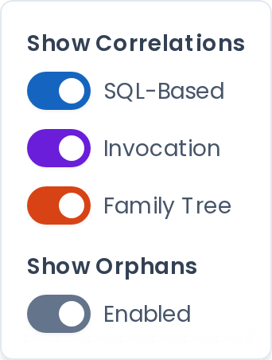

# Correlation Types

The Process Overview shows three types of relationships between automata. Each type has its own line style and color, and you can show or hide each type independently.

The **Legend** (the **ⓘ** button at the top left of the graph) and the filter panel (top right) use different names for two of the types:

| Legend | Filter panel | Line |
|---|---|---|
| SQL-like | SQL-Based | Solid blue |
| New | Invocation | Dashed purple |
| Family Tree | Family Tree | Dotted orange |

In dark mode the colors are lighter.

/// caption
Fig.1 - The legend: the three line styles and the three node shapes
///

---

## SQL-like

A **SQL-like** correlation (solid blue line) connects an automaton to another whose state it reads through a query.

When an Action or a Metric of automaton A has a query that reads the table of automaton B, the designer draws an SQL-like edge from A to B. This represents a data dependency: A observes B's state to drive its own transitions.

The designer finds automaton B from the table name, which joins the file name and the automaton `Id` (see [Queries](../../reference/queries.md#table-naming-convention)). It looks for the file first in the folder of automaton A and in its parent folders, then in the whole repository. If it does not find the file or the automaton, B is drawn as a cloud.

When you select a node, the SQL-like edges show the `Id` of the Actions and Metrics that contain the query. When more than one query reads the same automaton, the edge lists all of them.

This is the most common type of correlation in monitoring scenarios.

---

## New

A **New** correlation (dashed purple line) connects a parent automaton to a child automaton that it starts.

When an automaton has a `TransitionNew` or a `TransitionNewMulti` that starts another automaton, the designer draws a New edge from the parent to the child. The child is found from the **Target File** and the **Target Automaton** of the transition (see [Spawning Child Automata](../transitions/transition_new.md)). If the Target Automaton comes from a global state variable, the child is drawn as an ellipse.

This represents a lifecycle dependency: the parent creates the child, and the child then runs on its own.

---

## Family Tree

A **Family Tree** correlation (dotted orange line) connects an automaton to another automaton that it runs as a subprocess.

When an Action or a Metric of automaton A has the type **Automaton** (see [Type Automaton](../states/actions.md#type-automaton)), the designer draws a Family Tree edge from A to the automaton that the function runs. Unlike a TransitionNew, the function waits for the called automaton to finish, and receives its output values.

This type of correlation is less common than the other two.

---

## Filters and orphan nodes

In the filter panel, under **Show Correlations**, a switch for each type shows or hides its edges.

An **orphan** is an automaton that has no connections in the current view: a standalone automaton, or an automaton whose connections are all of a hidden type. The **Show Orphans** switch, **Enabled** or **Disabled**, includes or excludes the orphan nodes from the graph. It is available only when at least one correlation type is shown.

/// caption
Fig.2 - The filter panel
///
