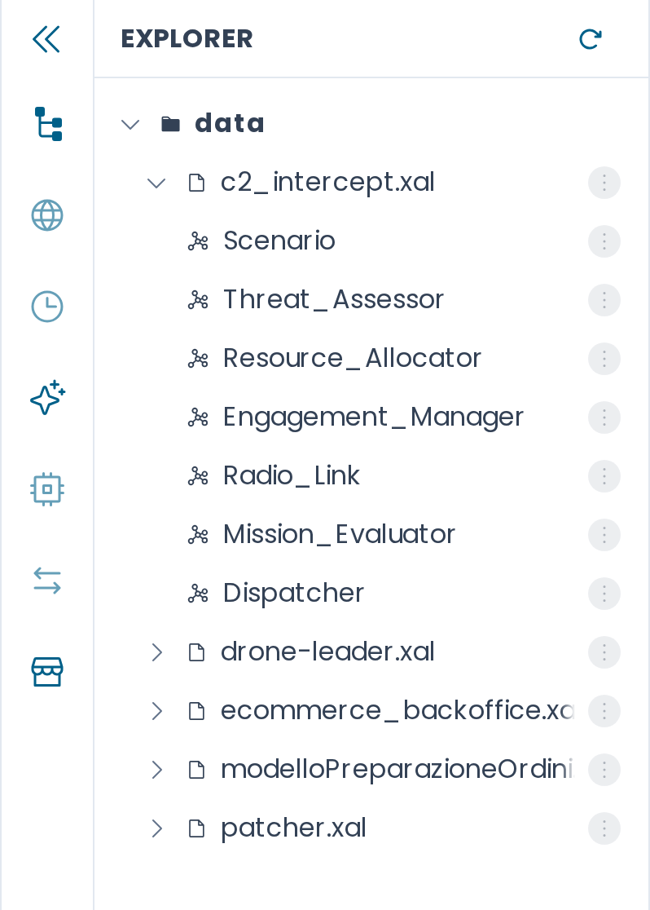

# Aprire un Automa

È possibile aprire un automa per la modifica da due punti: il grafico del Process Overview e l'Explorer.

---

## Dal Process Overview

Il tab Overview mostra il grafico delle correlazioni di tutti gli automi dei file caricati.

**Doppio clic** su un nodo del grafico per aprire l'automa corrispondente nel canvas. Appare come nuovo tab nella barra dei tab. Non serve che l'Explorer sia aperto.

Un singolo clic su un nodo evidenzia solo le sue connessioni — non apre l'automa. Assicurati di fare doppio clic.

!!! note
    Si possono aprire solo i rettangoli arrotondati. Le nuvole (automi il cui file non è tra quelli caricati) e le ellissi (automi scelti da una variabile di stato globale) non hanno un file da aprire. Vedi [Forme dei nodi](reading.md#forme-dei-nodi).

---

## Dall'Explorer

Fai clic su **File** (icona ad albero) nella barra laterale sinistra per aprire l'Explorer.

L'Explorer mostra la struttura delle cartelle del repository collegato e i file che hai caricato. Fai clic su un file XAL per espanderlo e mostrare gli automi che contiene. Ogni automa è elencato sotto il suo file con l'icona di un grafo.

Fai clic sul nome di un automa per aprirlo nel canvas. Se il suo tab è già aperto ma non attivo, il clic passa a quel tab. Se il suo tab è quello attivo, il clic chiude il tab.

Un automa che hai eliminato e non hai ancora committato resta nell'Explorer fino al commit, ma non si può aprire.

/// caption
Fig.1 - Un file XAL espanso nell'Explorer che mostra i suoi automi
///

---

## Lavorare con più automi

Ogni automa aperto appare come tab separato. Puoi avere più automi aperti contemporaneamente e passare dall'uno all'altro facendo clic sui rispettivi tab.

Aprire lo stesso automa una seconda volta passa al tab esistente anziché aprire un duplicato.

Per spostare, chiudere e gestire i tab, vedi [Tab](../getting_started/interface.md#tab).

---

## Tornare all'Overview

Fai clic sul tab **Overview** in qualsiasi momento per tornare al grafico delle correlazioni. I tab degli automi rimangono aperti in background — il lavoro non viene perso.
