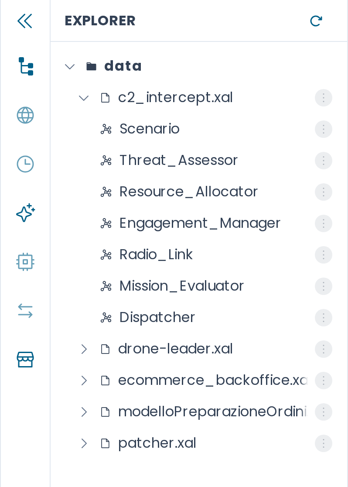

# Opening an Automaton

You can open an automaton for editing from two places: the Process Overview graph and the Explorer.

---

## From the Process Overview

The Overview tab displays the correlation graph of all automata in the loaded files.

**Double-click** a node in the graph to open the corresponding automaton on the canvas. It appears as a new tab in the tab bar. The Explorer does not need to be open.

Single-clicking a node only highlights its connections — it does not open the automaton. Make sure to double-click.

!!! note
    Only the rounded rectangles can be opened. Clouds (automata whose file is not among the loaded files) and ellipses (automata chosen from a global state variable) have no file to open. See [Node shapes](reading.md#node-shapes).

---

## From the Explorer

Click **File** (tree icon) in the left sidebar to open the Explorer.

The Explorer shows the folder structure of the connected repository and the files you uploaded. Click a XAL file to expand it and show the automata it contains. Each automaton is listed below its file with a graph icon.

Click an automaton name to open it on the canvas. If its tab is already open but not active, the click switches to it. If its tab is the active one, the click closes the tab.

An automaton that you deleted and did not commit yet stays in the Explorer until the commit, but you cannot open it.

/// caption
Fig.1 - An expanded XAL file in the Explorer showing its automata
///

---

## Working with multiple automata

Each automaton you open appears as a separate tab. You can have several automata open at the same time and switch between them by clicking their tabs.

Opening the same automaton a second time switches to its existing tab rather than opening a duplicate.

To move, close and manage the tabs, see [Tabs](../getting_started/interface.md#tabs).

---

## Navigating back to the Overview

Click the **Overview** tab at any time to return to the correlation graph. The automaton tabs remain open in the background — your work is not lost.
