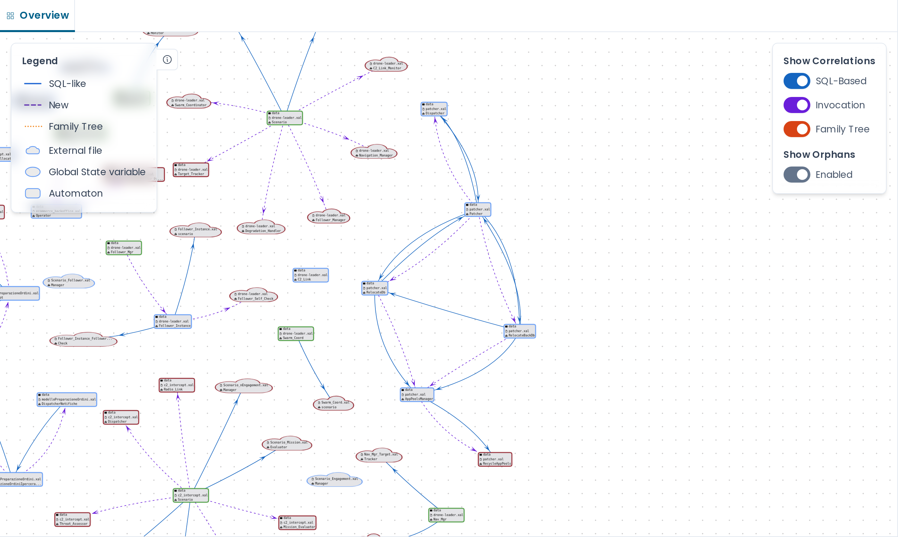
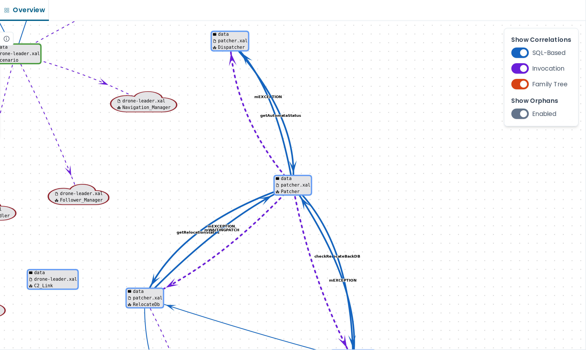

# Leggere il Process Overview

Il tab **Overview** mostra un grafico di tutti gli automi dei file caricati e delle relazioni tra loro.

Questa vista offre una visione d'insieme dell'intero sistema di automazione — quali automi esistono, come sono collegati e quali fanno riferimento ad automi che non sono nei file caricati.

/// caption
Fig.1 - Il grafico del Process Overview, con la legenda aperta a sinistra e i filtri a destra
///

Se nessun repository è collegato e nessun file è caricato, il tab mostra **Select a repository or upload a file to explore the process overview**.

Il grafico si aggiorna da solo quando i file cambiano: quando modifichi un automa, carichi un file o ricarichi i file dell'Explorer.

---

## Forme dei nodi

Ogni nodo del grafico rappresenta un automa. La forma del nodo indica dove l'automa è definito. Fai clic sul pulsante **ⓘ** in alto a sinistra del grafico per aprire la **Legend**.

| Forma | Nome nella legenda | Significato |
|---|---|---|
| Rettangolo arrotondato | Automaton | Un automa definito in un file caricato. Il nodo mostra la cartella, il file e l'automa. |
| Nuvola | External file | Un automa citato per nome del file, ma il file, o l'automa al suo interno, non è tra i file caricati. Il nodo mostra il file e l'automa. |
| Ellisse | Global State variable | L'automa è scelto durante l'esecuzione da una variabile di stato globale. Il nodo mostra il nome della variabile con l'icona del globo. |

Una nuvola non indica sempre un errore: l'automa può esistere in un altro repository e girare a livello di piattaforma. Se ti aspettavi di trovarlo nel repository, controlla il nome del file e l'`Id` dell'automa.

I nomi lunghi di cartella, file e automa sono tagliati con `...`. Passa il mouse su un nodo per vedere i nomi completi.

---

## Colori del bordo dei nodi

Il colore del bordo di un nodo riflette le sue connessioni nel grafico.

| Colore bordo | Significato |
|---|---|
| Verde | Solo connessioni in uscita — un automa sorgente |
| Rosso | Solo connessioni in ingresso — un automa foglia. Nuvole ed ellissi sono di solito rosse, perché ricevono solo connessioni. |
| Blu | Connessioni sia in ingresso che in uscita, oppure nessuna connessione (un orfano) |

La legenda disegna tutte le forme con il bordo blu: spiega le forme, non i colori.

---

## Interagire con il grafico

**Clic singolo** su un nodo per evidenziarne le connessioni. Gli archi collegati diventano più spessi, e gli archi SQL-like mostrano i nomi delle Action e delle Metric che contengono la query. Fai clic su un'area vuota del grafico per togliere l'evidenziazione.

/// caption
Fig.2 - L'automa Patcher selezionato: i suoi archi sono più spessi e mostrano le etichette
///

**Doppio clic** su un rettangolo arrotondato per aprire l'automa nel canvas come nuovo tab. Nuvole ed ellissi non si possono aprire. Vedi [Aprire un Automa](opening_automaton.md).

Il grafico supporta lo scorrimento e lo zoom. Puoi trascinare i nodi per riorganizzare il layout. Le posizioni non vengono salvate: il designer ridisegna il grafico, dallo stesso layout di partenza, quando i file cambiano, quando cambi un filtro o il tema, e quando ricarichi la pagina.

---

## Filtri

Usa il pannello in alto a destra del grafico per mostrare o nascondere ogni tipo di correlazione, e per mostrare o nascondere i nodi orfani — automi che non hanno connessioni nella vista corrente.

Se non resta nessuna correlazione da mostrare, il grafico mostra **No correlations to show**.

!!! info
    Per una descrizione dei tre tipi di correlazione e dei filtri, vedi [Tipi di Correlazione](correlation_types.md).

---

## Errori

Se il designer non riesce a leggere un file per calcolarne le correlazioni, l'Overview mostra l'errore **Error calculating correlations for** seguito dal percorso del file. Gli automi di quel file mancano dal grafico. Apri il file per trovare e correggere l'errore.
