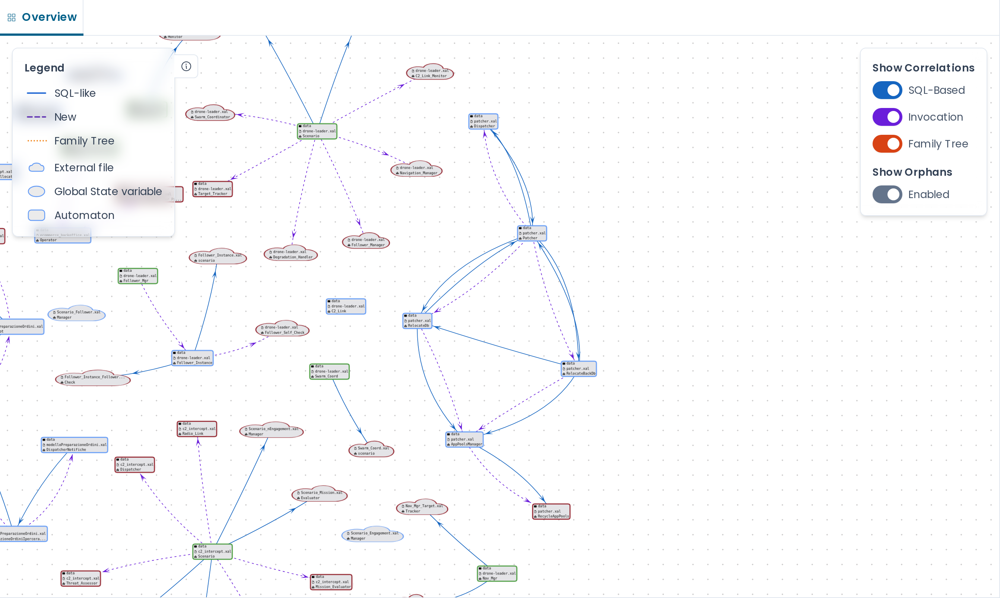
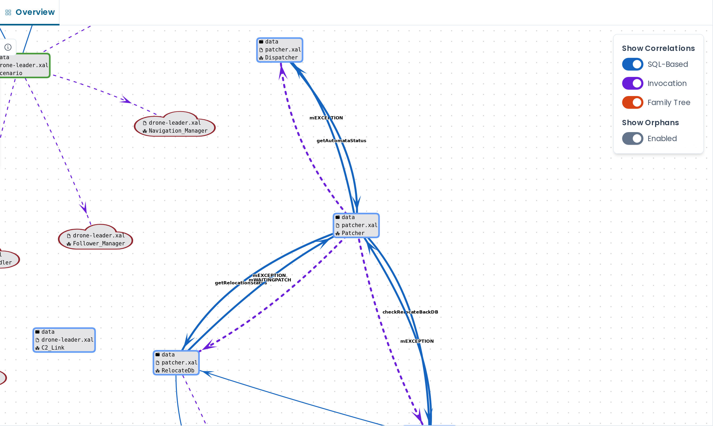

# Reading the Process Overview

The **Overview** tab displays a graph of all the automata in the loaded files and the relationships between them.

This view gives you a bird's-eye picture of the entire automation system — which automata exist, how they are connected, and which ones reference automata that are not in the loaded files.

/// caption
Fig.1 - The Process Overview graph, with the legend open on the left and the filters on the right
///

If no repository is connected and no file is uploaded, the tab shows **Select a repository or upload a file to explore the process overview**.

The graph updates by itself when the files change: when you edit an automaton, upload a file, or reload the files of the Explorer.

---

## Node shapes

Each node in the graph represents an automaton. The shape of the node indicates where the automaton is defined. Click the **ⓘ** button at the top left of the graph to open the **Legend**.

| Shape | Legend name | Meaning |
|---|---|---|
| Rounded rectangle | Automaton | An automaton defined in a loaded file. The node shows the folder, the file and the automaton. |
| Cloud | External file | An automaton referenced by file name, but the file, or the automaton in it, is not among the loaded files. The node shows the file and the automaton. |
| Ellipse | Global State variable | The automaton is chosen at run time from a global state variable. The node shows the variable name with a globe icon. |

A cloud does not always mean an error: the automaton can exist in another repository and run at platform level. If you expected to find it in the repository, check the file name and the automaton `Id`.

Long folder, file and automaton names are cut with `...`. Hover a node to see the full names.

---

## Node border colors

The border color of a node reflects its connections in the graph.

| Border color | Meaning |
|---|---|
| Green | Only outgoing connections — a source automaton |
| Red | Only incoming connections — a leaf automaton. Clouds and ellipses are usually red, because they only receive connections. |
| Blue | Both incoming and outgoing connections, or no connections at all (an orphan) |

The legend draws all the shapes with a blue border: it explains the shapes, not the colors.

---

## Interacting with the graph

**Single-click** a node to highlight its connections. The connected edges become thicker, and the SQL-like edges show the names of the Actions and Metrics that contain the query. Click an empty area of the graph to remove the highlight.

/// caption
Fig.2 - The Patcher automaton selected: its edges are thicker and show their labels
///

**Double-click** a rounded rectangle to open the automaton on the canvas as a new tab. Clouds and ellipses cannot be opened. See [Opening an Automaton](opening_automaton.md).

The graph supports panning and zooming. You can drag the nodes to rearrange the layout. The positions are not saved: the designer draws the graph again, from the same starting layout, when the files change, when you change a filter or the theme, and when you reload the page.

---

## Filtering

Use the panel at the top right of the graph to show or hide each correlation type, and to show or hide the orphan nodes — automata that have no connections in the current view.

If no correlation is left to show, the graph shows **No correlations to show**.

!!! info
    For a description of the three correlation types and of the filters, see [Correlation Types](correlation_types.md).

---

## Errors

If the designer cannot read a file to compute its correlations, the Overview shows the error **Error calculating correlations for** followed by the file path. The automata of that file are missing from the graph. Open the file to find and correct the error.
