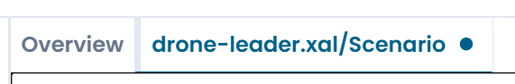
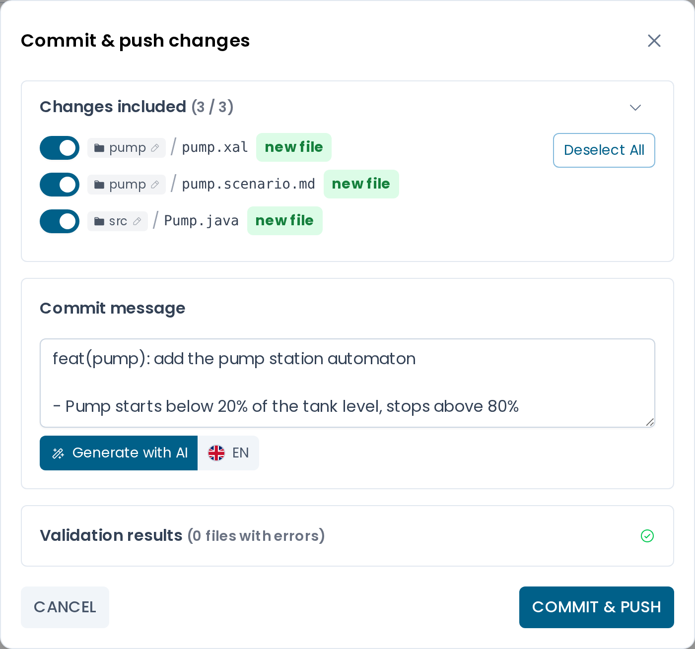

# Commit e Push

Quando hai terminato di modificare un automa, puoi pubblicare le modifiche nel repository collegato utilizzando la funzione **Commit & Push**.

---

## L'indicatore di modifiche non salvate

Durante la modifica, un **indicatore a punto** appare sul tab di qualsiasi automa che ha modifiche non ancora committate. Questo include modifiche strutturali (aggiunta o rimozione di stati e transizioni), modifiche di configurazione e modifiche di layout come lo spostamento di nodi nel canvas.

/// caption
Fig.1 - L'indicatore a punto segnala modifiche non committate su un tab
///

---

## Aprire la finestra di dialogo Commit

Fai clic sul **pulsante upload/commit** nella barra superiore per aprire la finestra di dialogo **Commit & Push**. Il pulsante è attivo solo quando sono collegati un repository e un branch e c'è almeno una modifica da committare.

Se hai modificato a mano un XAL che ha funzioni Java, il designer prima aggiorna il suo file di stub Java. Il file `.java` aggiornato compare poi tra le modifiche. Vedi [Stub Java](../arianna/java_stubs.md).

/// caption
Fig.2 - La finestra di dialogo Commit & Push
///

La finestra di dialogo mostra:

| Sezione | Descrizione |
|---|---|
| **Changes included** | Tutte le modifiche in sospeso, con il numero di quelle selezionate sul totale. Ogni modifica ha un toggle per includerla nel commit. All'apertura nessuna modifica è selezionata: usa **Select All**, oppure i singoli toggle. |
| **Commit message** | Un campo di testo per il messaggio di commit, pre-compilato con `Commit from XAL Designer`. Scrivi il tuo messaggio, oppure fai clic su **Generate with AI**. |
| **Validation results** | Il risultato della validazione eseguita sui file selezionati. Un segno di spunta verde e **0 files with errors** significa che i file sono validi e pronti per il commit. |

---

## Scegliere le modifiche

Ogni modifica ha un'etichetta che ti dice di che cosa si tratta:

| Etichetta | Significato |
|---|---|
| **new file** | Un file che non è ancora nel repository. |
| **new** | Un automa nuovo in un file del repository. |
| **modified** | Un automa che hai modificato. |
| **removed** | Un automa che hai eliminato. |
| **layout only** | Un automa in cui è cambiata solo la posizione dei nodi. Fai clic sulla freccia accanto all'etichetta per scartare queste modifiche. |
| **regenerating** | Un file che Arianna sta generando di nuovo. Puoi committarlo quando la generazione finisce. |

### File che vanno insieme

Un file XAL, il suo scenario (`.scenario.md`) e il suo file di stub Java (`.java`) si committano insieme. Quando ne selezioni uno, si selezionano anche gli altri. Quando ne togli uno, si tolgono anche gli altri.

### Scegliere la cartella di un file nuovo

Un file nuovo mostra la sua cartella in un chip prima del nome del file. Il chip mostra **root** quando il file è nella cartella principale del repository.

1. Fai clic sul chip.
2. Scrivi il percorso della cartella, per esempio `processes/pumps`. Una cartella che non esiste ancora viene creata dal commit.
3. Premi **Invio**, oppure fai clic fuori dal campo.

Un file XAL e il suo scenario restano nella stessa cartella: quando sposti uno dei due, si sposta anche l'altro. Il file `.java` puoi metterlo in qualsiasi cartella: l'XAL viene aggiornato con il nuovo percorso.

Se l'XAL o lo scenario è già nel repository, il chip del file nuovo è bloccato: il file resta accanto all'altro. Passa il mouse sul chip per vedere il motivo.

Il chip diventa rosso, e non puoi fare il commit, quando:

- il percorso contiene caratteri non ammessi (usa lettere, numeri, `_ - . ( )` e `/`);
- nel repository c'è già un file con lo stesso percorso;
- un altro file nuovo va nello stesso percorso.

---

## Generare il messaggio con l'AI

Fai clic su **Generate with AI** per far scrivere il messaggio di commit ad Arianna. Arianna legge le modifiche selezionate e, quando c'è, lo scenario di ogni XAL. Il messaggio segue il formato conventional commits, per esempio `feat(pump): add the pump station automaton`.

- Il pulsante è disponibile quando è impostata una chiave API (vedi [Configurazione](../arianna/setup.md)), almeno una modifica è selezionata e Arianna non sta rispondendo nella chat.
- Il messaggio generato sostituisce il testo del campo. Puoi modificarlo prima del commit.
- Se chiudi la finestra mentre il messaggio viene generato, la generazione si ferma.

Il pulsante accanto a **Generate with AI** mostra la lingua del messaggio, con la sua bandiera. Fai clic per scegliere **EN** o **IT**. Questa lingua è separata da quella di Arianna: all'inizio è la stessa, poi il designer ricorda la tua scelta.

---

## Validazione prima del commit

Prima che il commit venga inviato, la piattaforma valida tutti i file XAL inclusi rispetto allo schema e alle regole di runtime. Questa è la validazione autorevole — è lo stesso controllo che viene eseguito quando la piattaforma carica un automa.

Se un file contiene errori, la sezione dei risultati di validazione mostra il numero di file con errori. Risolvi i problemi prima di fare il commit. Se devi committare comunque, il pulsante diventa **Commit & Push anyway**. Lo stesso succede quando il validatore non è raggiungibile: i file non sono stati controllati.

!!! note
    Il designer può mostrare avvisi di validazione del modulo (come messaggi sul formato dei campi) che sono indipendenti dalla validazione backend. Un file che supera la validazione backend è considerato corretto, anche se il designer mostra avvisi minori.

---

## Completare il commit

Una volta superata la validazione, fai clic su **Commit & Push** per pubblicare le modifiche. Le modifiche vengono inviate al branch selezionato del repository collegato.

L'indicatore a punto scompare dai tab interessati dopo un commit riuscito.

---

## Chiudere un tab con modifiche non committate

Chiudere un tab non scarta le sue modifiche: restano nell'elenco delle modifiche da committare e le ritrovi quando riapri l'automa.

Per scartare le modifiche di un automa, fai clic destro sull'automa nel pannello dei file e scegli **Discard changes**. Conferma con **Discard**: l'automa torna alla versione del repository.

!!! warning
    Le modifiche scartate non si possono recuperare dall'interno del designer.
