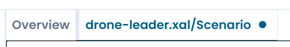
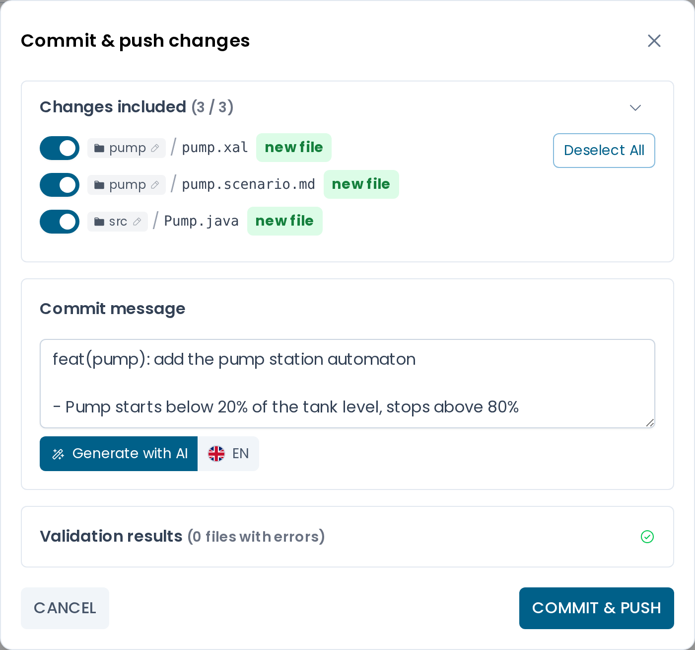

# Commit and Push

When you have finished editing an automaton, you can publish your changes back to the connected repository using the **Commit & Push** function.

---

## The unsaved changes indicator

While you are editing, a **dot indicator** appears on the tab of any automaton that has uncommitted changes. This includes structural edits (adding or removing states and transitions), configuration changes, and layout changes such as moving nodes on the canvas.

/// caption
Fig.1 - The dot indicator signals uncommitted changes on a tab
///

---

## Opening the commit dialog

Click the **upload/commit button** in the top bar to open the **Commit & Push** dialog. The button is active only when a repository and a branch are connected and there is at least one change to commit.

If you edited by hand an XAL that has Java functions, the designer first brings its Java stub file up to date. The updated `.java` file then appears among the changes. See [Java Stubs](../arianna/java_stubs.md).

/// caption
Fig.2 - The Commit & Push dialog
///

The dialog shows:

| Section | Description |
|---|---|
| **Changes included** | All the pending changes, with the number of selected changes out of the total. Each change has a toggle to include it in the commit. No change is selected when the dialog opens: use **Select All**, or the single toggles. |
| **Commit message** | A text field for the commit message, pre-filled with `Commit from XAL Designer`. Write your own message, or click **Generate with AI**. |
| **Validation results** | The result of the validation run on the selected files. A green checkmark and **0 files with errors** means that the files are valid and ready to commit. |

---

## Choosing the changes

Each change has a tag that tells you what it is:

| Tag | Meaning |
|---|---|
| **new file** | A file that is not in the repository yet. |
| **new** | A new automaton in a file of the repository. |
| **modified** | An automaton you changed. |
| **removed** | An automaton you deleted. |
| **layout only** | An automaton where only the position of the nodes changed. Click the arrow next to the tag to discard these changes. |
| **regenerating** | A file that Arianna is generating again. You can commit it when the generation ends. |

### Files that go together

An XAL file, its scenario (`.scenario.md`) and its Java stub file (`.java`) are committed together. When you select one of them, the others are selected too. When you clear one of them, the others are cleared too.

### Choosing the folder of a new file

A new file shows its folder as a chip before the file name. The chip shows **root** when the file is at the top of the repository.

1. Click the chip.
2. Type the folder path, for example `processes/pumps`. A folder that does not exist yet is created by the commit.
3. Press **Enter**, or click outside the field.

An XAL file and its scenario stay in the same folder: when you move one of them, the other moves too. You can put the `.java` file in any folder: the XAL is updated to point to the new path.

If the XAL or the scenario is already in the repository, the chip of the new file is locked: the file stays next to the other one. Hover over the chip to see why.

The chip turns red, and you cannot commit, when:

- the path contains characters that are not allowed (use letters, numbers, `_ - . ( )` and `/`);
- a file with the same path is already in the repository;
- another new file goes to the same path.

---

## Generating the message with AI

Click **Generate with AI** to let Arianna write the commit message. Arianna reads the selected changes and, when there is one, the scenario of each XAL. The message follows the conventional commits format, for example `feat(pump): add the pump station automaton`.

- The button is available when an API key is set (see [Setup](../arianna/setup.md)), at least one change is selected, and Arianna is not answering in the chat.
- The generated message replaces the text in the field. You can edit it before you commit.
- If you close the dialog while the message is being generated, the generation stops.

The button next to **Generate with AI** shows the language of the message, with its flag. Click it to choose **EN** or **IT**. This language is separate from the language of Arianna: at first it is the same, then the designer remembers your choice.

---

## Validation before commit

Before the commit is sent, the platform validates all included XAL files against the schema and runtime rules. This is the authoritative validation — it is the same check that runs when the platform loads an automaton.

If any file contains errors, the validation results section shows the number of files with errors. Resolve the issues before committing. If you need to commit anyway, the button becomes **Commit & Push anyway**. The same happens when the validator cannot be reached: the files were not checked.

!!! note
    The designer may show form validation warnings (such as field format messages) that are independent of the backend validation. A file that passes backend validation is considered correct, even if the designer shows minor warnings.

---

## Completing the commit

Once the validation passes, click **Commit & Push** to publish your changes. The changes are pushed to the selected branch of the connected repository.

The dot indicator disappears from the affected tabs after a successful commit.

---

## Closing a tab with uncommitted changes

Closing a tab does not discard its changes: they stay in the list of changes to commit, and you find them again when you reopen the automaton.

To discard the changes to an automaton, right-click it in the file panel and choose **Discard changes**. Confirm with **Discard**: the automaton goes back to the version in the repository.

!!! warning
    Discarded changes cannot be recovered from within the designer.
