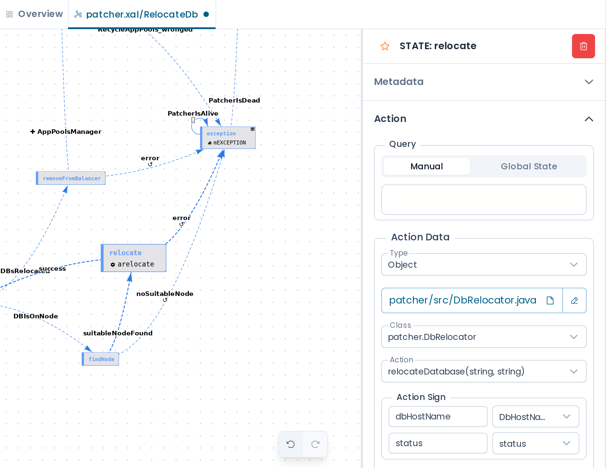

# Configurare le Action degli Stati

Un'Action associata a uno stato definisce un'operazione che l'automa esegue quando entra in quello stato. Le Action interagiscono con sistemi esterni — API, piattaforme ERP, sistemi di gestione magazzino o qualsiasi altro target di integrazione. Un'Action può anche avviare un altro automa.

Per configurare un'Action, seleziona uno stato nel canvas e apri il pannello **Action** nella sidebar dello stato.

/// caption
Fig.1 - Il pannello Action di uno stato, con un metodo Java scelto
///

Il pannello salva da solo ogni modifica, come il resto della sidebar. Se il nome dello stato non è valido, il pannello mostra **Changes are kept but not saved until the state metadata is valid.** Correggi il nome in **Metadata** per salvarle (vedi [Creare uno stato](creating.md#assegnare-un-nome-allo-stato)).

---

## L'indicatore di avviso

Quando uno stato non ha un'Action, l'intestazione **Action** mostra un'icona **⚠**. È solo un promemoria: non impedisce di salvare o committare l'automa.

---

## Query

Il campo **Query** è facoltativo. Recupera dati dalla piattaforma prima che l'Action venga eseguita. Scegli come compilarlo:

- **Manual**: scrivi la query nell'editor (vedi [Sintassi delle query](../../reference/queries.md)).
- **Global State**: seleziona una variabile del Global State che contiene la query.

Quando l'Action ha una query e dei parametri, sopra i parametri di **Action Sign** compaiono **list[string]** e **Query result**: il risultato della query viene passato all'Action.

---

## Action Data

Il campo **Type** stabilisce cosa esegue l'Action:

| Type | Cosa esegue |
|---|---|
| **Object** | Un metodo Java |
| **Automaton** | Un altro automa |

Cambiare **Type** svuota il file, la classe e il **Target Type**.

### Type Object

1. Nel campo del file, clicca l'**icona del file** e scegli il file `.java` dal repository. Per scrivere il percorso a mano, clicca la **matita**.
2. In **Class**, seleziona la classe. Se il file ha una sola classe, il designer la seleziona per te.
3. In **Action**, seleziona il metodo. L'elenco mostra solo i metodi `public static` della classe, con i tipi dei parametri.
4. In **Action Sign**, collega ogni parametro del metodo a una variabile del Global State dell'automa. Per i parametri `string` e `int`, l'elenco mostra solo le variabili dello stesso tipo.
5. In **Action Return**, seleziona la variabile del Global State che riceve il valore restituito dal metodo.

Sotto i parametri, **Action Code** mostra il codice del metodo. Qui non puoi modificarlo.

Cambiare **Class** svuota **Action**.

Se il file non è nel repository, il pannello mostra **The file appears to be missing from the repository. Code preview is disabled.** Puoi comunque configurare l'Action: **Class** e **Action** diventano campi di testo e aggiungi i parametri a mano (vedi [Parametri scritti a mano](#parametri-scritti-a-mano)). Il file può esistere nell'ambiente di runtime della piattaforma, e l'automa funziona lo stesso.

!!! info
    Le classi disponibili per le Action dipendono dal deployment della piattaforma. Per un elenco delle implementazioni standard, contatta il team di delivery di XAUTOMATA.

### Type Automaton

Con **Target Type** scegli da dove viene l'automa da avviare.

**File**

1. In **File\***, scegli il file `.xal` che contiene l'automa.
2. In **Automaton\***, seleziona l'automa. L'elenco mostra gli automi del file.
3. In **Min Wait**, scrivi l'attesa minima in secondi.
4. In **Action Sign**, collega le variabili di input dell'automa chiamato alle variabili di quello corrente.
5. In **Action Return**, collega le variabili di output dell'automa chiamato alle variabili di quello corrente.

**Global States**

Il file e l'automa vengono da due variabili del Global State di tipo `string`:

- **File\***: la variabile che contiene il file;
- **Automaton\***: la variabile che contiene l'automa.

I parametri li aggiungi a mano.

Cambiare **Target Type** svuota il file, l'automa e i parametri.

### Parametri scritti a mano

Quando il designer non può leggere i parametri da un file, li aggiungi uno alla volta: scrivi il nome del parametro, seleziona la variabile locale e clicca **+**. Per togliere un parametro, clicca **×**. Non puoi aggiungere due volte lo stesso parametro: il pannello mostra **Parameter already added**.

---

## Togliere l'Action

Clicca **Reset** in fondo al pannello. Il form si svuota e lo stato non ha più un'Action. Per recuperarla, premi **Ctrl+Z**.

---

## Modifiche automatiche

Quando apri uno stato, il designer può adattare alcuni valori perché il form li possa mostrare. Una notifica te lo segnala:

- **Action was changed**: un percorso salvato è stato adattato al form.
- **Automaton was reset**: l'automa selezionato non esiste più nel file. Selezionane uno nuovo, oppure cambia il file.
