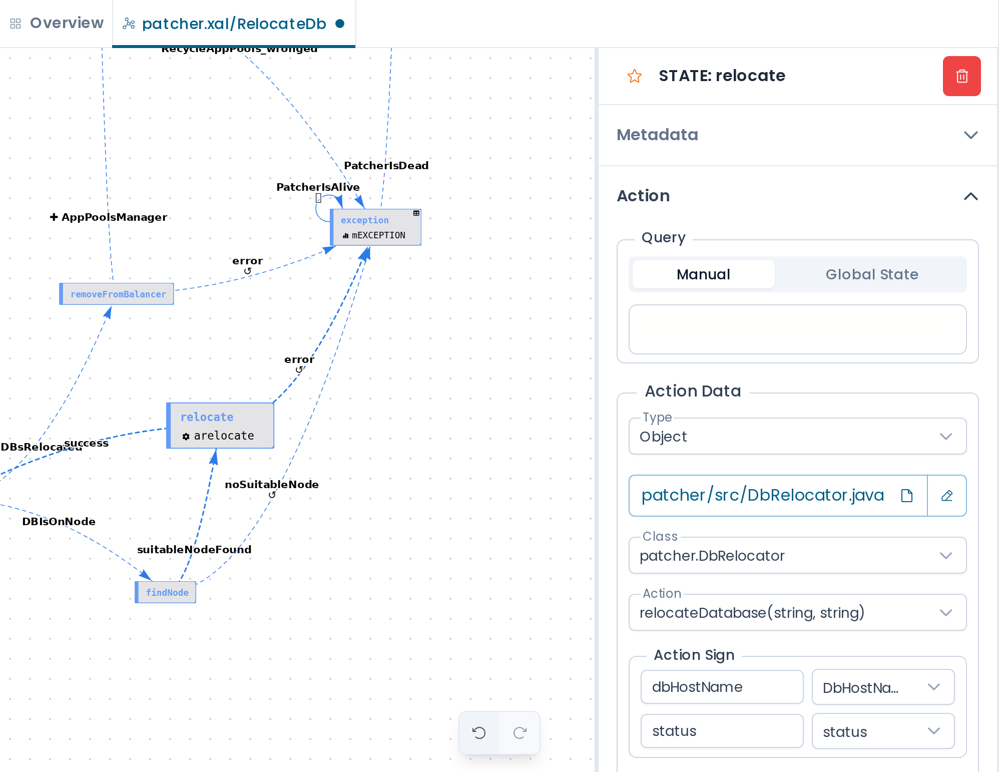

# Configuring State Actions

An action associated with a state defines an operation the automaton performs when it enters that state. Actions interact with external systems — APIs, ERP platforms, warehouse management systems, or any other integration target. An action can also start another automaton.

To configure an action, select a state on the canvas and open the **Action** panel in the state sidebar.

/// caption
Fig.1 - The Action panel of a state, with a Java method chosen
///

The panel saves every change by itself, like the rest of the sidebar. If the state name is not valid, the panel shows **Changes are kept but not saved until the state metadata is valid.** Fix the name in **Metadata** to save them (see [Creating a State](creating.md#naming-a-state)).

---

## The warning indicator

When a state has no action, the **Action** header shows a **⚠** icon. It is only a reminder: it does not prevent the automaton from being saved or committed.

---

## Query

The **Query** field is optional. It retrieves data from the platform before the action runs. Choose how to fill it:

- **Manual**: type the query in the editor (see [Query Syntax](../../reference/queries.md)).
- **Global State**: select a global state variable that holds the query.

When the action has a query and parameters, **list[string]** and **Query result** appear above the parameters in **Action Sign**: the result of the query is passed to the action.

---

## Action Data

The **Type** field sets what the action runs:

| Type | What it runs |
|---|---|
| **Object** | A Java method |
| **Automaton** | Another automaton |

Changing **Type** clears the file, the class and the **Target Type**.

### Type Object

1. In the file field, click the **file icon** and choose the `.java` file from the repository. To type the path instead, click the **pencil**.
2. In **Class**, select the class. If the file has only one class, the designer selects it for you.
3. In **Action**, select the method. The list shows only the `public static` methods of the class, with their parameter types.
4. In **Action Sign**, link each parameter of the method to a global state variable of the automaton. For `string` and `int` parameters, the list shows only the variables of the same type.
5. In **Action Return**, select the global state variable that receives the value returned by the method.

Below the parameters, **Action Code** shows the code of the method. You cannot edit it here.

Changing **Class** clears **Action**.

If the file is not in the repository, the panel shows **The file appears to be missing from the repository. Code preview is disabled.** You can still configure the action: **Class** and **Action** become text fields, and you add the parameters by hand (see [Parameters typed by hand](#parameters-typed-by-hand)). The file may exist in the platform's runtime environment, and the automaton still works.

!!! info
    The classes available for actions depend on the platform deployment. For a list of standard implementations, contact the XAUTOMATA delivery team.

### Type Automaton

Use **Target Type** to choose where the automaton to start comes from.

**File**

1. In **File\***, choose the `.xal` file that contains the automaton.
2. In **Automaton\***, select the automaton. The list shows the automata of the file.
3. In **Min Wait**, type the minimum wait in seconds.
4. In **Action Sign**, link the input variables of the called automaton to the variables of the current one.
5. In **Action Return**, link the output variables of the called automaton to the variables of the current one.

**Global States**

The file and the automaton come from two global state variables of type `string`:

- **File\***: the variable that holds the file;
- **Automaton\***: the variable that holds the automaton.

You add the parameters by hand.

Changing **Target Type** clears the file, the automaton and the parameters.

### Parameters typed by hand

When the designer cannot read the parameters from a file, you add them one by one: type the name of the parameter, select the local variable and click **+**. To remove a parameter, click **×**. You cannot add the same parameter twice: the panel shows **Parameter already added**.

---

## Removing the action

Click **Reset** at the bottom of the panel. The form is cleared and the state no longer has an action. To get it back, press **Ctrl+Z**.

---

## Automatic changes

When you open a state, the designer may adjust some values so that the form can show them. A notification tells you:

- **Action was changed**: a saved path was adapted to the form.
- **Automaton was reset**: the selected automaton no longer exists in the file. Select a new one, or change the file.
