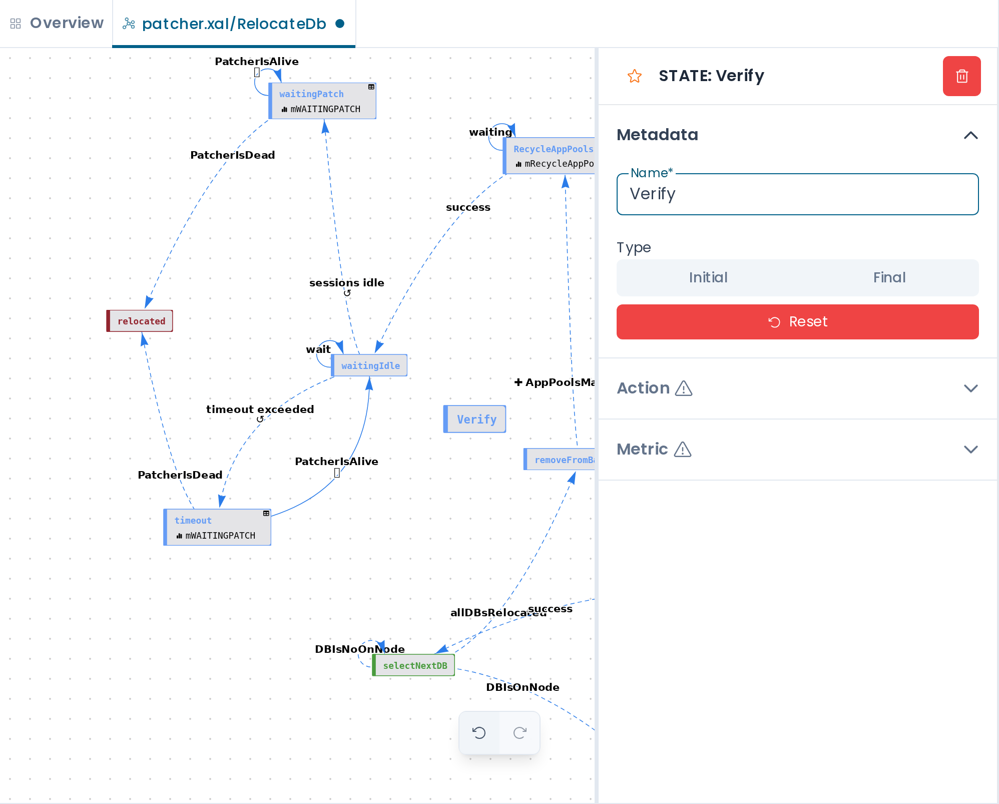

# Creare uno Stato

Gli stati sono i nodi del diagramma dell'automa. È possibile creare un nuovo stato in qualsiasi momento mentre un automa è aperto nel canvas.

---

## Aggiungere uno stato

1. Fai clic su **New State** nella barra laterale sinistra. Il pannello di configurazione si apre sulla destra, con il nome `NewNode`.
2. Nel campo **Name**, scrivi il nome dello stato.

Lo stato compare nel canvas appena il nome è valido. Da lì in poi il pannello salva da solo ogni modifica: non c'è un pulsante di salvataggio.

/// caption
Fig.1 - Un nuovo stato nel canvas, con il suo pannello di configurazione
///

Per rinunciare prima che lo stato compaia, fai clic su **×** nell'intestazione del pannello. Non viene aggiunto niente.

---

## Assegnare un nome allo stato

Il nome deve rispettare queste regole:

- è obbligatorio;
- contiene solo lettere e numeri, senza spazi né underscore;
- non è `NewNode`;
- non è già usato da un altro stato dello stesso automa.

Se il nome non rispetta una regola, il pannello mostra un messaggio vicino al campo. Uno stato esistente tiene le altre modifiche, ma le salva solo quando il nome torna valido.

Quando rinomini uno stato, le transizioni collegate seguono il nuovo nome.

---

## Impostare il tipo di stato

Usa il selettore **Type** per contrassegnare lo stato come **Initial** o **Final**. Lasciali entrambi deselezionati per uno stato intermedio.

- **Initial** rende questo lo stato di partenza dell'automa. Un automa ha un solo stato iniziale: se selezioni **Initial** su un altro stato, quello diventa lo stato iniziale e il precedente diventa uno stato intermedio.
- **Final** contrassegna uno stato terminale. Un automa può avere più stati finali. Quando l'automa raggiunge uno stato finale, interrompe l'elaborazione.

Non puoi cambiare il tipo dello stato iniziale, né eliminarlo. Per sostituirlo, seleziona **Initial** su un altro stato.

**Reset** cancella il nome e il tipo. Sullo stato iniziale lascia il tipo com'è.

La **stella** accanto al nome dello stato lo contrassegna come preferito (*starred*, vedi [Riferimento States](../../reference/states.md#stati-starred)).

---

## Salvataggio e modifiche automatiche

Mentre il pannello salva una modifica, in alto a destra nel canvas compare **Applying changes…** e sotto la barra superiore scorre una linea sottile.

Quando apri uno stato, il designer può correggere alcuni valori della sua Action o della sua Metric perché il form li possa mostrare. Te lo dice una notifica: **Action was changed** o **Metric was changed**. Vedi [Action](actions.md) e [Metric](metrics.md).

Per annullare una modifica, fai clic sul pulsante di annullamento in fondo al canvas o premi **Ctrl+Z** (vedi [L'Interfaccia](../getting_started/interface.md#canvas)).

---

## Spostare gli stati nel canvas

Trascina un nodo stato per riposizionarlo nel canvas. Il layout non è vincolato: posiziona i nodi dove il diagramma si legge meglio.

!!! note
    Spostare un nodo conta come modifica, e il tab mostra un punto. Se hai solo spostato dei nodi, il dialog di [Commit and Push](../publishing/commit.md) segna l'automa come **layout only**.

---

## Eliminare uno stato

Seleziona lo stato nel canvas, fai clic sull'**icona cestino** nell'angolo in alto a destra del pannello e conferma con **OK**.

Eliminare uno stato rimuove anche tutte le transizioni collegate. Per recuperarle, premi **Ctrl+Z**.
