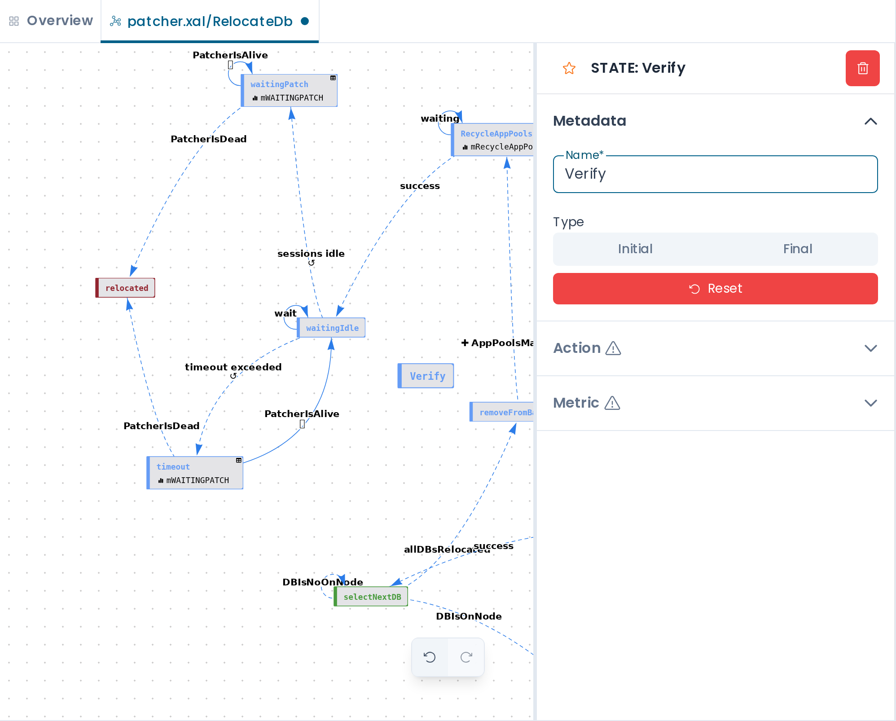

# Creating a State

States are the nodes of the automaton diagram. You can create a new state at any time while an automaton is open on the canvas.

---

## Adding a state

1. Click **New State** in the left sidebar. The configuration panel opens on the right, with the name `NewNode`.
2. In the **Name** field, type the name of the state.

The state appears on the canvas as soon as the name is valid. From then on the panel saves every change by itself: there is no save button.

/// caption
Fig.1 - A new state on the canvas, with its configuration panel
///

To give up before the state appears, click **×** in the panel header. Nothing is added.

---

## Naming a state

The name must follow these rules:

- it is required;
- it contains only letters and numbers, with no spaces or underscores;
- it is not `NewNode`;
- it is not used by another state of the same automaton.

If the name breaks a rule, the panel shows a message next to the field. An existing state keeps your other changes, but saves them only when the name is valid again.

When you rename a state, the transitions connected to it follow the new name.

---

## Setting the state type

Use the **Type** selector to mark the state as **Initial** or **Final**. Leave both unselected for an intermediate state.

- **Initial** makes this the starting state of the automaton. An automaton has only one initial state: if you select **Initial** on another state, that state becomes the initial one and the previous one becomes an intermediate state.
- **Final** marks a terminal state. An automaton can have several final states. When the automaton reaches a final state, it stops processing.

You cannot change the type of the initial state, and you cannot delete it. To replace it, select **Initial** on another state.

**Reset** clears the name and the type. On the initial state, it leaves the type as it is.

The **star** next to the state name marks the state as starred (see [States](../../reference/states.md#starred-states)).

---

## Saving and automatic changes

While the panel saves a change, **Applying changes…** appears at the top right of the canvas, and a thin line runs under the top bar.

When you open a state, the designer can adjust some values of its Action or Metric so that the form can show them. A notification tells you: **Action was changed** or **Metric was changed**. See [Actions](actions.md) and [Metrics](metrics.md).

To undo a change, click the undo button at the bottom of the canvas or press **Ctrl+Z** (see [The Interface](../getting_started/interface.md#canvas)).

---

## Moving states on the canvas

Drag a state node to reposition it on the canvas. The layout is not constrained: place nodes wherever makes the diagram easiest to read.

!!! note
    Moving a node counts as a change, and the tab shows a dot. If you only moved nodes, the [Commit and Push](../publishing/commit.md) dialog marks the automaton as **layout only**.

---

## Deleting a state

Select the state on the canvas, click the **trash icon** in the top-right corner of the panel and confirm with **OK**.

Deleting a state also removes all the transitions connected to it. To get them back, press **Ctrl+Z**.
