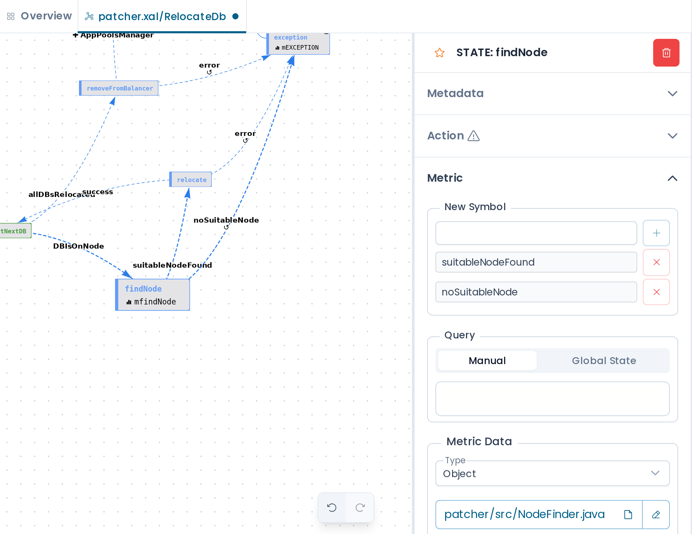

# Configurare le Metric degli Stati

Una Metric associata a uno stato definisce cosa l'automa osserva mentre si trova in quello stato. I valori restituiti dalla Metric determinano quale transizione in uscita scatta successivamente.

Per configurare una Metric, seleziona uno stato nel canvas e apri il pannello **Metric** nella sidebar dello stato.


/// caption
Fig.1 - Il pannello Metric di uno stato, con due simboli e un file Java scelto
///

Il pannello salva da solo ogni modifica, come il resto della sidebar. Se il nome dello stato non è valido, il pannello mostra **Changes are kept but not saved until the state metadata is valid.** Correggi il nome in **Metadata** per salvarle (vedi [Creare uno stato](creating.md#assegnare-un-nome-allo-stato)).

Nel canvas, uno stato con una Metric mostra un'**icona a grafico** seguita dal nome della Metric.

---

## L'indicatore di avviso

Quando uno stato non ha una Metric, l'intestazione **Metric** mostra un'icona **⚠**. È solo un promemoria: non impedisce di salvare o committare l'automa.

---

## Simboli

I simboli sono i valori che la Metric può restituire. Ogni simbolo è un possibile esito che una transizione in uscita può attendere.

Per aggiungere un simbolo, scrivilo in **New Symbol** e fai clic su **+**. Per toglierlo, fai clic su **×** accanto al simbolo.

- Un simbolo inizia con una lettera e contiene solo lettere, cifre e trattini (`-`).
- Non puoi aggiungere due volte lo stesso simbolo: il pannello mostra **Symbol already added**.

!!! info
    Su ogni transizione in uscita, l'elenco **Metric Value** mostra i simboli della Metric dello stato di partenza (vedi [Metric Value e Clock](../transitions/metric_clocks.md#metric-value)). Aggiungi prima i simboli qui, poi sceglili sulle transizioni.

---

## Query

Il campo **Query** è facoltativo. Legge dati dalla piattaforma prima che la Metric venga eseguita, per esempio il Global State di un altro automa. Scegli come compilarlo:

- **Manual**: scrivi la query nell'editor.
- **Global State**: seleziona una variabile del Global State che contiene la query.

Una query che legge lo stato dell'automa `Patcher` in `patcher.xal`:

```sql
SELECT GLOBALSTATE_STATUS FROM patcher_Patcher WHERE groupLabel = 'this.GROUPLABEL'
```

Il nome della tabella unisce il nome del file e quello dell'automa. Per le regole, vedi [Sintassi delle query](../../reference/queries.md).

Quando la Metric ha una query e dei parametri, sopra i parametri di **Metric Sign** compaiono **list[string]** e **Query result**: il risultato della query viene passato alla Metric.

Quando è configurata una query, il nodo dello stato nel canvas mostra un'**icona a tabella** nell'angolo in alto a destra.

---

## Metric Data

**Metric Data** funziona come **Action Data** nel pannello Action: stesso **Type** (**Object** o **Automaton**), stessi campi e stessi passi. Vedi [Configurare le Action degli stati](actions.md#action-data). Cambiano solo i nomi:

| Pannello Action | Pannello Metric |
|---|---|
| **Action** | **Metric** |
| **Action Sign** | **Metric Sign** |
| **Action Return** | **Metric Return** |
| **Action Code** | **Metric Code** |

### Quale valore è il simbolo

Una Metric restituisce il simbolo che sceglie la transizione in uscita. In **Metric Return**, il pulsante tondo accanto a un valore di ritorno indica il valore che contiene il simbolo.

- Con **Type Object**, il metodo ha un solo valore di ritorno: è il simbolo, e viene anche scritto nella variabile del Global State che selezioni.
- Con **Type Automaton**, l'automa chiamato può restituire più valori. Fai clic sul pulsante tondo accanto a quello che contiene il simbolo.

---

## Togliere la Metric

Fai clic su **Reset** in fondo al pannello. Il form viene svuotato, simboli compresi, e lo stato non ha più una Metric. Per recuperarla, premi **Ctrl+Z**.

!!! warning
    Le transizioni che escono da questo stato mantengono il loro **Metric Value**, ma nessuna Metric lo restituisce più.

---

## Modifiche automatiche

Quando apri uno stato, il designer può correggere alcuni valori perché il form li possa mostrare. Te lo dice una notifica:

- **Metric was changed**: un percorso salvato è stato adattato al form.
- **Automaton was reset**: l'automa scelto non esiste più nel file. Scegline un altro, oppure cambia il file.
