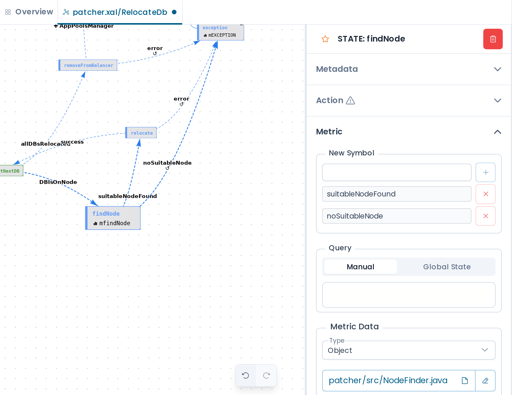

# Configuring State Metrics

A metric associated with a state defines what the automaton observes while it is in that state. The values returned by the metric determine which outgoing transition fires next.

To configure a metric, select a state on the canvas and open the **Metric** panel in the state sidebar.


/// caption
Fig.1 - The Metric panel of a state, with two symbols and a Java file chosen
///

The panel saves every change by itself, like the rest of the sidebar. If the state name is not valid, the panel shows **Changes are kept but not saved until the state metadata is valid.** Fix the name in **Metadata** to save them (see [Creating a State](creating.md#naming-a-state)).

On the canvas, a state with a metric shows a **chart icon** followed by the metric name.

---

## The warning indicator

When a state has no metric, the **Metric** header shows a **⚠** icon. It is only a reminder: it does not prevent the automaton from being saved or committed.

---

## Symbols

The symbols are the values the metric can return. Each symbol is a possible outcome that an outgoing transition can wait for.

To add a symbol, type it in **New Symbol** and click **+**. To remove a symbol, click **×** next to it.

- A symbol starts with a letter and contains only letters, digits and hyphens (`-`).
- You cannot add the same symbol twice: the panel shows **Symbol already added**.

!!! info
    On each outgoing transition, the **Metric Value** list shows the symbols of the input state's metric (see [Metric Value and Clocks](../transitions/metric_clocks.md#metric-value)). Add the symbols here first, then choose them on the transitions.

---

## Query

The **Query** field is optional. It reads data from the platform before the metric runs, for example the global state of another automaton. Choose how to fill it:

- **Manual**: type the query in the editor.
- **Global State**: select a global state variable that holds the query.

A query that reads the status of the `Patcher` automaton in `patcher.xal`:

```sql
SELECT GLOBALSTATE_STATUS FROM patcher_Patcher WHERE groupLabel = 'this.GROUPLABEL'
```

The table name joins the file name and the automaton name. For the rules, see [Query Syntax](../../reference/queries.md).

When the metric has a query and parameters, **list[string]** and **Query result** appear above the parameters in **Metric Sign**: the result of the query is passed to the metric.

When a query is configured, the state node on the canvas shows a **table icon** in its top-right corner.

---

## Metric Data

**Metric Data** works like **Action Data** in the Action panel: the same **Type** (**Object** or **Automaton**), the same fields and the same steps. See [Configuring State Actions](actions.md#action-data). Only the names change:

| Action panel | Metric panel |
|---|---|
| **Action** | **Metric** |
| **Action Sign** | **Metric Sign** |
| **Action Return** | **Metric Return** |
| **Action Code** | **Metric Code** |

### Which value is the symbol

A metric returns the symbol that chooses the outgoing transition. In **Metric Return**, the round button next to a return value marks the value that holds the symbol.

- With **Type Object**, the method has one return value: it is the symbol, and it is also written to the global state variable you select.
- With **Type Automaton**, the called automaton can return more values. Click the round button next to the one that holds the symbol.

---

## Removing the metric

Click **Reset** at the bottom of the panel. The form is cleared, symbols included, and the state no longer has a metric. To get it back, press **Ctrl+Z**.

!!! warning
    The transitions that leave this state keep their **Metric Value**, but no metric returns it any more.

---

## Automatic changes

When you open a state, the designer may adjust some values so that the form can show them. A notification tells you:

- **Metric was changed**: a saved path was adapted to the form.
- **Automaton was reset**: the selected automaton no longer exists in the file. Select a new one, or change the file.
