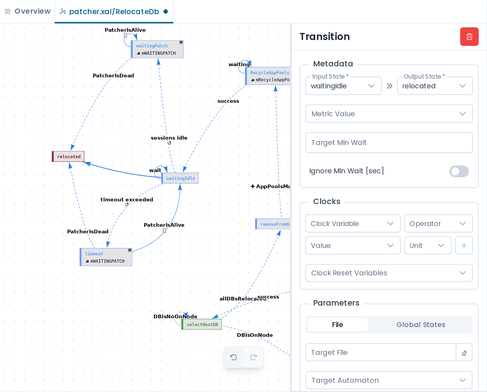

# Creare una Transizione

Le transizioni collegano gli stati e definiscono le condizioni in base alle quali l'automa si sposta da uno stato all'altro.

---

## Aggiungere una transizione

1. Fai clic su **New Transition** nella barra laterale sinistra. Il pannello di configurazione si apre sulla destra, con i campi vuoti.
2. Nella sezione **Metadata**, scegli l'**Input State** (da dove parte la transizione) e l'**Output State** (dove arriva). Le opzioni sono gli stati dell'automa corrente.

La transizione compare nel canvas appena sono impostati entrambi gli stati. Da lì in poi il pannello salva da solo ogni modifica: non c'è un pulsante di salvataggio.

/// caption
Fig.1 - Una nuova transizione da waitingIdle a relocated, con il suo pannello di configurazione
///

Per rinunciare prima che la transizione compaia, fai clic su **×** nell'intestazione del pannello. Non viene aggiunto niente.

!!! note
    Una transizione può avere lo stesso stato sia come input sia come output. Questo crea un **self-loop**, disegnato come un piccolo anello sullo stato: l'automa rimane in quello stato finché non si verifica una condizione diversa.

---

## Configurare la transizione

Il pannello ha tre sezioni:

| Sezione | Contenuto | Vedi |
|---|---|---|
| **Metadata** | Stato di input e di output, **Metric Value**, **Target Min Wait**, **Ignore Min Wait** | [Metric Value e Clock](metric_clocks.md) |
| **Clocks** | Vincoli sui clock e reset dei clock | [Metric Value e Clock](metric_clocks.md) |
| **Parameters** | **Target File**, **Target Automaton** e le variabili passate all'automa figlio | [Istanziare automi figli](transition_new.md) |

Mentre il pannello salva una modifica, in alto a destra nel canvas compare **Applying changes…**. Per annullare una modifica, premi **Ctrl+Z**, anche su una transizione appena creata.

---

## Il tipo di transizione

Il titolo del pannello mostra il tipo della transizione. Su una transizione nuova, il tipo segue i campi che compili:

- **Transition**: il tipo standard.
- **TransitionNew**: hai impostato un **Target File** e un **Target Automaton** nella sezione Parameters.
- **TransitionNewMulti**: hai impostato anche le variabili di loop.

Per una descrizione completa di ogni tipo e di quando usarlo, vedi [Transition Types](types.md).

---

## Le transizioni nel canvas

Ogni transizione è una freccia dallo stato di input allo stato di output:

- l'etichetta mostra il **Metric Value**;
- una transizione che avvia un automa figlio mostra **✚** e il nome dell'automa di destinazione (**✚✚** per una TransitionNewMulti);
- il simbolo dell'orologio segna un vincolo sui clock, **↺** un reset dei clock. Passa il mouse sulla freccia per vederli;
- due transizioni in direzioni opposte tra gli stessi stati sono disegnate come due frecce separate.

---

## Eliminare una transizione

Seleziona una transizione nel canvas facendo clic sul suo arco o sulla sua etichetta, fai clic sull'**icona cestino** nell'angolo in alto a destra del pannello e conferma con **Delete**. Per recuperarla, premi **Ctrl+Z**.
