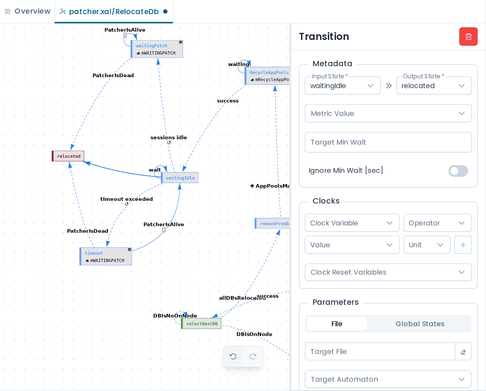

# Creating a Transition

Transitions connect states and define the conditions under which the automaton moves from one state to another.

---

## Adding a transition

1. Click **New Transition** in the left sidebar. The configuration panel opens on the right, with empty fields.
2. In the **Metadata** section, choose the **Input State** (where the transition starts) and the **Output State** (where it arrives). The options are the states of the current automaton.

The transition appears on the canvas as soon as both states are set. From then on the panel saves every change by itself: there is no save button.

/// caption
Fig.1 - A new transition from waitingIdle to relocated, with its configuration panel
///

To give up before the transition appears, click **×** in the panel header. Nothing is added.

!!! note
    A transition can have the same state as both input and output. This creates a **self-loop**, drawn as a small loop on the state: the automaton remains in that state until a different condition is met.

---

## Configuring the transition

The panel has three sections:

| Section | Contents | See |
|---|---|---|
| **Metadata** | Input and output state, **Metric Value**, **Target Min Wait**, **Ignore Min Wait** | [Metric Value and Clocks](metric_clocks.md) |
| **Clocks** | Clock constraints and clock resets | [Metric Value and Clocks](metric_clocks.md) |
| **Parameters** | **Target File**, **Target Automaton** and the variables passed to the child automaton | [Spawning Child Automata](transition_new.md) |

While the panel saves a change, **Applying changes…** appears at the top right of the canvas. To undo a change, press **Ctrl+Z**, also on a transition you have just created.

---

## The transition type

The panel title shows the type of the transition. On a new transition, the type follows the fields you fill in:

- **Transition**: the standard type.
- **TransitionNew**: you set a **Target File** and a **Target Automaton** in the Parameters section.
- **TransitionNewMulti**: you also set the loop variables.

For a full description of each type and when to use it, see [Transition Types](types.md).

---

## Transitions on the canvas

Each transition is an arrow from the input state to the output state:

- the label shows the **Metric Value**;
- a transition that starts a child automaton shows **✚** and the name of the target automaton (**✚✚** for a TransitionNewMulti);
- a clock symbol marks a clock constraint, **↺** a clock reset. Hover the arrow to see them;
- two transitions in opposite directions between the same states are drawn as two separate arrows.

---

## Deleting a transition

Select a transition on the canvas by clicking its edge or label, click the **trash icon** in the top-right corner of the panel and confirm with **Delete**. To get it back, press **Ctrl+Z**.
